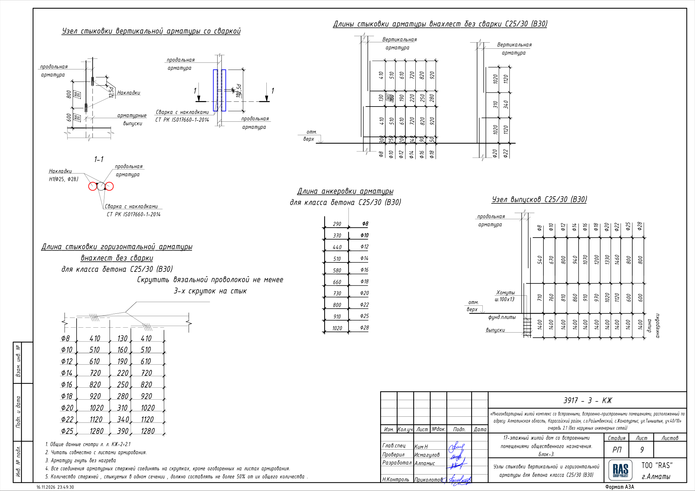
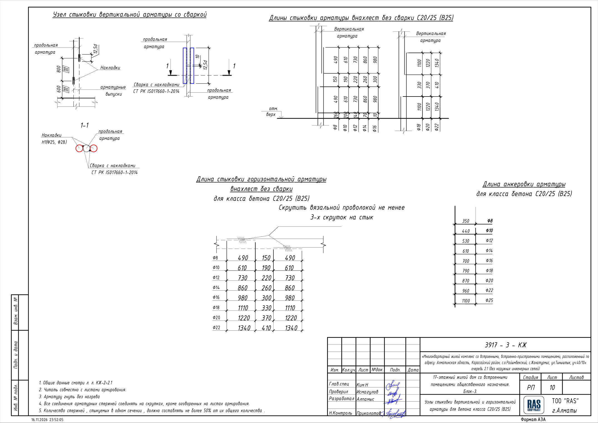
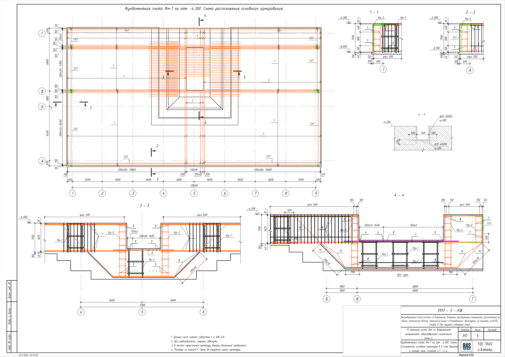
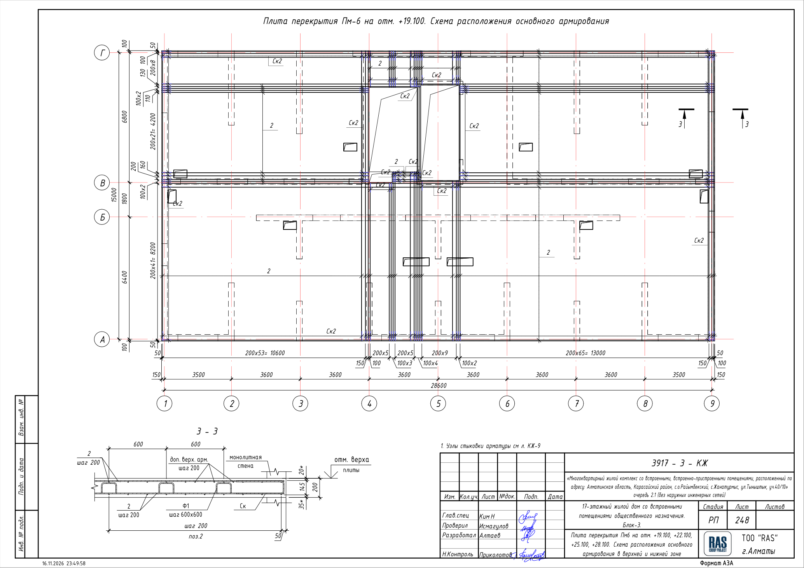
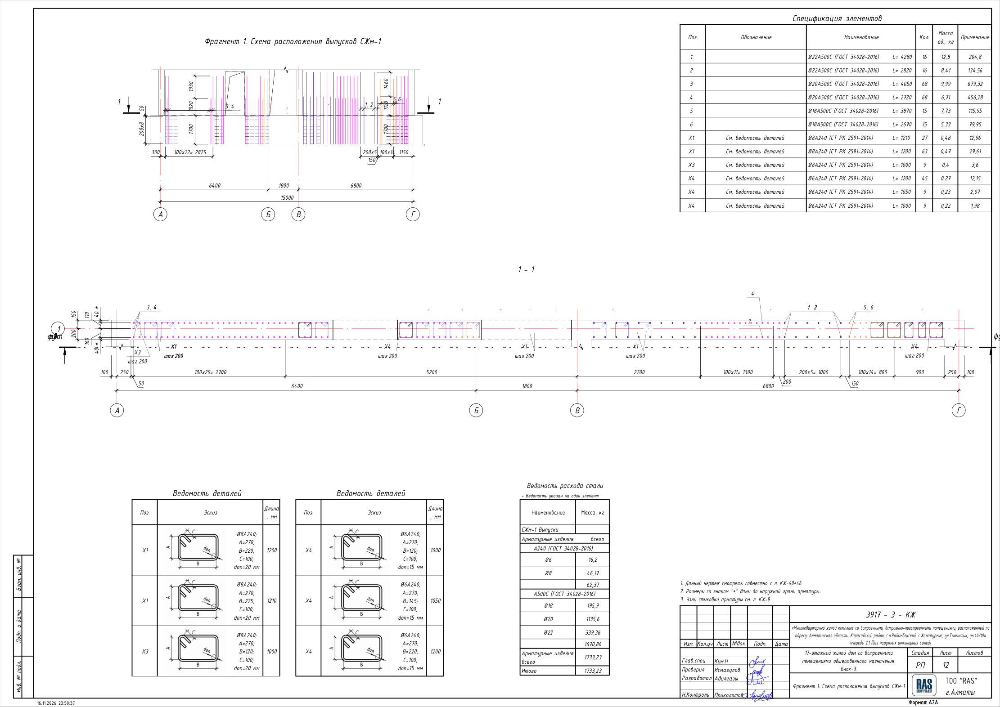

# 02. Основное армирование (BI Group)

Жазылған: 17.11.2026. Дерек: S03 моделі (`out\d04b_rebar.tsv`, `a02_wall…`, `a03_slab`), парақтар КЖ-5, 9, 10, 12, 53, 55, 248. Аясы: тек BI жобалары.
Сандар (Ø, шаг) — осы объектінің есебінен; ереже — тәсіл.

## 1. Жалпы принцип

1. Негізгі арматура — **жеке `Rebar` жиындары** («Число с интервалом»: саны + шаг). «Армирование по площади» қолданылмайды.
2. **Тұтас стержень.** Плита мен фундаментте стержень конструкцияның шетінен шетіне дейін бір дана болып модельденеді (S03: 28 860 және 15 160 мм). Стыктар модельде көрсетілмейді.
3. Мұндай стержень типі — **`… пм`** (`BI_в_погонных_метрах = Да`). Кестеде ол «п.м.» жолымен шығады, ал нахлёст өзі қосылады: стык саны (поставочная ұзындық ≈ 11,7 м бойынша) × `k·d` (тип параметрі `BI_длина_нахлеста_множитель`, 10 мм-ге дөңгелектеу).
   Тексерілді (Пм-6): Ø10 — модельде 8 699,4 м, кестеде 9 024,6 м; Ø8 (3 стержень × 11,8 м) — 35,4 → 36,9 м (3 стык × 0,5 м).
4. Қысқа, кесілген стержень (доп., проём маңы, стена тігі) — кәдімгі тип (`пм`-сіз), кестеде `L = … / дана`.
5. Барлық негізгі стерженьге `BI_фильтр` қойылады (плита: `Гор` / `Верт`; фундамент: `Низ_X` …; стена: `Верт` / `Гор`) — парақтағы көріну осыған байланысты.
6. Стыктардың орны мен ұзындығы примечание мен «Узлы стыковки» парағында беріледі (3-бөлім), сызбада әр стык сызылмайды.

## 2. Қорғаныс қабаты (үлгіде)

| Конструкция | Мән | Қайдан |
|---|---|---|
| Стена | **40 мм — тік арматураның сыртқы қырына дейін** (размерде `40 *`); көлденең арматура тіктің сыртында жатады | КЖ-55 қималары; модель: t = 300 стенада тік Ø18 сырты осьтен 110, көлденең Ø14 — 110…124 |
| Плита t = 200 | қимада: үсті `20*`, асты `35*`, арасы 145 | КЖ-248 (3-3 легенда). Модельде: негізгі үстіңгі стержень үсті плита бетінен 40, астыңғы стержень асты 30 |
| Фундамент t = 1700 | үсті `35 *`, асты 40 (+ подготовка 100) | КЖ-5, қима 1-1 |
| Плита/фундамент шеті | стержень ұшы қырдан 50 | шаг тізбегінің басы «50» |

`*` белгісі: «Размеры со знаком * даны до наружной грани арматуры» — примечаниеге міндетті жазылады.

## 3. Нахлёст, анкеровка, разбежка — «Узлы стыковки» парағы

Альбомда **екі парақ** (А3): «Узлы стыковки вертикальной и горизонтальной арматуры для бетона класса C25/30 (B30)» және «… C20/25 (B25)». Барлық армирование парағы соған сілтейді («Узлы стыковки арматуры см. л. КЖ-9»). Қай кесте — конструкцияның бетон класына қарай (стена типінің атында `B30` бар-жоғы).

### 3.1 Нахлёст ұзындығы (сваркасыз), мм

| Ø | 8 | 10 | 12 | 14 | 16 | 18 | 20 | 22 | 25 |
|---|---|---|---|---|---|---|---|---|---|
| **B25** нахлёст | 490 | 610 | 730 | 860 | 980 | 1100 | 1220 | 1340 | — |
| B25 стыктар арасы | 150 | 190 | 220 | 260 | 300 | 330 | 370 | 410 | — |
| **B30** нахлёст | 410 | 510 | 610 | 720 | 820 | 920 | 1020 | 1120 | 1280 |
| B30 стыктар арасы | 130 | 160 | 190 | 220 | 250 | 280 | 310 | 340 | 390 |

B25 ≈ 61d, B30 ≈ 51d; стыктар арасы ≈ 0,3 × нахлёст. (Үлгіде B25 Ø18: тік кестеде 1100, көлденең кестеде 1110 — қайшылық, `07`-файл.)

### 3.2 Тік арматура: бірінші стыктың плита үстінен биіктігі, мм

| Ø | 8 | 10 | 12 | 14 | 16 | 18 | 20 | 22 |
|---|---|---|---|---|---|---|---|---|
| B25 | 260 | 200 | 140 | 70 | 10 | 0 | 0 | 0 |
| B30 | 300 | 250 | 200 | 140 | 90 | 50 | 0 | 0 |

Стыктар **екі деңгейде, 50 % вразбежку**: жартысы — плита үстінен (жоғарыдағы биіктіктен), екінші жартысы — нахлёст + аралық қашықтықтан кейін.

### 3.3 Анкеровка ұзындығы, мм

| Ø | 8 | 10 | 12 | 14 | 16 | 18 | 20 | 22 | 25 | 28 |
|---|---|---|---|---|---|---|---|---|---|---|
| B25 | 350 | 440 | 530 | 610 | 700 | 790 | 870 | 960 | 1100 | — |
| B30 | 290 | 370 | 440 | 510 | 580 | 660 | 730 | 800 | 910 | 1020 |

### 3.4 Сваркамен стык (Ø25, Ø28)

«Узел стыковки вертикальной арматуры со сваркой»: накладка Н1 (Ø25, Ø28), шов ұзындығы 12,5d, выпуск 600 және 800 (вразбежку), «Сварка с накладками СТ РК ISO 17660-1-2014». Стена парағында қажет жерде «Узел А» легендасы: «Сварка ГОСТ 14098-2014, тип С23-Рэ», 12,5d.

### 3.5 Көлденең арматура стыгы

«Скрутить вязальной проволокой не менее 3-х скруток на стык»; ұзындық пен аралық — 3.1-кестедегідей.

### 3.6 Парақ примечаниесі (сөзбе-сөз)

1. Общие данные смотри л. КЖ-2÷2.1. 2. Читать совместно с листами армирования. 3. Арматуру гнуть без нагрева. 4. Все соединения арматурных стержней соединять на скрутках, кроме оговоренных на листах армирования. 5. Количество стержней, стыкуемых в одном сечении, должно составлять не более 50% от их общего количества.

## 4. Плита перекрытия (үлгі: Пм-6, t = 200)

| | |
|---|---|
| Тор | Ø10 А500С, шаг 200, екі бағыт, астыңғы және үстіңгі зона — барлығы **бір позиция** (поз. 2), типі `(арматура)d=10_А500 пм` |
| `BI_фильтр` | `Гор` — X бойымен (буквенные осьтерге параллель, L = 28 860), `Верт` — Y бойымен (L = 15 160) |
| Қабаттар реті (модель) | асты: Y-стержень ең астында (осі 35), үстінде X (осі 45); үсті: Y (осі плита үстінен 55), ең үстінде X (осі 45) |
| Шеттер | стержень плита қырынан 50; әр негізгі жиынға сәйкес **П-шка `Ск2`** (Ø8 А500С, `(форма)21`, A = C = 490, B = 140, L = 1080), шагы негізгідей, `BI_фильтр` да сондай |
| Жиілету | стена/проём маңында сол позициямен шаг 100 (тізбекте `100х3`, `100х4`) |
| Проём | жиын проёмда үзіледі: бір тұтас жиын емес, проёмның екі жағында бөлек жиындар (Пм-6-да негізгі тор 68 жиын: `Верт` 36, `Гор` 32) |
| Ойықта | «Основная арматура … в местах отверстий обрезается по месту и отгибается в тело плиты или анкеруется П-образной арматурой» |

Стык ережесі (плита парағының примечаниесі): «Стыки арматуры плиты перекрытия выполнять на скрутках из вязальной проволоки не менее 3 шт на стык. Стыки стержней выполнять на расстоянии 1/3–1/4 пролета от опоры, при этом в одном сечении стыковать не более 50% арматуры. Стыки верхней арматуры — не менее 1/3 пролета плиты. Стыки нижней арматуры — не более 1/4 пролета плиты».

Парақта қалай көрінеді — `05`-файл: әр жиыннан бір өкіл стержень + полкада `2` + шеттегі тізбек `200х53=10600`.

## 5. Фундаментная плита (үлгі: Фм-1, t = 1700, B25)

| | |
|---|---|
| Тор | Ø18 А500С шаг 200, **әр зонада 2 қабат** («основная арматура в 2 слоя верхней и нижней зоне»), типі `(арматура)d=18_А500 пм`, поз. 1 |
| `BI_фильтр` | `Низ_X`, `Низ_Y`, `Верх_X`, `Верх_Y` (әрқайсысында екі қабаттың жиындары) |
| Қабаттар (модель, ось деңгейі) | асты (плита табанынан): X 44–47 → Y 62 → X 80 → Y 97; үсті (плита бетінен): Y 44 → X 62 → Y 80 → X 97 |
| Шеті | П-шка `Ск1` (Ø14 А500С, `(форма)21`, шаг 200, L = 3270), `BI_фильтр = осн` |
| Үстіңгі торды ұстау | поддерживающие каркасы `Кр-1` (уголок 50×6: 3 тірек 1665 + 6 көлденең 950, группа «Каркас Кр-1»), `Кр-2`, `Кр-3` (Ø18, тип `… каркас`) — бөлек парақ «Схема расположения поддерживающих каркасов» |
| Поперечная | сварной каркас `Ф1` (Ø10 А500С: тік 1685 шаг 200 + бойлық 1000), тип `… каркас` / `… каркас пм` — бөлек парақ «Схема расположения поперечной арматуры сварными каркасами Ф1, Ф2» |
| Приямок | жеке стерженьдер (`(форма)15`, `24`, `26`), қималар 3-3, 4-4 |
| Примечание | «Длина нахлеста для арматуры ∅16А500С Lнахл = 990 мм. Стыки … вразбежку, чтобы площадь рабочей арматуры, стыкуемой в одном сечении, не превышала 50%»; «Защитный слой основной арматуры см. в сечениях» |

## 6. Стена (үлгі: СЖм-1, t = 350 → 200 биіктікпен, 17 қабат)

### 6.1 Тік арматура (`BI_фильтр = Верт`)

- Әр қабатқа **бөлек жиын**, екі бетте: ұзындық = **қабат биіктігі + нахлёст** (модельден, ең көп кездесетін ұзындықтар):
  - типтік қабат 3000, B25: Ø10 — 3610, Ø12 — 3730, Ø14 — 3860, Ø16 — 3980, Ø18 — 4100;
  - подвал / 1-қабат 4200, B30: Ø12 — 4810, Ø16 — 5020, Ø18 — 5120, Ø20 — 5220, Ø22 — 5320.
- Орны: 50 % стержень плита үстінен басталады (3.2-кестедегі биіктіктен), 50 % — «нахлёст + аралық»-қа жоғары (Ø18 B25: +1430 = 1100 + 330). Екі топ шахмат ретімен, әрқайсысы өз жиыны: жиын шагы екі еселенген, екіншісі бір шагқа ығысқан (400 + 400 → нәтижесінде 200; 200 + 200 → 100).
- Қалыңдық бойынша орны: сыртқы қыры стена бетінен 40 мм.
- Диаметр биіктік бойынша азаяды (СЖм-1: төменде Ø22/Ø20, жоғарыда Ø12/Ø10) — түсі өзгергені схемадан бірден көрінеді.
- Шеткі (торцевой) аймақта шаг 100, өрісте 200 / 400.
- Проём үстінде/астында тік П-шкалар (`Ск`, `(форма)21`, шаг 100, B = t − 80) — `BI_фильтр = Верт`.

### 6.2 Көлденең арматура (`BI_фильтр = Гор`)

- Тіктің **сыртында** жатады.
- Қабат ішіндегі раскладка (3000 = 2800 стена + 200 плита), плита үстінен: **50 → 200×12 = 2400 → 200 → 100×3 → 50**. Яғни өрісте шаг 200 (13 стержень), плита деңгейінде — 4 стержень шаг 100 (обвязка).
- Обвязканың 4 стержені стенаның бүкіл ұзындығына тұтас: тип `… пм` (S03: Ø20, L = 15 160). Өрістегі стержень проёмнан проёмға дейін — кәдімгі тип (L = 3910, 6810).
- Стена шетінде, проём жиегінде, қиылыста — **көлденең П-шка `Ск`** (`(форма)21`): шагы көлденең арматурадай (200), **аяғы = нахлёст ұзындығы** (Ø10 B25: A = C = 610), **B = t − 50**.
- Шаг парақта оң жақтағы размер тізбегімен беріледі (`04`-файл).

### 6.3 Поперечная арматура (`BI_фильтр = Попереч`)

- Шеткі аймақтарда тұйық **хомут `Х`** (Ø6 / Ø8 А240, `(форма)хомут`): қабат басы мен соңында шаг 100 (≈ 600 мм аймақ), ортада шаг 150.
- Өрісте **шпилька `Ш`** (Ø6 / Ø8 А240, `(форма)шпилька S`): шаг 400, шахмат ретімен (маркада «шах. п400»); кей аймақта шаг 200.

### 6.4 Примечание (стена армирование парағы, сөзбе-сөз)

3. Размеры со знаком * даны до наружной грани вертикальной арматуры. 4. Стержни рабочей арматуры Ø10 -:- Ø22 в полевой зоне соединять в нахлест. 5. Стыки вертикальной арматуры выполнять в разбежку. 6. Количество стержней, стыкуемых в одном сечении, должно составлять не более 50% от их общего количества. 7. При выполнении гнутых стержней КАТЕГОРИЧЕСКИ запрещается применять нагрев стержней. 8. Размеры всех деталей уточнять по месту. 9. Арматуру во всех пересечениях вязать вязальной проволокой. 10. Участки вертикального сопряжения стен в плане должны выполняться при одновременном бетонировании продольных и поперечных стен. 11. Ск-элементы стыковать внахлест на скрутках из вязальной проволоки. 12. Узлы стыковки арматуры см. л. КЖ-9.

## 7. Выпуски из фундамента

- Әр стенаға (және колоннаға) **бөлек «Фрагмент N. Схема расположения выпусков СЖм-N»** парағы + жалпы «Схема расположения фрагментов выпусков».
- Выпуск стержені: `BI_марка_конструкции = Выпуски`, «Марка» және «Комментарии» = `СЖм-1 Выпуски`, `BI_фильтр = Верт`, хост — фундамент плитасы.
- Ұзындық «Узел выпусков» бойынша (B30), фундамент үстінен шығуы, мм:

| Ø | 8 | 10 | 12 | 14 | 16 | 18 | 20 | 22 | 25 | 28 |
|---|---|---|---|---|---|---|---|---|---|---|
| қысқа выпуск | 710 | 760 | 810 | 860 | 910 | 970 | 1020 | 1120 | 600 | 600 |
| ұзыны: + | 540 | 670 | 800 | 940 | 1070 | 1200 | 1330 | 1460 | 800 | 800 |

  Фундамент ішіне анкеровка — 1400 (t = 1700 плитада, астыңғы торға дейін). Ø25, Ø28 — сваркаға (600 / 800).
- Фундамент қалыңдығында выпуск айналасына хомуттар: «Хомуты ш. 100×13» (узелде), парақта `Х1 шаг 200`.
- Парақта: развертка фрагменті (1:100), қима 1-1 (1:25), өз спецификациясы, ведомость деталей, ведомость расхода стали («Ведомость указан на один элемент»). Сурет: `_суреттер\S03_л12_выпуски_СЖм-1.png`.

## 8. Суреттер

