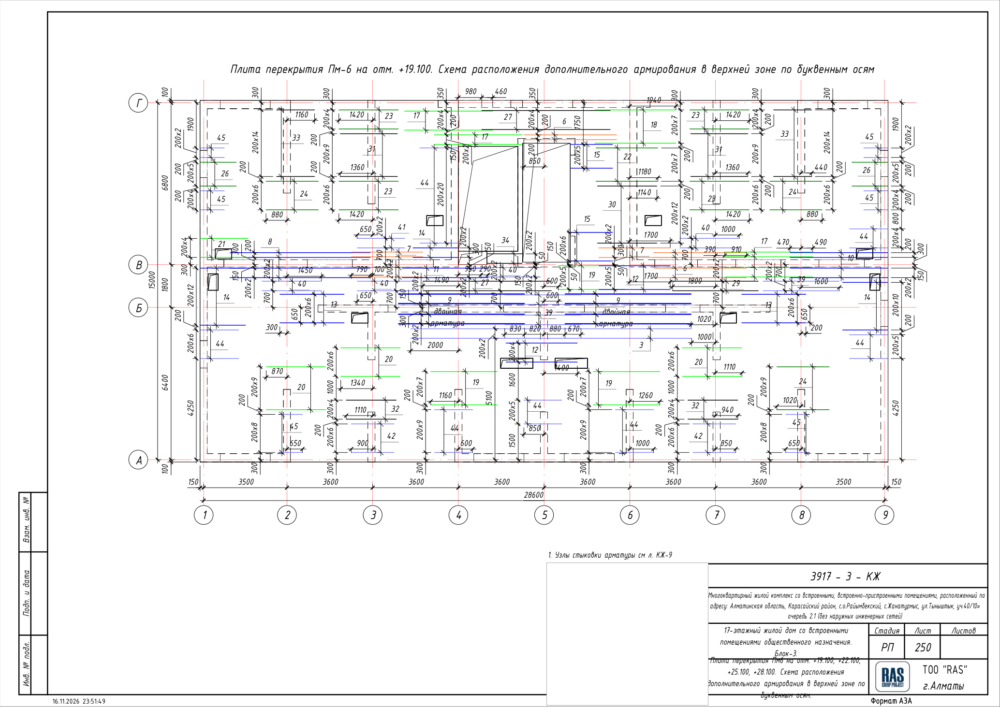
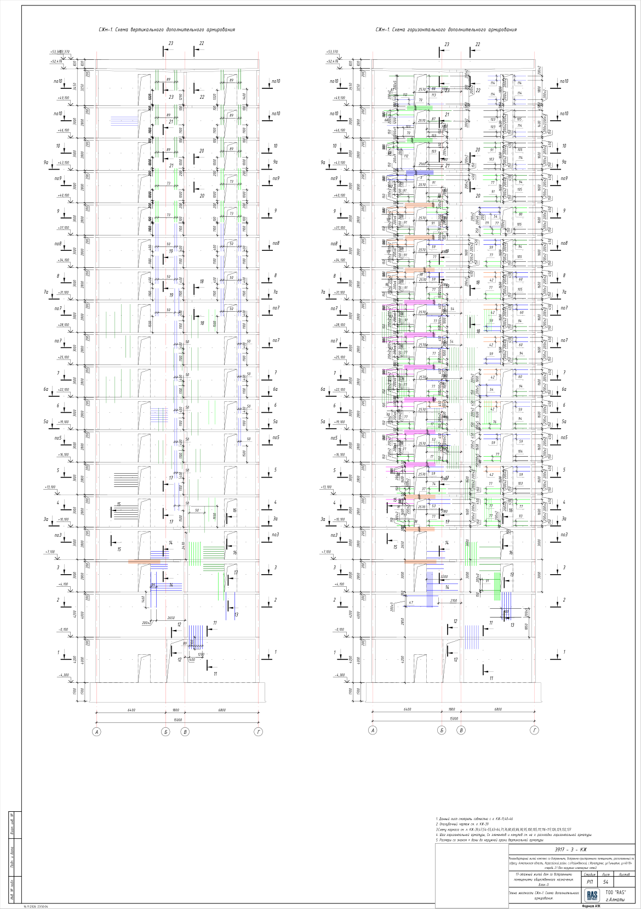

# 03. Дополнительное армирование (BI Group)

Жазылған: 17.11.2026. Дерек: S03 моделі (`a01_summary.txt`, `a03_slab`, `d06_sheet_54 / 250 / 253 / 247 / 6`), парақтар КЖ-6, 54, 196, 200–204, 247–253, 293. Аясы: тек BI жобалары.

## 1. Жалпы принцип

1. Доп. арматура — **бөлек `Rebar` жиындары**, негізгі тордан тәуелсіз: кәдімгі тип (`пм`-сіз), `(форма)1`, «Число с интервалом», шаг көбіне 200 (негізгі тордың шагындай).
2. Негізгіден `BI_фильтр` мәнімен ажыратылады; сол арқылы **бөлек парақта** көрсетіледі.
3. Әр ұзындық пен диаметр — жеке позиция; нөмірлеу спецификация ретімен: алдымен `п.м.` жолдары, содан дана стерженьдер **Ø кемуімен, ұзындық кемуімен** (Пм-6: поз. 4 — Ø20 L = 4200 … поз. 45 — Ø8 L = 1000).
4. Примечание (плита доп. парақтары, сөзбе-сөз): «Стержни дополнительного армирования устанавливать в промежутках между рабочей арматурой. В случае совмещения дополнительного стержня с рабочей арматурой, дополнительный стержень сдвинуть». Фундаментте: «При необходимости стержни сдвинуть».

## 2. Плита перекрытия

### 2.1 Төрт топ — төрт парақ

| `BI_фильтр` | Парақ атауы | Не көрінеді |
|---|---|---|
| `ДопНиз_X` | «…Схема расположения дополнительного армирования в нижней зоне **по буквенным осям**» | астыңғы зона, X бойымен жатқан стерженьдер |
| `ДопВерх_X` | «…в верхней зоне **по буквенным осям**» | үстіңгі зона, X бойымен |
| `ДопНиз_Y` | «…в нижней зоне **по цифровым осям**» | астыңғы зона, Y бойымен |
| `ДопВерх_Y` | «…в верхней зоне **по цифровым осям**» | үстіңгі зона, Y бойымен |

Парақ реті альбомда: низ буквенные → верх буквенные → низ цифровые → верх цифровые (Пм-3, Пм-5-те: низ букв. → низ цифр. → верх букв. → верх цифр. — екі рет те кездеседі).

### 2.2 Модельдеу (Пм-6)

- Диаметрлер Ø8…Ø20 А500С, шаг 200, ұзындық 1000…5900 (Ø8 — 8100-ге дейін). Ұзындық 100 мм-ге дөңгелек (1600, 2000, 2500, 2800, 3600, 4200).
- Әр аймақ — жеке жиын (Пм-6: `ДопВерх_X` 85 жиын, `ДопВерх_Y` 46, `ДопНиз_X` 65, `ДопНиз_Y` 43).
- Бір жерде екі қатар қойылса, парақта мәтін «двойная арматура».
- Деңгей (модельде, ось): `ДопНиз_X` пен `ДопНиз_Y` — плита табанынан 35; `ДопВерх_X` — плита бетінен 55; `ДопВерх_Y` — плита бетінен 35 (негізгі тордың үстінде). Деңгейлер шартты (кей бағытта негізгі тордың көлденең қабатымен бір деңгейде тұр) — **СҰРАҚ** (`07`).

### 2.3 Парақта

Вид — плита планы 1:100 (`#03_Армирование плиты`, тип `*06_Плиты`). Тек бір топ көрінеді, қалған фильтрлер жасырын. Әр жиыннан **бірінші және соңғы стержень** («Показать первый и последний»), арасында MRA `поз.`: шаг тізбегі `200х8=1600` + полкада позиция нөмірі. Жиынды осьтерге/стенаға байлайтын размер (`BI_курсив_2.5 мм`): стержень ұзындығы және жақын осьтен қашықтық. Түс — диаметр бойынша. Толығы `05`-файлда.

## 3. Фундаментная плита

- Топтар сол: `ДопНиз_X`, `ДопНиз_Y`, `ДопВерх_X`, `ДопВерх_Y` (Фм-1: Ø12 А500С шаг 200 / 400, L = 1080…4110).
- Парақ: «Схема расположения дополнительной арматуры вдоль цифровых осей» — бір А1 парақта бірнеше план (нижняя по цифровым, верхняя по цифровым, верхняя по буквенным), әрқайсысы өз фильтрімен.
- Приямок жиегіндегі қосымша стерженьдер негізгі армирование парағындағы қималарда «доп. арм.» деп көрсетіледі.

## 4. Стена

- Барлық қосымша стержень — `BI_фильтр = Доп` (тік те, көлденең де бір мән). СЖм-1-де 390 жиын: Ø8…Ø20 А500С, `(форма)1`, шаг 200 (кей жерде 100), L = 1200…3300.
- Не жатады (модель, СЖм-1, 5-қабат):
  - проём үстіндегі және астындағы көлденең стерженьдер — 3 дана шаг 200, ұзындығы проёмнан екі жаққа шығып тұрады (L = 1600…2600), екі бетте;
  - қабат түбіндегі (плита үстінен 150…550) көлденең стерженьдер шеткі аймақтарда — 3 дана шаг 200;
  - проём жиегіндегі тік қосымша стерженьдер (Ø12, Ø16, L = 1960…2600), тік тор жазықтығында;
  - плита деңгейіндегі обвязкаға қосымша (Ø20, 4 дана шаг 100, L = 2890).
- Парақ: «Стена жесткости СЖм-N. Схема дополнительного армирования» — екі развертка қатар: «Схема **вертикального** дополнительного армирования» және «Схема **горизонтального** дополнительного армирования» (1:100, А1 книжный). Екеуінде де `Арм_Верт`, `Арм_Гор`, `Арм_Хомуты и шпилька` жасырын, `Арм_Доп` көрінеді; тік пен көлденеңді бөлу — видте элементтерді жасыру арқылы (фильтр бір).
- Аннотация: MRA `поз.` (`200х4=800`), стерженьді байлайтын размерлер, оң жақта шаг тізбегі (`{200х2}`, `1600`, `150`, `50`, `300`, `100` …), отметкалар.
- Шағын стенада доп. жеке параққа шығарылмайды: «Схема вертикального, горизонтального и дополнительного армирования» бір парақта (СЖм-13).

## 5. Поперечное армирование плиты (шпилькалар)

- Стена үстіндегі / шеттегі аймақтарда тік шпилькалар: Ø6 және Ø8 А240, `(форма)шпилька`, шаг 100, L ≈ 350 (Пм-6: 453 жиын, 5 250 дана). `BI_фильтр` — S05-те `Попереч`, S03-те бос (екі жағдайда да `Арм_Хомуты и шпилька` фильтрімен ұсталады). Дұрысы — **`Попереч` қою**.
- Парақ: «…Схема расположения поперечного армирования» (А2): планда тек шпилькалар, маркасы `Позиция/Шаг_12` типімен — `Ш1 шаг 100`, `Ш2 шаг 100`; аймақты осьтерге байлайтын размерлер.
- Жанында легендалар: «(Плита)Плиты … сечение поперечной арматуры» (1:20 шартты қима: «Основная арматура шаг 200», «поз. Ш-1,2* шаг 100», `100хn`, `50`, «диафрагма»), «(Плита)Плиты Фиксатор», «узел раскладка фиксатора».

## 6. Пространственные каркасы плиты

- Стена үстіндегі жолақтарда (скрытая балка): бойлық Ø14 А500С `пм` (2 дана шаг 200, асты мен үсті), хомут `Х1`, `Х2` Ø6 А240 шаг 200, шетінде П-шка Ø10. Барлығына `BI_фильтр = Каркас`.
- Парақ: «…Схема расположения пространственных каркасов» (А3): тек `Каркас` көрінеді; MRA `поз.` + марка `Х1 шаг 200`; шартты қималар 1-1…4-4 — легенда «(Плита)_Сечение 1-1» («Пространственный каркас», «Основная арматура шаг 200», «поз. Х-1;2* шаг 200»).
- Спецификацияда бойлық стерженьдер поз. 1 (`п.м.`).

## 7. Фиксаторлар

- Плита: **Ф1** — «лягушка» Ø10 А240 (`(форма)98_лягушка`, L = 1140), шаг 600×600 шахмат ретімен; `BI_фильтр = Доп`. Легендадағы жазу: «Ф1, ш. 600х600 в шахм. пор. — деталь для фиксации арм-ры верхней зоны плиты перекрытия».
- Фундамент: поддерживающие каркасы Кр-1…Кр-3 (`02`-файл, 5-бөлім).

## 8. Отверстие обрамлениесі

### 8.1 Стенада — парақ «Узлы усиления отверстий в стенах» (А2, типтік)

| Ойық өлшемі | Усиление |
|---|---|
| 300…500 | төрт жағынан поз. 1 (Ø20 А500С, `L = п.м.`), ойық жиегінен 50, екі ұшы Lанк-қа шығады; жиектерде П-шкалар Ск1, Ск2, Ск3 (тік жақтар) және Ск4, Ск5, Ск6 (көлденең жақтар) — Ø16 А500С, аяғы 1000 |
| 500…1500 | соған қоса хомуттар Х1, Х2, Х3 және Х4, Х5, Х6 (Ø8 А240, шаг 200) |

- Ск / Х нөмірі стена қалыңдығына қарай үшеу (t = 300 / 250 / 200): Ск1–Ск3 ені 255 / 205 / 155 (L = 2255 / 2205 / 2155), Ск4–Ск6 ені 220 / 170 / 120 (L = 2220 / 2170 / 2120); қимада екі жақтан `40*`.
- Ведомость деталей сол парақта: Ск — «по н.г.» (сыртқы қыр бойынша), Х — «по в.г.» (ішкі қыр бойынша); «R = 2,5Ø (< Ø20), R = 4Ø (≥ Ø20)».
- Негіздеме (примечаниеде): «Обрамление отверстий разработано согласно п. 3.14.1 „Руководство по конструированию б. и ж.б. конструкций из тяжелого бетона (без предварительного напряжения)“».
- Опалубка парағының примечаниесі: «Отверстия размерами больше 300 мм обрамить по узлу обрамления отверстия см. л. КЖ-…».

### 8.2 Плитада — парақ «Узлы усиления отверстий в плитах» (А3, типтік)

| Ойық өлшемі | Усиление |
|---|---|
| 350…600 | поз. 2 (Ø14 А500С, `п.м.`) әр жағынан + жиекті жабатын П-шка поз. 3 (Ø10 А500С, 140×550, L = 1240), жиектен 30 |
| 600…1000 | поз. 2 (Ø14) + хомут Х1 (Ø8 А240, L = 780) + поз. 3 |
| > 1000 | поз. 1 (Ø16 А500С, `п.м.`) + Х1 + поз. 3 |

- Примечание: «Основная арматура плиты … в местах отверстий обрезается по месту и отгибается в тело плиты или анкеруется П-образной арматурой. Отверстия размерами больше 300 мм обрамить по узлу. Отверстия, расположенные рядом, обрамить как одно общее»; «Расход арматуры на усиление отверстий смотреть на опалубочных чертежах».

### 8.3 Модельде қалай есептеледі

- Обрамление арматурасы 3D-де **сызылмайды**. Оның орнына геометриясыз семействолар қойылады: `(арматура)стержень_пустой`, `(арматура)форма_21_равносторонний_пустой`, `(арматура)хомут_форма_51_пустой` — `BI_фильтр_арматуры = обрамление`, `BI_марка_конструкции` = сол стена/плита.
- Олар бөлек кестеге жиналады: `(Стены)_<Марка>_2СА обрамление` — опалубка парағындағы «Спецификация на усиление отверстий». Негізгі спецификацияда сүзгі `BI_фильтр_арматуры ≠ обрамление` тұр (екі рет саналмауы үшін).
- Ойықтың өзі: `RAS_проема_перекрытие : (отверстие)` (обобщенная модель), планда `(Элемент_узлов)Обозначение_проема_прямоугольный` (бір диагональ).

## 9. Суреттер

