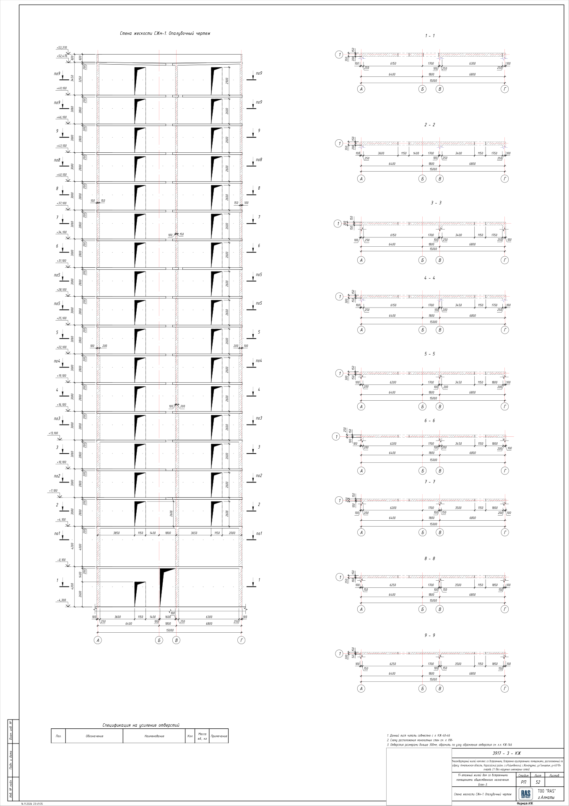
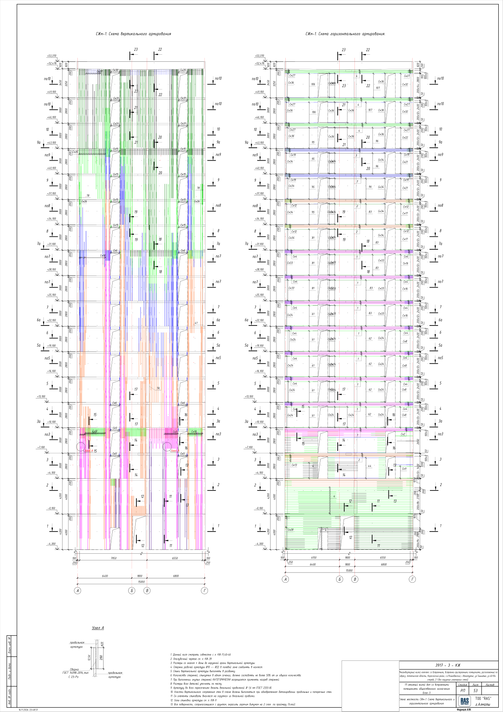
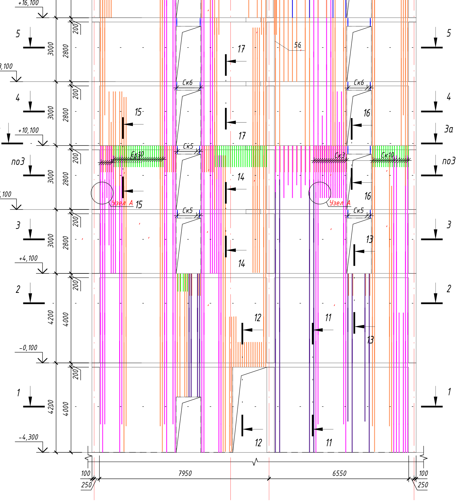
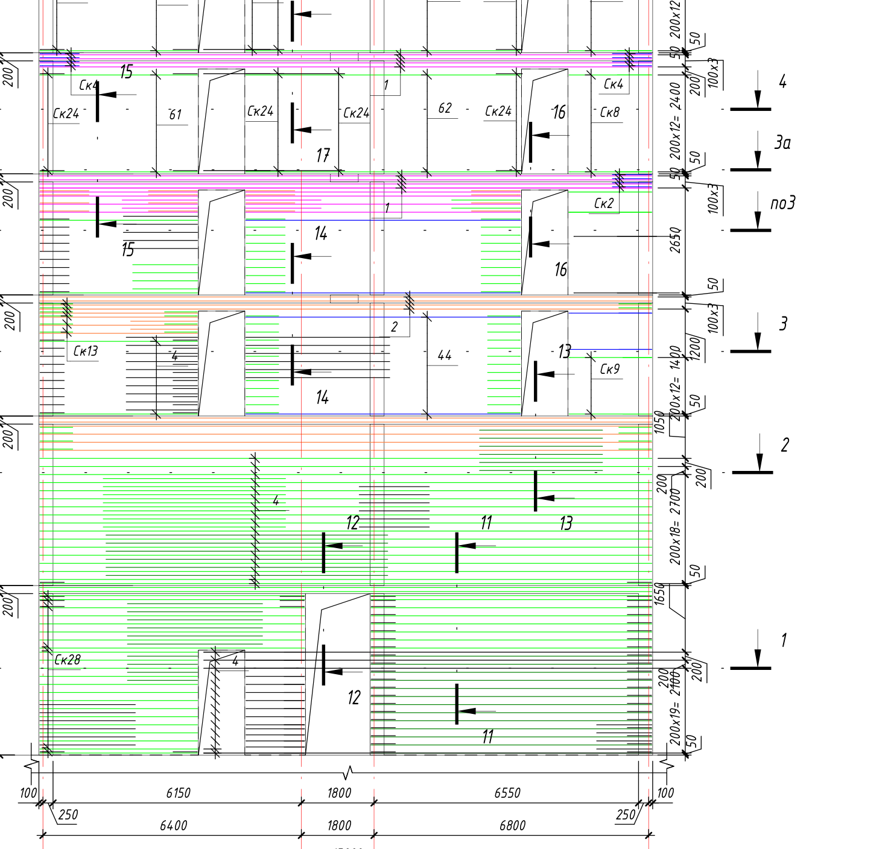
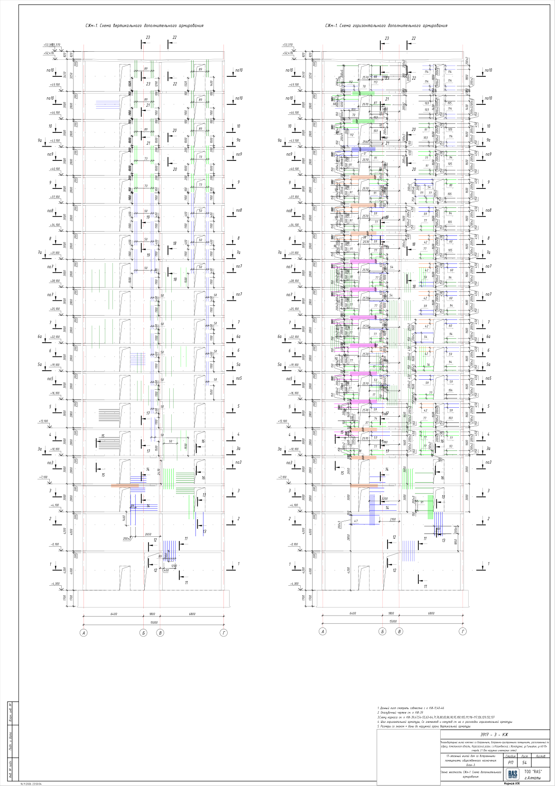
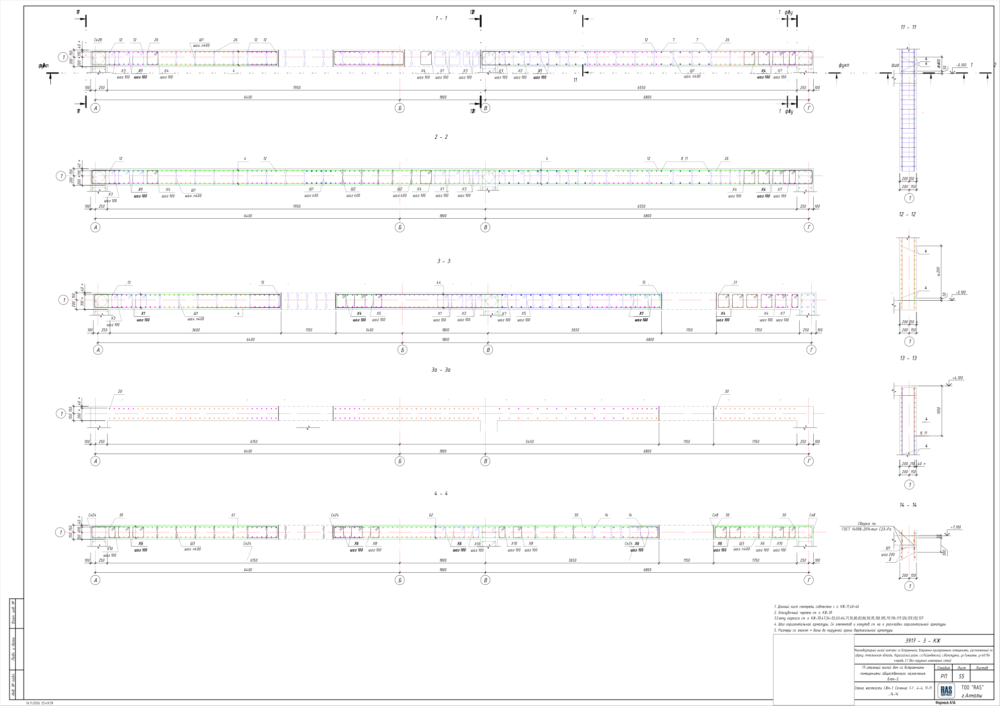
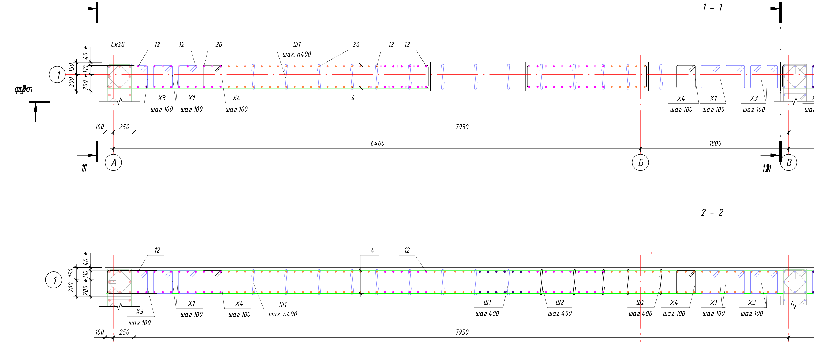
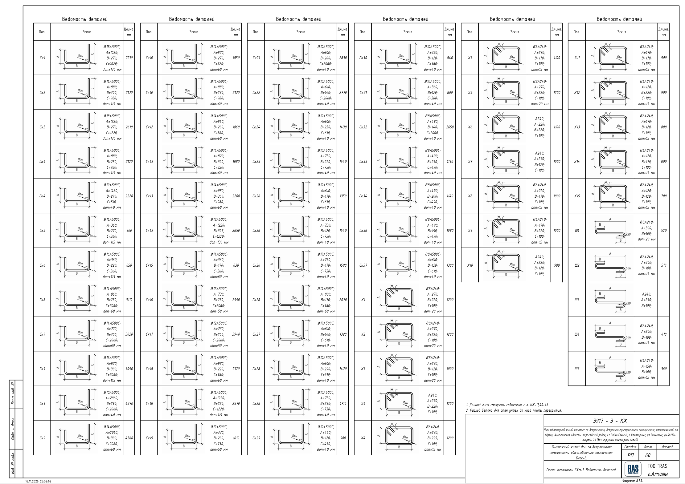
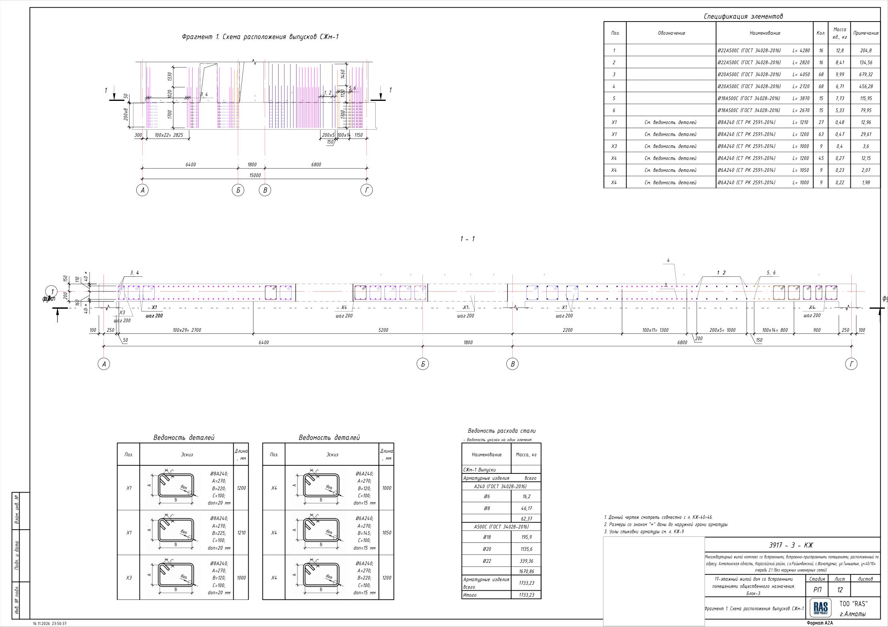

# 04. Стена — парақтар және оформление (BI Group)

Жазылған: 17.11.2026. Дерек: S03, СЖм-1 (КЖ-52…60), СЖм-2 (КЖ-61…65), выпуски (КЖ-12); дамп `out\d06_sheet_52…55.txt`, PDF `pdf\S03_052…060.pdf`. S05-те парақ жиыны бірдей. Аясы: тек BI жобалары.
Суреттер: `_суреттер\S03_л52…`, `л53…`, `л54…`, `л55…`, `л60…`, `л12…`.

## 1. Бір стенаның парақ жиыны

Парақ атауы: «Стена жесткости СЖм-N. <мазмұны>» (шахта: «Стена шахты СШм-N. …»).

| № | Парақ | Формат | Не тұрады |
|---|---|---|---|
| 1 | Опалубочный чертеж | А1 книжный (кіші стена — А2 книжный) | бүкіл биіктіктегі развертка 1:100 + көлденең қималар 1-1…9-9 (1:100) + «Спецификация на усиление отверстий» + гильза кестесі |
| 2 | Схема вертикального и горизонтального армирования | А1 книжный | екі развертка қатар, 1:100: сол жақта тік, оң жақта көлденең арматура; қажет болса «Узел А» легендасы |
| 3 | Схема дополнительного армирования | А1 книжный | екі развертка: тік доп. және көлденең доп. |
| 4…6 | Сечение 1-1…4-4, 11-11…14-14 (және жалғасы) | А1 альбом | көлденең қималар 1:25 (параққа 4–5 дана, бірінің астына бірі) + оң жақта тік қималар 1:25 |
| 7…8 | Спецификация (начало) / (продолжение). Ведомость расхода стали | А1 книжный не А2 | поэтажная спецификация бағандарға бөлінген + ведомость материалов + ВРС |
| 9 | Ведомость деталей | А2 (кішісіне А3) | 4ВД кестесі 6 бағанға бөлінген |

- Үлкен стенада тік пен көлденең екі бөлек параққа шығады («Схема вертикального армирования», «Схема горизонтального армирования» — СЖм-3, 6, 14). Кіші стенада бәрі біріктіріледі: «Схема вертикального и горизонтального армирования. Сечение 1-1…12-12» (СЖм-2), «Схема армирование. Сечения 1-1…3-3» (СШм-2), ведомость деталей мен ВРС спецификация парағына қосылады.
- S03-те 17 СЖм + 5 СШм стенасы КЖ-52…195 парақтарын алады (144 парақ, оның екеуі — Бм-1, Бм-2 балкалары), яғни альбомның жартысына жуық.
- Алдында жалпы парақтар: «Схема расположение элементов каркаса на отм. …» (әр деңгейге, А2 — планда сборка маркалары `(марка)сборка`), «Разрез 1-1», «Разрез 2-2» (А1 книжный).

## 2. Қима белгілерінің жүйесі

- **Көлденең қималар** (стенаны планда кесу) — әр қабатта бір белгі, нөмірі `1`, `2`, `3`, `3а`, `4` … `10`. Армирование қайталанатын қабатта жаңа қима сызылмайды, белгіге **`по3`**, **`по5`** («3-қима бойынша») деп жазылады.
- **Тік қималар** (стенаны қалыңдығы бойынша кесу) — `11`, `12` … `23`, развертканың ішінде, проём/торец маңында.
- Опалубка парағында қималар өз ретімен `1-1…9-9`.
- Қима белгісі — нағыз Revit қимасы (тип `*01_Стена_разрез`), қажетсізі фильтрмен жасырылады (`#СЖм-1_Разрезы`, `Разрезы_Армирование`, `Разрезы_Опалубка`).

## 3. Опалубочный чертеж (КЖ-52)

- Вид «СЖм-1. Опалубочный чертеж»: қима (стена бойымен), шаблон `#02_Опалубка стены`, 1:100, видовой экран `загаловок_на_листе`.
- Разверткада: стена контуры, плиталар, проёмдар (**қара сынамен** белгіленген), қабырға қалыңдығы өзгеретін жерде қалыңдық размері (`100 / 150`, `100 / 200`).
- Сол жақта: отметкалар (`BI_стрелка_проектная_вверх`: −4,300; −0,100; +4,100 …), қабат размерлері екі қатар — `3000` және `200 / 2800`.
- Екі жақта қима белгілері (`1`, `по1`, `2` …).
- Астында: бөлік размерлері (`100, 250, 3600, 1150, 1400, 1600, 6300, 250, 100`), осьтер арасы (`6400, 1800, 6800`), жалпы (`15000`), ось шеңберлері.
- Оң жақта көлденең қималар `1 – 1 … 9 – 9` (1:100, видовой экран `сечение_номер_вида`): бетон штрихы, проём өлшемдері, қалыңдық (ось екі жағына `150 / 200`), сол жақта көлденең ось шеңбері `1`.
- Кестелер: `(Стены)_СЖм-1_2СА обрамление` («Спецификация на усиление отверстий»), `03_Задание_гильзы СЖм-1`.
- Примечание: «1. Данный лист читать совместно с л. КЖ-… 2. Схему расположения монолитных стен см. л. КЖ-… 3. Отверстия размерами больше 300 мм обрамить по узлу обрамления отверстия см. л. КЖ-…».

## 4. Схема вертикального / горизонтального армирования (КЖ-53)

### 4.1 Вид баптауы

| | |
|---|---|
| Вид | қима стена бойымен, тип `*01_Стена_разрез`, шаблон `#03_Армирование стены`, 1:100, стиль «скрытые линии» |
| Тереңдік | «Смещение дальнего предела секущего диапазона» = стена қалыңдығынан сәл артық (400…850 мм) — көрші стена арматурасы түспеуі үшін |
| Параметрлер | `BI_группирование = ⏺ Стены`, `BI_комментарии_к_виду = Стены`, `BI_марка_конструкции = СЖм-1`, `BI_назначение_вида = Армирование` |
| Екі вид | бір қиманың екі көшірмесі: «СЖм-1. Схема вертикального армирования», «СЖм-1. Схема горизонтального армирования.» |

### 4.2 Фильтрлер («көрінбейді» деп қойылатыны)

| Вид | Жасырылады | Көрінеді |
|---|---|---|
| Тік схема | `Арм_Гор`, `Арм_Доп`, `Арм_Хомуты и шпилька`, `#СЖм-1_Армирование`, `#СЖм-1_Разрезы`, `Разрез Стены`, `Разрезы_Армирование` | `BI_фильтр = Верт` (тік стержень + тік П-шка) |
| Көлденең схема | `Арм_Верт`, `Арм_Доп`, `Арм_Хомуты и шпилька` + сол үшеуі | `BI_фильтр = Гор` (көлденең стержень + Ск) |
| Доп схема (екеуі) | `Арм_Верт`, `Арм_Гор`, `Арм_Хомуты и шпилька` + сол үшеуі | `BI_фильтр = Доп` |

`#СЖм-1_Армирование` = «маркасы СЖм-1 емес арматура» → жасыру; басқа маркалардың фильтрлері тізімде тұр, бірақ көрінетін күйде (әсер етпейді).

### 4.3 Арматураның көрсетілуі

- Жиындар «Показать первый и последний» не «Показать все» режимінде; артық стержень жеке жасырылады (тік схемада 4 376 стерженьнің 2 231-і жасырын). Тығыз аймақ толық, біркелкі өріс — шеткі стерженьдер.
- Түс — диаметр бойынша (`01`-файл, 9-бөлім); қабат сайын диаметр өзгергені түстен көрінеді.
- Проёмдар бір диагональмен.

### 4.4 Аннотация

| Не | Қалай |
|---|---|
| Позиция | **MRA `поз.`**: жиынның барлық стерженін қамтитын размер (`BI_поз.`, засечка 3 мм) + полкадағы нөмір (`Позиция_7`). Тізбек мәтіні автоматты: `100х5=500`, `200х12=2400`, `125х2=250` |
| Жалғыз стержень / П-шка | марка `Позиция_с засечкой_7`: `41`, `78`, `Ск26`; проём үстінде `Ск5`, `Ск6`, `Ск10` |
| Көлденең арматура шагы | оң жақта тік размер тізбегі (`BI_основной_2,5мм_округление_до_5мм`): әр қабатқа `50, {100х3}, 200, 200х12= 2400, 50` — **префикс `200х12=` + нақты мән**, қысқа бөлікте мәтін алмастыру `{100х3}` |
| Қабаттар | сол жақта `820, 3450, 3000 × 15, 4200, 4200` және `200 / 2800` жұптары |
| Отметка | сол жақта әр плита үстіне `BI_стрелка_проектная_вверх` (20 дана) |
| Асты | `100, 250, 7950, 6550, 250, 100`; осьтер `6400, 1800, 6800`; `15000`; ось шеңберлері А, Б, В, Г |
| Қима белгілері | екі жақта көлденең (`1 … 10`, `по N`), ішінде тік (`11 … 23`) |
| Узел | шеңбер + «Узел А» (қызыл мәтін `BI_основной_текст_2,5_к красный`), легенда парақтың төменгі сол жағында |
| Обрыв | фундамент деңгейінде `(типовые_аннотации)линия_обрыва` |

Вид атауы парақта: «СЖм-1. Схема вертикального армирования» (3,5 мм курсив, видтің үстінде ортада).

### 4.5 Примечание

Парақтың төменгі жағында, штамптың сол жағында (`BI_примечание_расширенное`): 13 тармақ — `02`-файл, 6.4-бөлім + «1. Данный лист смотреть совместно с л. КЖ-… 2. Опалубочный чертеж см. л. КЖ-… 13. Все поверхности, соприкасающиеся с грунтом, окрасить горячим битумом на 2 слоя по праймеру (1 слой)».

## 5. Схема дополнительного армирования (КЖ-54)

- Екі вид: «Схема вертикального дополнительного армирования», «Схема горизонтального дополнительного армирования» — баптауы 4-бөлімдегідей, тек `Арм_Доп` көрінеді.
- Әр жиынға MRA `поз.` + стерженьнің орнын байлайтын размерлер (ұзындығы, проём жиегінен / плитадан қашықтық).
- Оң жақта тізбек: `{200х2}, 1600, {200х2}, 100, 300, 50, 150` түрінде — қабат сайын.
- Примечание: «3. Схему каркаса см. л. … 4. Шаг горизонтальной арматуры, Ск элементов и хомутов см. на л. раскладки горизонтальной арматуры. 5. Размеры со знаком * даны до наружной грани вертикальной арматуры».

## 6. Қималар (КЖ-55…57)

### 6.1 Көлденең қима (1:25)

- Вид тип `*01_Стена_разрез`, 1:25, шаблон көбіне жоқ (баптау видте); арматура **толық** көрсетіледі («Показать все»), кесілген стержень — нүкте, көлденеңі — сызық, хомут — контур.
- Фильтр: `#СЖм-1_Армирование` **көрінеді, бірақ «полутон»** — қиылысқан көрші стенаның арматурасы бозарып тұрады; `Разрез Стены` жасырын.
- Маркалар:
  - тік стержень позициясы — үстінде, полкада (`Позиция_7`): `12`, `26`, `7`; бірнеше стерженьге бір полка, бірнеше выноска;
  - Ск — `Ск28`, `Ск24`;
  - хомут — `Позиция/Шаг_12`: полка үстінде `Х1`, астында `шаг 100`;
  - шпилька — `Позиция/Шаг*Шаг_15`: `Ш1` / `шах. п400`.
- Размерлер: қалыңдық бойынша `40 *`, `110`, `200 *` (жұлдызша — суффикс; «до наружной грани вертикальной арматуры»), астында бөліктер `100, 250, 7950, 6550, 250, 100` және осьтер `6400, 1800, 6800`.
- Осьтер: А, Б, В, Г шеңберлері астында, көлденең ось `1` сол жақта.
- Көрші стена `(типовые_аннотации)линия_обрыва` арқылы үзіледі; проём — үзік контур.
- Атауы: `1 – 1` (видовой экран `сечение_номер_вида`), қиманың үстінде ортада.

### 6.2 Тік қима (1:25)

- Стена–плита түйінін көрсетеді: тік стерженьдер, көлденеңдер нүктемен, проём үстіндегі П-шка, сварка узелі (`Сварка по ГОСТ 14098-2014 тип С23-Рэ`).
- Отметка (`−0,100`, `+4,100`), `ш.200`, қалыңдық размері `200 / 150`, астында ось шеңбері.

### 6.3 Параққа орналастыру

Көлденең қималар бірінің астына бірі сол жақта (15 м стена 1:25-те ≈ 600 мм — А1 еніне сыяды), тік қималар оң жақ бағанда.

## 7. Спецификация, ведомость деталей, ВРС (КЖ-58…60)

- `(СтеныЖес)_СЖм-1_1СА_поэтажно` — бір кесте параққа үш рет қойылып, **үш бағанға бөлінген** (екі парақта 6 бөлік). Топтар: «Отм. −4.300», «Отм. −0.100» … — әр қабаттың соңында масса қосындысы.
- `(СтеныЖес)_СЖм-1_3ВМ_поэтажно` (бетон), `(СтеныЖес)_СЖм-1_5ВРС_поэтажно` (ведомость расхода стали) — спецификацияның соңғы парағында.
- `(СтеныЖес)_СЖм-1_4ВД` — А2 парақта 6 бағанға бөлінген; жол: «Поз.» | «Эскиз» (форма суреті + мәтін `Ø18А500С; A=1020; B=270; C=1020; dоп=130 мм`) | «Длина, мм».
- Примечание: «2. Расход бетона для стен учтен до низа плиты перекрытия».
- Құрылымы — `06`-файл.

## 8. Выпуски парағы (КЖ-12 үлгісі)

Бір парақта (А2): развертка фрагменті «Фрагмент 1. Схема расположения выпусков СЖм-1» (1:100) → қима `1 – 1` (1:25; позициялар, `Х1 шаг 200`, тізбек `100х29= 2700`, `200х5= 1000`) → «Спецификация элементов» → «Ведомость деталей» → «Ведомость расхода стали» («Ведомость указан на один элемент»). Кестелер: `(Фундаменты)_Выпуски_2СА / 4ВД / 5ВРС СЖм-1`. Примечание: «2. Размеры со знаком "*" даны до наружной грани арматуры. 3. Узлы стыковки арматуры см. л. КЖ-9».

## 9. Стена парағын жасағанда тексеретінім

1. Барлық стерженьде `BI_марка_конструкции`, `BI_позиция`, `BI_фильтр`, `BI_этаж` бар ма (бос = кестеден де, парақтан да түсіп қалады).
2. Әр видте өз маркасының фильтрі (`#<Марка>_Армирование`) жасыру күйінде, басқа топ фильтрлері жасырын ба.
3. Тереңдік (дальний предел) көрші стенаны қамтымай ма.
4. Әр жиында MRA `поз.` бар ма; тізбек мәтіні `шаг х саны = жалпы` шығып тұр ма.
5. Оң жақтағы шаг тізбегі қабат биіктігіне тең бе (қосындысы 3000 / 4200).
6. Қима белгілері: әр қабатта бар ма, қайталанатыны «по N» ме.
7. Қимада `40 *` размері және примечаниеде жұлдызшаның түсіндірмесі бар ма.
8. Примечаниедегі парақ сілтемелері бос қалмаған ба («см. л. КЖ- » — үлгідегі қате).
9. Ведомость деталей: бір позицияға бір өлшем (үлгіде `Ск9`, `Ск13`, `Ск26` бірнеше рет әртүрлі өлшеммен — қайталамаймын).

## 10. Суреттер

