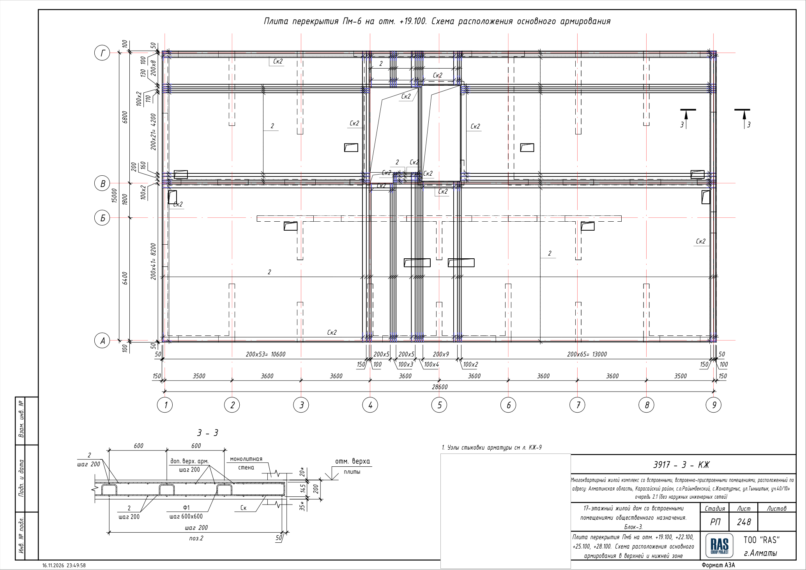
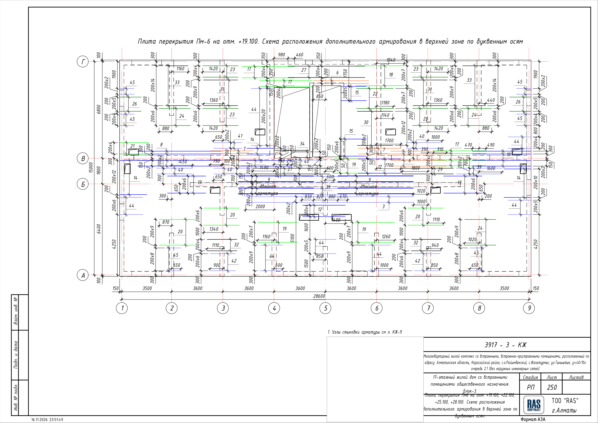
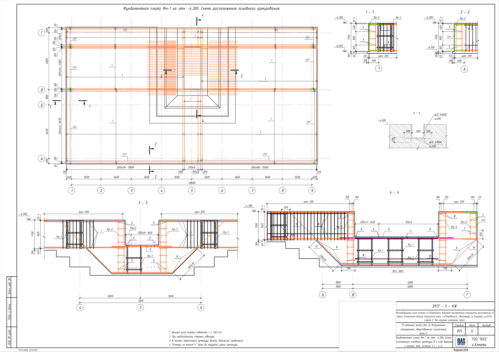

# 05. Плита және фундамент — парақтар (BI Group)

Жазылған: 17.11.2026. Дерек: S03, Пм-1 (КЖ-197…205), Пм-6 (КЖ-243…254), Фм-1 (КЖ-4…8); дамп `out\d06_sheet_5 / 6 / 248 / 250 / 253 / 247.txt`. Аясы: тек BI жобалары.
Суреттер: `_суреттер\S03_л248…`, `л250…`, `л5…`.

## 1. Плитаның парақ жиыны

Парақ атауы: «Плита перекрытия Пм-N на отм. +X.XXX. <мазмұны>» (соңғысы — «Плита покрытия …»). Бірдей плиталар бір маркада: «Плита перекрытия Пм6 на отм. +19.100, +22.100, +25.100, +28.100. …» — армирование бір рет сызылады, **опалубка әр отметкаға бөлек**.

| № | Парақ | Формат | Көрінетін `BI_фильтр` |
|---|---|---|---|
| 1 | Опалубочный чертеж (әр отметкаға) | А2 | — (бетон, ойықтар) |
| 2 | Схема расположения пространственных каркасов | А3 | `Каркас` |
| 3 | Схема расположения основного армирования в верхней и нижней зоне | А3 (не А2) | `Гор` + `Верт` |
| 4 | …дополнительного армирования в нижней зоне по буквенным осям | А3 | `ДопНиз_X` |
| 5 | …в верхней зоне по буквенным осям | А3 | `ДопВерх_X` |
| 6 | …в нижней зоне по цифровым осям | А3 | `ДопНиз_Y` |
| 7 | …в верхней зоне по цифровым осям | А3 | `ДопВерх_Y` |
| 8 | Схема расположения поперечного армирования | А2 | шпилькалар (`Арм_Хомуты и шпилька` көрінеді) |
| 9 | Спецификация. Ведомость деталей. Ведомость расхода стали | А2 | кестелер |

- План 1:100: ғимарат 28,6 × 15 м → 286 × 150 мм, А3-ке сыяды. Әр схема — жеке парақ (бір парақ = бір вид + қажет болса бір легенда-қима).
- Кіші плиталар (лифт плитасы, будка, парапет) — бір А2 парақта бәрі: «Плита покрытия Пм-10 на отм. +53.900.», «Парапет ПРПм-1 на отм. +52.250.».
- Ортақ парақ: «Узлы усиления отверстий в плитах» (А3).

## 2. Вид баптауы (барлық плита схемасына ортақ)

| | |
|---|---|
| Вид | план несущих конструкций, тип `*06_Плиты`, шаблон `#03_Армирование плиты` (опалубкаға `#02_Опалубка плиты`), 1:100, стиль «каркас» |
| Параметрлер | `BI_группирование = ⏺ Плиты`, `BI_комментарии_к_виду = Плиты`, `BI_марка_конструкции = Плита Пм-6` |
| Фильтрлер | көрсетілетін топтан басқаның бәрі жасырын: `Арм_Доп`, `Арм_Каркас`, `Арм_Верх_X/Y`, `Арм_Низ_X/Y`, `Арм_ДопНиз_X/Y`, `Арм_ДопВерх_X/Y`, `Арм_Попереч`, `Арм_Хомуты и шпилька`, `Арм_Верт`, `Арм_Гор` + `Пм-6_Армирование`, `Пм-6_Разрезы`, `УБРАТЬ ВСЕ РАЗРЕЗЫ` |
| Астындағы стена | үзік сызықпен («невидимые линии») көрінеді |
| Ойық | `(Элемент_узлов)Обозначение_проема_прямоугольный` — бір диагональ |
| Осьтер | барлығы, шеңберлері астында және сол жақта; размер тізбегі `150, 3500, 3600 … 3500, 150` + `28600`; `100, 6800, 1800, 6400, 100` + `15000` |
| Атауы | видтің үстінде ортада, 3,5 мм курсив: «Плита перекрытия Пм-6 на отм. +19.100. Схема расположения основного армирования» |

## 3. Основное армирование парағы (КЖ-248)

- Көрінеді: негізгі тор (`Гор`, `Верт`) және шеткі П-шкалар.
- Әр жиыннан **бір өкіл стержень** (жиындар «первый и последний» / таңдаулы режимде, қалғаны жасырын: 1 152 стерженьнің 912-сі жасырын). Стержень бүкіл ұзындығымен жіңішке сызық, үстінде полкада позиция `2`.
- Жиынның таралуы — **MRA `поз.`**: плитаның сыртында, сол жақта және астында тізбек: `200х53= 10600`, `200х5`, `100х3`, `200х9`, `100х2`, `200х65= 13000`; шеттерінде `50` (қырдан бірінші стерженьге дейін), `150`, `100`.
- Сыртқы тізбектің қайталамасы размер типі `BI_курсив_2.5 мм`-мен: префикс `200х41=` + мән, қысқасына мәтін `{100х2}`.
- Шеткі П-шкалар: марка `Ск2` (плита жиегінде, проём жиегінде).
- Шартты қима белгісі `3` (`(типовая_аннотация)разрез_условный`) → парақтың төменгі сол жағында **легенда** «(Плита)_Сечение 3-3» (1:20): қолмен сызылған (детальные линии + `(цветовая_область)сталь`), жазулар `(Оформление) Выноска`: «2 / шаг 200», «доп. верх. арм. / шаг 200», «Ф1 / шаг 600х600», «Ск», «монолитная стена», «отм. верха плиты» (флажок); размерлер `20*`, `145`, `35*`, `200`, `600, 600`, «шаг 200 / поз.2», `50`.
- Примечание: «1. Узлы стыковки арматуры см. л. КЖ-9» (бірінші плитада толық: стык ережелері — `02`-файл, 4-бөлім).

## 4. Доп. армирование парақтары (КЖ-249…252)

- Көрінеді: бір ғана топ (мыс. `ДопВерх_X`).
- Әр жиыннан **бірінші және соңғы стержень** (барлық 85 жиын «первый и последний»), түсі диаметр бойынша.
- MRA `поз.`: шаг тізбегі `200х8=1600`, `200х9=1800`, `200х14=2800` + полкада позиция (`17`, `23`, `44`).
- Байлау размерлері (`BI_курсив_2.5 мм`): стержень ұзындығы (`1160`, `1420`, `880`), осьтен/стенадан ығысу (`300`, `350`), зоналар арасы (`200`, `1000`, `{200х6}`).
- Қосарланған жерге мәтін «двойная арматура».
- Примечание: «1. Опалубочный чертеж см. л. … 2. Схему расположения основной арматуры см. л. … 3. Данный лист читать совместно с л. … 4. Стержни дополнительного армирования устанавливать в промежутках между рабочей арматурой. 5. В случае совмещения дополнительного стержня с рабочей арматурой дополнительный стержень сдвинуть».

## 5. Поперечное армирование парағы (КЖ-253)

- Көрінеді: шпилькалар, барлығы толық («Показать все», 453 жиын).
- Марка `Позиция/Шаг_12`: `Ш1 / шаг 100`, `Ш2 / шаг 100` — әр аймаққа.
- Аймақ размерлері (`1000, 2500`; `500, 500`; `550, 450`) осьтерге байланған.
- Шартты қима белгісі `5` → легенда «(Плита)Плиты … сечение поперечной арматуры» + «(Плита)Плиты Фиксатор» + «узел раскладка фиксатора».
- Пм-1-де осы параққа ведомость деталей мен ВРС қосылған.

## 6. Пространственные каркасы парағы (КЖ-247)

- Көрінеді: `Каркас` (бойлық Ø14 `пм`, хомуттар, П-шкалар).
- MRA `поз.` (бойлық стерженьдер: `200`, `150`) + марка `Х1 / шаг 200`, `Х2 / шаг 200`.
- Байлау размерлері, шартты қима белгілері `1…4` → легенда «(Плита)_Сечение 1-1»: «Пространственный каркас», «Основная арматура / шаг 200», «поз. Х-1;2* / шаг 200»; `35*`, `145`, `20*`.

## 7. Опалубочный чертеж плиты (КЖ-243…246)

- Шаблон `#02_Опалубка плиты`, А2, 1:100. Плита контуры, ойықтар (өлшемі, осьтерге байлауы), астындағы стеналар, отметка.
- Жанында легендалар (1:25): «(Лестница)Пм Выпуски под лестницу вверх», «…вниз» — лестницаға выпуск узелдері.
- Кестелер: ойық усилениесінің шығыны — «2СА обрамление» кестесінің осы плитаға сүзілген көшірмесі (S03-те аты `(Стены)_СЖм-1_2СА обрамление  Пм-1`) және `03_Задание_гильзы Пм-1`. («Расход арматуры на усиление отверстий смотреть на опалубочных чертежах».)
- Примечание: «2. Основная арматура плиты перекрытия в верхней и нижней зонах, в местах отверстий, обрезается по месту и отгибается в тело плиты или анкеруется П-образной арматурой. 3. Отверстия размерами больше 300 мм обрамить по узлу обрамления отверстия. 4. Отверстия, расположенные рядом, обрамить как одно общее. 5. Узлы стыковки арматуры см. л. КЖ-9».

## 8. Фундаментная плита парақтары (КЖ-4…8)

| № | Парақ | Формат | Не тұрады |
|---|---|---|---|
| 4 | Опалубочный чертеж. Сечения 1-1 ÷ 2-2 | А2 | план + қималар |
| 5 | Схема расположения основной арматуры в 2 слоя верхней и нижней зоне. Сечения 1-1 ÷ 4-4 | А2 | план 1:100 + **нағыз қималар** (жиек 1-1, 2-2; приямок 3-3, 4-4) + деталь а-а |
| 6 | Схема расположения дополнительной арматуры вдоль цифровых осей | А1 книжный | бірнеше план: нижняя по цифровым, верхняя по цифровым, верхняя по буквенным |
| 7 | Схема расположения поддерживающих каркасов | А2 | Кр-1…Кр-3 планы + легенда «(Фундамент)Каркасы Фунд» (1:35) + кесте `(Фундаменты)_изделия_СА` |
| 8 | Схема расположения поперечной арматуры сварными каркасами Ф1, Ф2 | А2 | Ф1 планы + легенда «(Фундамент)Каркасы Фунд Ф1» + **Фм-1 кестелері**: `_2СА`, `_4ВД` (3 бағанға бөлінген), `_5ВРС`, `_3ВМ(сборка)` |

- Вид: тип `*01_*ФундСхема`, шаблон `#03_Армирование фундамента`, 1:100; параметрлер `BI_группирование = ⏺ Фундаменты`, `BI_комментарии_к_виду = ФундПлитный_арм`, `BI_марка_конструкции = Фм-1`, `BI_назначение_вида = ❶ Оформленные виды`.
- Негізгі арматура планы: өкіл стержень + позиция `1`, шеткі `Ск1`, MRA тізбегі `200х69= 13800`, `200х42= 8400`, `200х24= 4800`, жиекте `50`.
- Қималар (1:50, нағыз Revit қимасы, шаблон `#03_Армирование фундамента`): жиек қимасында қабаттар арасы `35 *, 460, 800, 365, 40` + подготовка `100`; позициялар, `Кр-1`, `Кр-2`, `Ск1`, «шаг 200», отметкалар (`−4,300`, `−6,000`); приямок қимасында `200х7= 1400`, `150х2`, «доп. арм.».
- Доп парағы: әр планда тек өз тобы (`ДопНиз_Y` т.с.с.), MRA `200х12=2400`, байлау размерлері (`950`, `880`, `80`).
- Примечание: «2. При необходимости стержни сдвинуть. 3. В местах пересечения арматуру вязать вязальной проволокой. 4. Размеры со знаком "*" даны до наружной грани арматуры».
- Фундаменттен кейін альбомда: «Узлы стыковки…» (2 парақ) → «Схема расположения фрагментов выпусков» → фрагменттер (`04`-файл, 8-бөлім).

## 9. Плита парағын жасағанда тексеретінім

1. Әр видте тек бір топ көрініп тұр ма (артық фильтр ашық қалмаған ба).
2. Негізгі тор стержені `пм` типінде ме, позициясы бір ме.
3. MRA тізбектерінің қосындысы плита өлшеміне сай ма (`50 + 200×53 + …`).
4. Доп. стерженьде байлау размері бар ма (ұзындық + осьтен қашықтық) — онсыз орны анықталмайды.
5. `_X` топ буквенные осьтер парағында, `_Y` — цифровые осьтер парағында ма.
6. Шартты қима — легенда; ондағы сандар (`20*`, `35*`) модельге сай ма (үлгіде сәйкес емес — `07`, сұрақ).
7. Бірдей плиталар бір маркаға жиналған ба; опалубка әр отметкаға бөлек пе.

## 10. Суреттер

