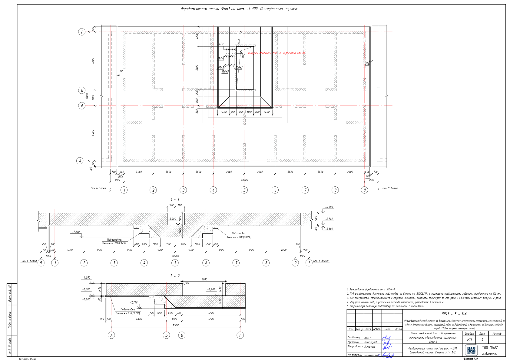
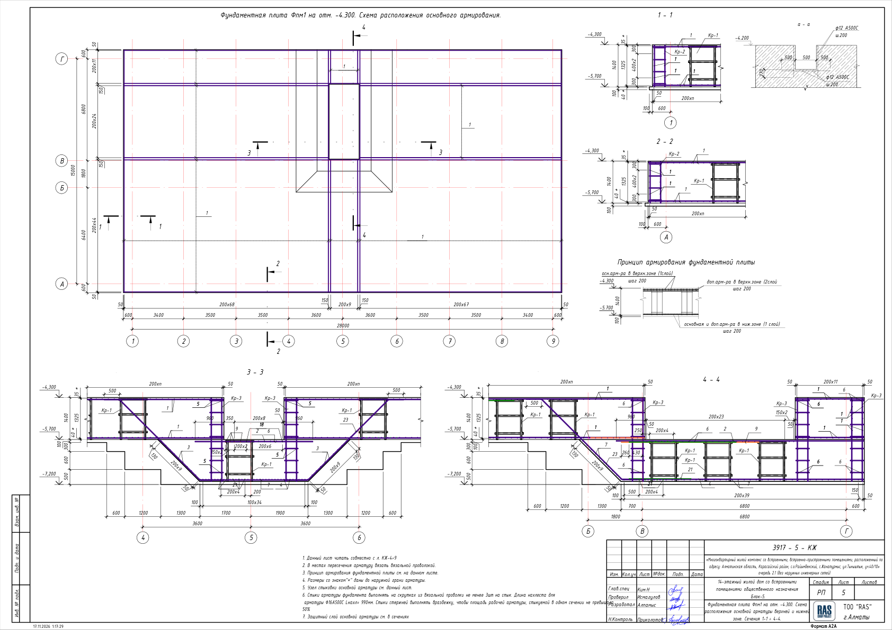
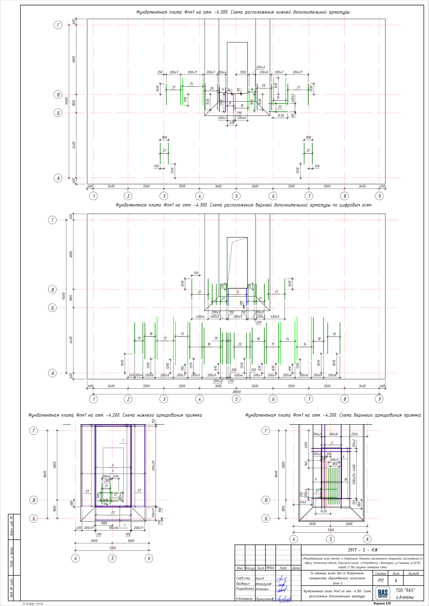
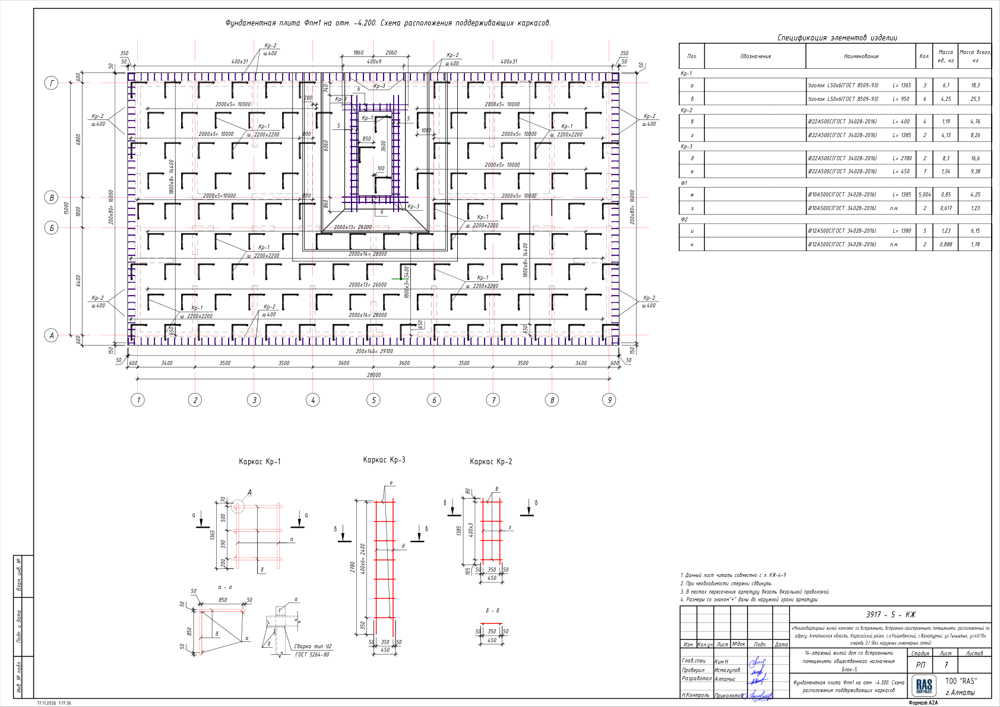
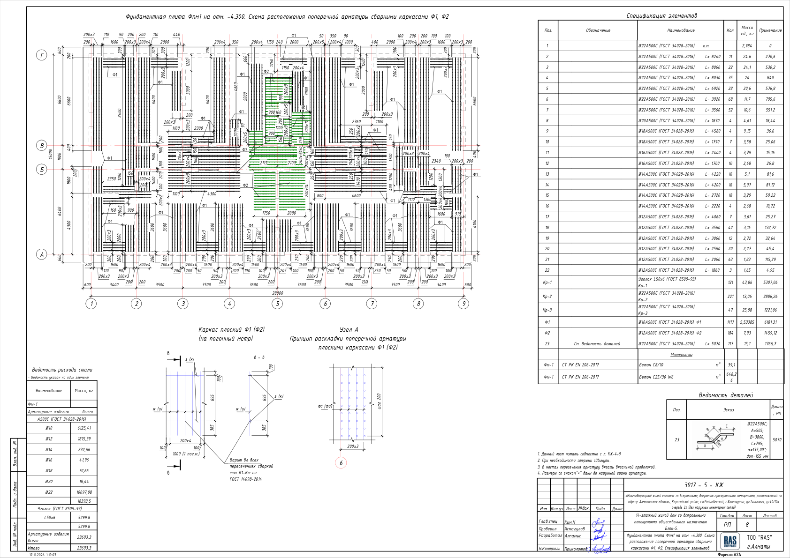
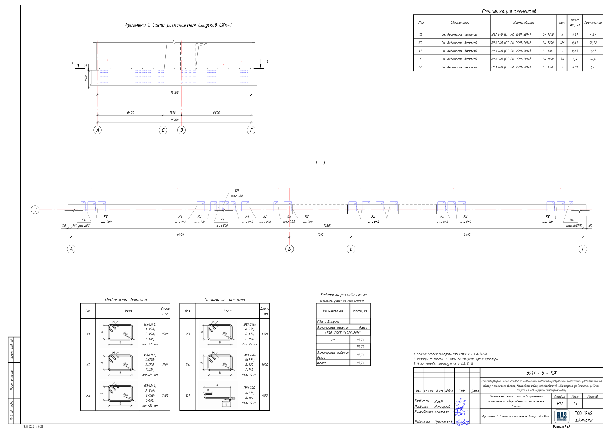
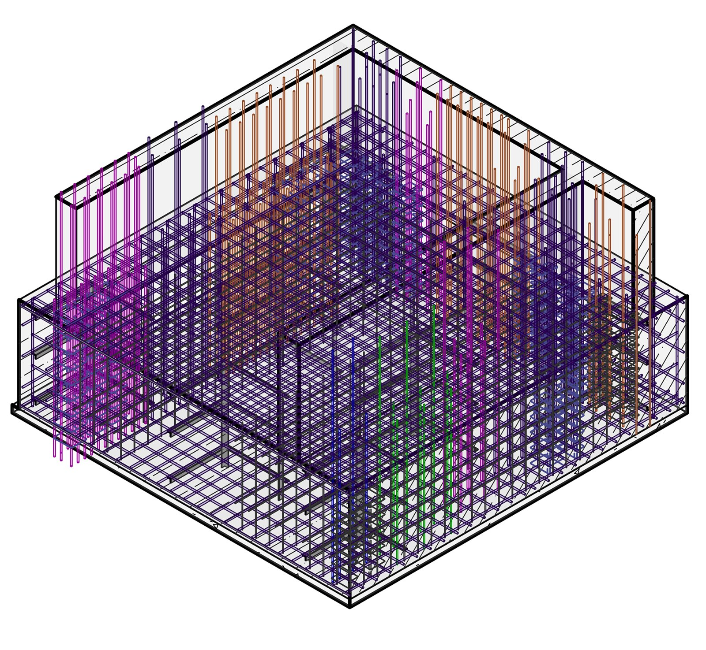
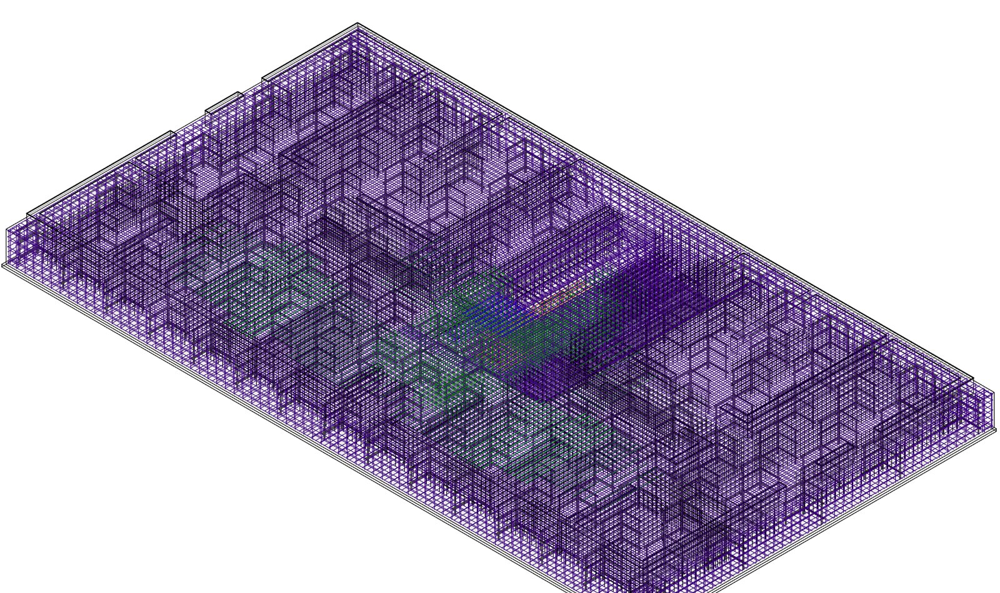

# 08. Фундаментная плита Фм-1 — Омар S05, толық талдау (BI Group)

Жазылған: 17.11.2026.
Источник: пайдаланушы 17.11.2026 (S05 «Фундамент» файлының 3D видінде арматура көрінбей тұрғаннан кейін) — «Сосын оны толық оқып биайдың данныйына сақта», «полный қарап қалай бар солай қабылдап сақта ок».
Дерек: `3917_OMAR_01_02_S05_KJ01_01_M3` (Блок-5, 14 қабат, ТОО «RAS», Revit 2026), файл `D:\РАБОЧКА\От Ержан\Фундамент\`. Парақтар КЖ-4…8, 11, 11.1, 12, 13…35 (PDF 34 парақ), видтер мен кестелер дампы, арматура кестесі.
Шикі дерек: `D:\_claude_work\Erzhan\S05\out\` (`s02_probe`, `s03_fm`, `f01_fm`, `d06_sheet_*`, `d08_sched_*`), `…\pdf\S05_*.pdf`, `D:\_claude_work\BI_Group\out_S05\d04b_rebar.tsv`.
Аясы: тек BI жобалары. Мұнда жазылғаны — модельден оқылған факт, **сол күйінде** қабылданған. Диаметр, шаг, отметка — осы объектінің есебінен; ереже — *қалай модельденеді және қалай көрсетіледі*. S03 фундаменті (t = 1700) — `02`-файл 5-бөлім, `05`-файл 8-бөлім; мына файл S05-ті толық сипаттайды, айырмасы 11-бөлімде.

## 1. Модель қорытындысы (S05)

| | |
|---|---|
| Арматура | 38 225 `Rebar` жиыны (264 921 стержень) + 1 570 арматура категориясындағы семейство |
| Хост бойынша | стена 23 023, плита 10 832, фундамент 3 497, балка 873 |
| Парақ | 309; фундамент бөлімі (браузер ұйымы «02_Фундамент»): 4…8, 11, 11.1, 12…35 |
| Деңгейлер | −01 Подвал −4.300; 01 Этаж −0.100; 02 +4.100; 03 +7.100 … 14 Этаж +40.100 (қадамы 3000); Кровля +43.590; Будка +47.300 |
| Фм-1 | 3 222 `Rebar` жиыны (11 976 стержень) + 1 089 уголок бөлшегі (Кр-1); выпускілер 894 жиын |
| Сборка | `Фундамент 6` = плита + подготовка (арматура сборкаға кірмейді) |

Модельдің ішкі координатасы: z = отметка − 300 мм (плита беті −4.300 → z = −4600).

## 2. Геометрия және опалубка парағы (КЖ-4, А2)

| Элемент | Модельде | Өлшемі |
|---|---|---|
| Плита | `Floor`, категория «Фундамент несущей конструкции», тип `(фундамент_плита)железобетон_t=1400` | 29 200 × 16 200 (осьтер 28 000 × 15 000, шеткі осьтен 600 шығады); беті −4.300, табаны −5.700; бетон C25/30 W6 — 648,26 м³ |
| Подготовка | `Floor`, тип `(подготовка)бетон_t=100` | плита контурынан 100 шығады; табаны −5.800; бетон C8/10 (В10) — 39,1 м³ |
| Приямок | семейство `(приямок)железобетонный_90°_ступенчатый` (FamilyInstance) | 4–6 / Б–Г осьтері аралығы; едені −5.700; қабырғасы еңіс; отметка −7.200; астындағы подготовка сатылы (600 / 1200 / 1300, биіктігі 300 / 600 / 500) |

Парақ рецепті:
- План: `План несущих конструкций`, тип `*01_*ФундСхема`, шаблон `#02_Опалубка фундамента`, 1:100, «Высокий», скрытые линии. Параметрлер: `BI_группирование = ⏺ Фундаменты`, `BI_комментарии_к_виду = *ФундСхема`, `BI_марка_конструкции = Фм-1`, `BI_назначение_вида = ❶ Оформленные виды`. Жасырын фильтрлер: `Разрезы_Опалубка`, `Фм-1_Разрезы`, `Фм-1_Выпуски_искл`.
- Үстіндегі стеналар штрихталған контурмен көрінеді; осьтер барлығы; размер типтері `BI_основной_2,5мм_округление_до_1мм` / `до_5мм`; приямок тізбегі `1400, 800, 900, 1100, 800, 1400` және `300, 1100, 800, 5000, 2300`.
- Көрші блок: `(типовые_аннотации)линия_обрыва` + выноска `(типовая_аннотация)текст_с_выноской` «Ось 6 блока», «Ось 8 блока».
- Қималар 1-1, 2-2 — **нағыз Revit қимасы**: тип `*03_Фундамента_разрез`, шаблон `#02_Опалубка фундамента`, 1:100; отметкалар `BI_стрелка_проектная_вверх / вниз` (−4,300; −5,700; −5,800; −7,200); выноска `(Оформление) Выноска : Без указателя` — «Подготовка / Бетон кл. B10(C8/10)»; грунт пен бетон — `(цветовая_область)песок / бетон`.
- Примечание (сөзбе-сөз): «1. Армирование фундамента см л. КЖ-4÷9. 2. Под фундаментами выполнить подготовку из бетона кл. В10(C8/10), с размерами превышающими габариты фундамента на 100 мм. 3. Все поверхности, соприкасающиеся с грунтом, очистить, обмазать праймером за два раза и обмазать холодным битумом 2 раза. 4. Деформационный шов, с указанием расхода материала, разработан в разделе АР. 5. Ступенчатую бетонную подготовку см. совместно с котлованом».

## 3. Арматура құрамы (Фм-1)

Барлығы «Число с интервалом»; `BI_марка_конструкции = Фм-1`.

| Поз. | Ø, тип | L, мм | Дана | Не | `BI_фильтр` | Группа |
|---|---|---|---|---|---|---|
| 1 | Ø22 А500С `пм` | 29 160 (X), 16 160 (Y); приямокта үзілгені 13 660, 13 460, 8 860, 2 260 | 528 | негізгі тор шаг 200, **әр зонада бір қабат** | `Низ_X`, `Низ_Y`, `Верх_X`, `Верх_Y` | «Фм-1. общ арм» |
| 1 | Ø22 А500С `пм` | 29 160, 16 160 | 24 | жиек бойындағы бойлық стерженьдер (биіктік бойынша 3 дана шаг 400, Кр-2 ішінде) | бос | «Для каркаса» |
| 8 | Ø20 | 1 870 | 4 | доп. астыңғы | `ДопНиз_Y` | «Фм-1. общ арм» |
| 10 | Ø18 | 1 790 | 7 | доп. астыңғы | `ДопНиз_Y` | — ″ — |
| 11 | Ø16 | 2 400 | 4 | доп. астыңғы | `ДопНиз_Y` | — ″ — |
| 15, 16 | Ø14 | 2 720, 2 220 | 18, 4 | доп. астыңғы | `ДопНиз_Y` | — ″ — |
| 20, 21, 22 | Ø12 | 2 560, 2 060, 1 860 | 15, 25, 3 | доп. астыңғы | `ДопНиз_Y` | — ″ — |
| 12 | Ø16 | 1 700 | 10 | доп. үстіңгі | `ДопВерх_Y` | — ″ — |
| 13, 14 | Ø14 | 4 220, 4 200 | 16, 16 | доп. үстіңгі | `ДопВерх_Y` | — ″ — |
| 17…21 | Ø12 | 4 060, 3 560, 3 060, 2 560, 2 060 | 7, 35, 12, 5, 23 | доп. үстіңгі | `ДопВерх_Y` | — ″ — |
| 2…7 | Ø22 | 8 240, 8 060, 8 030, 6 920, 3 920, 3 560 | 11, 22, 35, 28, 68, 52 | приямок | бос | «приямки» |
| 23 | Ø22, `(форма)26_угол_больше_90` | 5 070 (A = 505, B = 3 800, C = 795, α = 135°) | 117 | приямоктың еңіс қабырғасы | бос | «приямки» |
| 9; 18; 21 | Ø18; Ø12; Ø12 | 4 580; 3 560; 2 060 | 4; 7; 15 | приямок доп. | бос | «приямки» |
| Кр-2 «в», «г» | Ø22 `каркас` | 400; 1 385 | 884; 442 | жиек каркасы, 221 дана | бос | «Группа 21» |
| Кр-3 «д», «е» | Ø22 `каркас` | 2 780; 450 | 94; 329 | приямок каркасы, 47 дана | бос | «кр-3 30» |
| Ф1 «ж», «з» | Ø10 `каркас` / `каркас пм` | 1 385; 1 000 | 5 590; 2 234 | поперечная, 1 117 п.м. | бос | «Ф1» |
| Ф2 «и», «к» | Ø12 `каркас` / `каркас пм` | 1 380; 1 000 | 920; 368 | поперечная, 184 п.м. | бос | — |
| Кр-1 «а», «б» | уголок L50×6 — семейство `(закладная_деталь)уголок1` | 1 365; 950 | 363; 726 | үстіңгі торды ұстайтын каркас, 121 дана | `Каркас` | «Каркас Кр-1» |

- Доп. арматура тек Y бағытында (цифровые осьтер бойымен): `ДопНиз_X`, `ДопВерх_X` бұл плитада жоқ.
- Позиция нөмірлеу: 1 — `п.м.`; 2…22 — дана стержень, Ø кемуімен, ұзындық кемуімен; 23 — гнутый; каркас бөлшектері әріппен (а…к); изделие маркасы `BI_марка_изделия` (Кр-1…3, Ф1, Ф2).
- Плита шетінде П-шка `Ск` жоқ — жиекті Кр-2 каркасы мен бойлық стерженьдер жабады.

## 4. Қабаттар және қорғаныс қабаты

Стержень осінің деңгейі (модель):

| Зона | Реті | Қимадағы размер |
|---|---|---|
| Астыңғы | `Низ_X` — табаннан 51 (ең астында), `Низ_Y` — 68 | `40 *` (X стерженінің сыртқы қырына дейін) |
| Үстіңгі | `Верх_Y` — беттен 46 (ең үстінде), `Верх_X` — 64 | `35 *` |
| Доп. астыңғы | табаннан 53…66 — `Низ_Y` қабатының деңгейінде, негізгі стерженьдердің арасында | «основная и доп. арм-ра в ниж. зоне (1 слой)» |
| Доп. үстіңгі | беттен 75…106 — үстіңгі тордың астында | «доп. арм-ра в верхн. зоне (2 слой)» |
| Шеті | стержень ұшы қырдан 20; бірінші стержень қырдан 50 | тізбек басы `50` |

Қимадағы тік тізбек: `35 *, 1325, 40 *` (+ подготовка 100); жиекте `300, 400х2, 300` (бойлық стерженьдер). «Размеры со знаком "*" даны до наружной грани арматуры».

## 5. Каркастар

| Марка | Құрамы | Массасы | Саны | Орналасуы |
|---|---|---|---|---|
| **Кр-1** | уголок L50×6 (ГОСТ 8509-93): «а» L = 1 365 × 3 (тік тірек), «б» L = 950 × 6 (көлденең; планда үшбұрыш 850 × 850, шеттен 50); биіктік бойынша `200, 590, 500, 70`; «Сварка тип У2, ГОСТ 5264-80» | 43,86 кг | 121 | өрісте; размер тізбегі `2000х14=28000`, `2000х13=26000`, `1800х8=14400`; жазуы «Кр-1 / ш. 2200х2200» |
| **Кр-2** | Ø22 А500С: «г» L = 1 385 × 2 (тік), «в» L = 400 × 4 (көлденең шаг 400: `80, 400х3, 105`); ені 450 (`50, 350, 50`) | 13,06 кг | 221 | периметр бойымен, «Кр-2 / ш.400» |
| **Кр-3** | Ø22 А500С: «д» L = 2 780 × 2, «е» L = 450 × 7 (`400х6=2400`, 350) | 25,98 кг | 47 | приямок айналасы |
| **Ф1** | жалпақ сварной каркас, **1 пог. м-ге**: Ø10 А500С «ж» L = 1 385 × 5 (тік, `100, 200х4, 100`), «з» бойлық `п.м.` × 2 (легендада `385, 895, 100`) | 5,53 кг / п.м. | 1 117 | стена астындағы жолақтарда, каркастар арасы шаг 200 |
| **Ф2** | сол сияқты, Ø12 А500С: «и» L = 1 380 × 5, «к» `п.м.` × 2 | 7,93 кг / п.м. | 184 | приямок маңы |

- Ф1 / Ф2 легендасы: «Каркас плоский Ф1 (Ф2) (на погонный метр)», «Варить во всех пересечениях сваркой тип К1-Кт по ГОСТ 14098-2014», «Узел А. Принцип раскладки поперечной арматуры плоскими каркасами Ф1 (Ф2)» (`шаг 200`, `200х3`).
- Модельде: Кр-2, Кр-3, Ф1, Ф2 — кәдімгі `Rebar` жиындары, типі `(арматура)d=NN_А500 каркас` (бойлығы `… каркас пм`), әр изделие модель группасына жиналған; `BI_марка_изделия` = изделие маркасы, `BI_позиция` = бөлшек әрпі. Кр-1 — арматура категориясындағы семейство (уголок).
- Спецификацияда изделие **бір жолмен** («Кр-1 | Уголок L50х6 (ГОСТ 8509-93) Кр-1 | 121 | 43,86 | 5307,06»), құрамы бөлек кестеде «Спецификация элементов изделий».

## 6. Приямок

- Түбінде және еңіс қабырғаларында жеке стерженьдер (поз. 2…7, 9, 18, 21, 23), группа «приямки», `BI_фильтр` бос.
- Еңіс қабырға бойымен поз. 23 (`(форма)26_угол_больше_90`, α = 135°), шаг 200 (`200х9`), түбінде шаг 100 (`100х34`).
- Екі жеке план (КЖ-6): «Схема нижнего армирования приямка», «Схема верхнего армирования приямка»; қималар 3-3, 4-4 (КЖ-5).
- Деталь «а – а» (легенда `(Фундамент)Приямок ВК1`): плита бетіндегі ойық 500 × 270, «ф12 А500С ш.200».

## 7. Армирование парақтарының рецепті

Барлық планға ортақ: тип `*01_*ФундСхема`, 1:100, `BI_комментарии_к_виду = ФундПлитный_арм`; әр жиынның таралуы — MRA `поз.` (размер типі `BI_поз.`, марка `Позиция_7`); байлау размерлері `BI_основной_2,5мм_округление_до_10мм`; осьтер тізбегі `BI_курсив_2.5 мм`. Қималар: тип `*01_Стена_разрез`, шаблон `#03_Армирование фундамента`, 1:50, арматура «показать все» + без перекрытий.

| Парақ | Формат | Не тұрады | Көрінетін топ |
|---|---|---|---|
| **5.** Схема расположения основной арматуры верхней и нижней зоне. Сечения 1-1 ÷ 4-4 | А2 | план (шаблон `#03_Армирование фундамента`, «каркас» стилі) + қималар 1-1, 2-2 (жиек), 3-3, 4-4 (приямок) + легенда «Принцип арм фундаментой плиты» + деталь а-а | `Арм_Низ_X_(НизГор)`, `Арм_Низ_Y_(НизВерт)`; жиыннан бірінші және соңғы стержень (289 стерженьнің 271-і жасырын) |
| **6.** Схема расположения дополнительной арматуры | А2 книжный | төрт план: нижняя доп.; верхняя доп. по цифровым осям; нижнее армирование приямка; верхнее армирование приямка | `Арм_ДопНиз_X/Y`; `Арм_ДопВерх_Y`; приямок стерженьдері (таңдаулы / бірінші-соңғы) |
| **7.** Схема расположения поддерживающих каркасов | А2 | план («Низкий» детализация) + легенда `(Фундамент)Каркасы Фунд` (1:35) + кесте `(Фундаменты)_Фм-1_2СА на каркас_Фм-1` | `Арм_Каркас`, барлық стержень |
| **8.** Схема расположения поперечной арматуры сварными каркасами Ф1, Ф2. Спецификация элементов | А2 | план + легенда `(Фундамент)Каркасы Фунд Ф1` (1:35) + Фм-1 кестелері: `_2СА`, `_3ВМ(сборка)`, `_4ВД`, `_5ВРС` | `Арм_Каркас`; марка типі `BI_марка_изделия` (семейство `(марка)арматурная_сетка`) — «Ф1», «Ф2»; размер типі `BI_основной_фон_2,5мм_округление_до_5мм` |

- КЖ-5 планы: өкіл стержень + позиция `1`; төменде тізбек `50, 200х68, 150, 200х9, 150, 200х67, 50`, сол жақта `50, 200х44, 150, 200х24, 150, 200х11, 50`.
- КЖ-5 қималары: позиция маркалары `Позиция_7` және `Позиция_с засечкой_7`; каркас выноскасы `(типовая_аннотация)текст_с_выноской` — «Кр-1», «Кр-2», «Кр-3»; тізбектер `50, 200хп`, `200х39`, `200х23`, `150х2`.
- Легенда «Принцип армирования фундаментной плиты»: «осн. арм-ра в верхн. зоне (1 слой) шаг 200», «доп. арм-ра в верхн. зоне (2 слой) шаг 200», «основная и доп. арм-ра в ниж. зоне (1 слой) шаг 200».
- КЖ-5 примечаниесі (сөзбе-сөз): «1. Данный лист читать совместно с л. КЖ-4÷9. 2. В местах пересечения арматуру вязать вязальной проволокой. 3. Принцип армирования фундаментной плиты см. на данном листе. 4. Размеры со знаком "*" даны до наружной грани арматуры. 5. Узел стыковки основной арматуры см. данный лист. 6. Стыки арматуры фундамента выполнять на скрутках из вязальной проволки не менее 3шт на стык. Длина нахлеста для арматуры ∅16А500С Lнахл= 990мм. Стыки стержней выполнять вразбежку, чтобы площадь рабочей арматуры, стыкуемой в одном сечении не превышала 50%. 7. Защитный слой основной арматуры см. в сечениях».
- КЖ-6, 7, 8 примечаниесі: «1. Данный лист читать совместно с л. КЖ-4÷9. 2. При необходимости стержни сдвинуть. 3. В местах пересечения арматуру вязать вязальной проволокой. 4. Размеры со знаком "*" даны до наружной грани арматуры».

## 8. Кестелер

| Кесте | Категория, сүзгі | Не шығарады |
|---|---|---|
| `(Фундаменты)_Фм-1_2СА` | арматура; `BI_марка_конструкции = Фм-1` | «Спецификация элементов»: поз. 1 `п.м.`, 2…22 `L = …`, Кр-1…3, Ф1, Ф2 (изделие бір жолмен), 23 «См. ведомость деталей» |
| `(Фундаменты)_Фм-1_2СА на каркас_Фм-1` | арматура; `BI_тип_элемента_КЖ` 2…4, `Модель ≠ Пустой элемент`, марка Фм-1; топтау `BI_марка_изделия` (тақырыппен) | «Спецификация элементов изделий»: Кр-1 (а, б), Кр-2 (в, г), Кр-3 (д, е), Ф1 (ж, з), Ф2 (и, к) |
| `(Фундаменты)_Фм-1_3ВМ(сборка)` | сборкалар; шаблон `*(спецификация)ВМ(сборка)`; `Комментарии = Фм-1` | бетон: C8/10 — 39,1 м³; C25/30 W6 — 648,26 м³ (СТ РК EN 206-2017) |
| `(Фундаменты)_Фм-1_4ВД` | арматура; `BI_арматура_гнутая = 1`, марка Фм-1 | ведомость деталей: поз. 23 (эскиз `Форма_26 α + 90`, «Ø22А500С; A=505; B=3800; C=795; α=135,00°; dоп=155 мм», 5070) |
| `(Фундаменты)_Фм-1_5ВРС` | арматура; шаблон `*(спецификация)ВРС`; марка Фм-1, `Модель ≠ Пустой элемент` | ведомость расхода стали («Ведомость указан на один элемент») |
| `(Фундаменты)_Фм-1_1СА-конструкция_(сборка)` | сборкалар | «Фундамент Фм-1 — 1» |
| `(Фундаменты)_Выпуски_2СА / 4ВД / 5ВРС <Марка>` | арматура; `Марка = <Марка> Выпуски` | әр конструкцияның выпуск парағына үш кесте (СЖм-1…20, СШм-1…5, Км-1) |

ВРС (үлгідегі сандар): Ø10 — 6 125,41; Ø12 — 1 815,39; Ø14 — 232,66; Ø16 — 41,96; Ø18 — 61,66; Ø20 — 18,44; Ø22 — 10 097,98; арматура 18 393,5 кг; уголок L50×6 — 5 299,8 кг; барлығы 23 693,3 кг. (Негізгі тор бұл сандарға кірмеген — 12-бөлім.)

## 9. Выпускілер (S05 күйі)

- Жалпы схема — КЖ-12 «Схема расположения фрагментов выпусков» (вид `-01 Подвал_(-4.300)_(*Каркасы) Фрагменты`, тип `*02_Каркасы`, шаблон `#04_Каркас`, 1:100); фрагменттер — КЖ-13…35 (23 парақ: СЖм-1…19 (СЖм-7-сіз), СШм-1…5; А3, А2, екеуі А1).
- Стержень: `BI_марка_конструкции = Выпуски` (762 жиын) не `СЖм-6. Выпуск` (132); «Марка» = `СЖм-N Выпуски` (жиындардың бір бөлігінде ғана толтырылған).
- Тік стержень: Ø10…Ø25 А500С, `(форма)1`, L = 1 710…4 280, `BI_фильтр = Верт`, хосты көбіне стена; фундаментке кіру тереңдігі әртүрлі — көбінде плита табанына дейін, кейбірінде табаннан 590…890 жоғары тоқтайды; үстіне екі деңгейде шығады.
- Фундамент қалыңдығында хомут Ø6 / Ø8 / Ø10 А240 `(форма)хомут` шаг 100 / 200 және шпилька `(форма)шпилька S`.
- Фрагмент парағы (КЖ-13, СЖм-1): развертка 1:100 + қима «1-1» 1:30 (тип `*01_Стена_разрез`, шаблон `#03_Армирование стены`, арматура «показать все»), марка `Позиция/Шаг_12` — «Х2 / шаг 200», «Ш1 / шаг 200»; кестелер 2СА (Х1…Х4, Ш1 — Ø8 А240, СТ РК 2591-2014), 4ВД (екі бағанға бөлінген), 5ВРС. Примечание: «1. Данный чертеж смотреть совместно с л. КЖ-54÷61. 2. Размеры со знаком "*" даны до наружной грани арматуры. 3. Узлы стыковки арматуры см. л. КЖ-10÷11».
- Узлы стыковки: КЖ-11 (C25/30, B30) және КЖ-11.1 (C20/25, B25) — легендалар `(Стена)Узел стыковки В30 / В25`; кестелері `02`-файлдың 3-бөліміндегідей.

## 10. 3D-де арматураны көру

- **Неге көрінбейді:** стерженьдер бетон ішінде; `{3D}` видінде «Скрытие линий» стилінде бетон беті оларды жабады. «Показать без перекрытий» — әр стерженьнің әр видке жеке баптауы; ол тек парақ видтерінде қойылған (КЖ-5 қималары: барлығы «без перекрытий»), `{3D - …}` видтерінде қойылмаған.
- **BI инженерлерінің тәсілі** (модельде 50-ден аса жеке `{3D - аты}` виді): тар секущий диапазон (бір стена не аймақ) + «Каркас» стилі + «Высокий» детализация; бір конструкцияны оқшаулау — `<Марка>_Армирование` фильтрі (ережесі `BI_марка_конструкции ≠ <Марка>`, көрінуі өшірулі).
- **Локал файл:** үлгі — Revit Server хранилищесінің локал көшірмесі. Хранилище қолжетімсіз болғанда вид баптауы өзгермейді («Модель из хранилища отсутствует…»). Сондықтан файл тек «Отсоединить от файла хранилища» арқылы ашылады; Revit пайдаланушы атын өзгертпеймін.
- **Дайын файл:** `D:\РАБОЧКА\От Ержан\Фундамент\3917_OMAR_01_02_S05_KJ01_01_M3_отсоединено.rvt` (хранилищеден ажыратылған, рабочий наборсыз). Қосылған екі вид (үлгіде жоқ, менің қосқаным):
  - `3D_Фм-1_Армирование` — бүкіл плита: «Средний», «Заливка», бетон 80 % мөлдір, `Фм-1_Армирование` фильтрі, арматура «без перекрытий»; файл осы видтен ашылады;
  - `3D_Фм-1_Армирование_фрагмент` — бұрыш 5 × 5 м: «Высокий» (стержень көлемді), Фм-1 + выпускілер, диаметр түсі `3D_Арм_ØNN` фильтрлерімен.
- Жаңа вид «03_Фундаменты» браузер ұйымында көрінуі үшін: `BI_группирование = ⏺ Фундаменты`, `BI_назначение_вида = ❶ Оформленные виды`, `BI_марка_конструкции = Фм-1` (топ «Фм-1 > 3D виды»).
- Скрипттер: `скрипттер\scripts\v10_3d_rebar_views.cs`, `v12_3d_rebar_colors.cs` (жұмыс көшірмесі `D:\_claude_work\Erzhan\S05\rv\scripts\`).

## 11. S03 ↔ S05 фундаменті

| | S03 (`02`, `05`-файлдар) | S05 (осы файл) |
|---|---|---|
| Қалыңдық | 1700 | 1400 |
| Негізгі тор | Ø18 шаг 200, әр зонада 2 қабат | Ø22 шаг 200, әр зонада 1 қабат |
| Шеті | П-шка `Ск1` (Ø14) | каркас Кр-2 + бойлық стерженьдер, `Ск` жоқ |
| Кр-1 | уголок: 3 × 1665 + 6 × 950 | уголок: 3 × 1365 + 6 × 950 |
| Поперечная | Ф1 (Ø10) | Ф1 (Ø10) + Ф2 (Ø12) |
| Доп. | X және Y | тек Y |
| Доп. парағы | А1 книжный | А2 книжный, приямок пландарымен бірге |
| Узлы стыковки | КЖ-9, 10 | КЖ-11, 11.1 |
| Парақ атауы | «Фм-1» | «Фпм1» (модельдегі марка — Фм-1) |

Ортағы: парақ реті (опалубка → основное → доп → поддерживающие каркасы → поперечная + спецификация), вид типтері мен шаблондары, фильтр атаулары, кесте жүйесі, примечание мәтіндері.

## 12. Үлгідегі аяқталмаған не қайшы жерлер (ереже емес — көшірмеймін)

- `_2СА` кестесінде поз. 1 (`п.м.`) жолының саны бос, массасы 0. Модельдегі негізгі тор (528 стержень, 9 330,5 м ≈ 27,8 т) ВРС-ке кірмеген (ВРС-те Ø22 — 10 097,98 кг).
- КЖ-5 примечаниесінде «Длина нахлеста для арматуры ∅16А500С Lнахл= 990мм» — плитада негізгі арматура Ø22.
- Кр-1 жазуы «ш. 2200х2200», размер тізбегі 2000 / 1800.
- Вид атауларында «на отм. −4.200», парақ атауларында «−4.300»; парақта «Фпм1», модельде «Фм-1».
- Бір `Низ_X` жиыны (25 стержень) үстіңгі зонада тұр (фильтр мәні қате).
- КЖ-4-те қызыл ескертпе қалған: «выпуски лестницы еще не корректно стоит». Бір топ выпуск (СЖм-14, СЖм-17, СШм-2, СШм-3) плита табанынан 300-дей төмен шығып тұр (t = 1700 кезіндегі ұзындық).
- Выпуск хомуттарында `BI_фильтр` әркелкі (`Попереч`, бос, `Арм_Хомуты и шпилька`); «Марка» көп жиында бос; `СЖм-6. Выпуск` — басқа марка жазылуы.
- Қималарда белгісіз маркалар («??»), `Сечение 3-3 коп`, `4-4 коп` — «копия» видтер; КЖ-13-те ведомость деталей-де `Х3` екі өлшеммен (1000 және 1100).
- Ф1 легендасында бойлық стерженьдер арасы 895, модельде 800.

## 13. Суреттер

