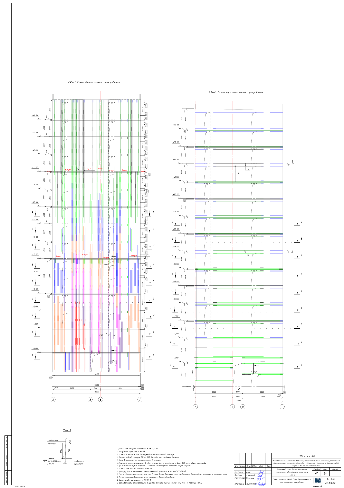
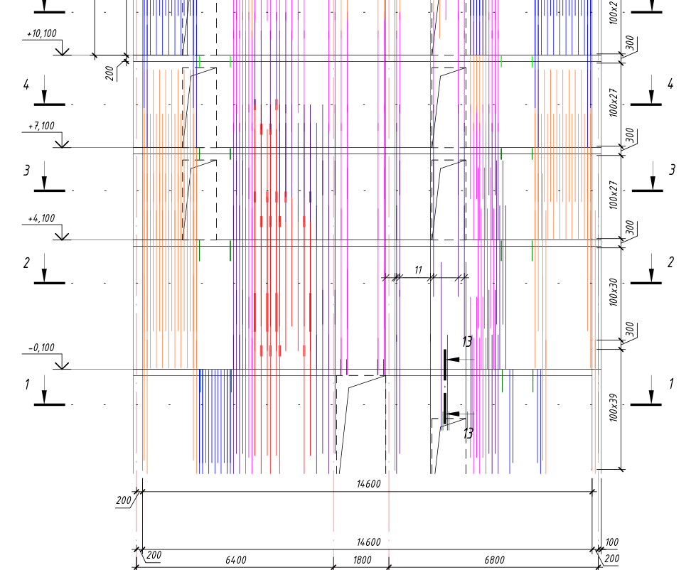
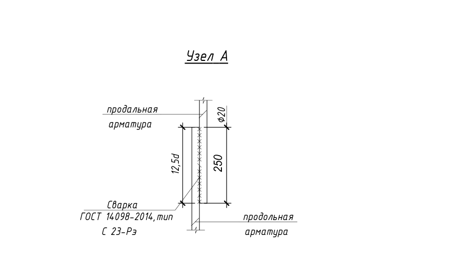
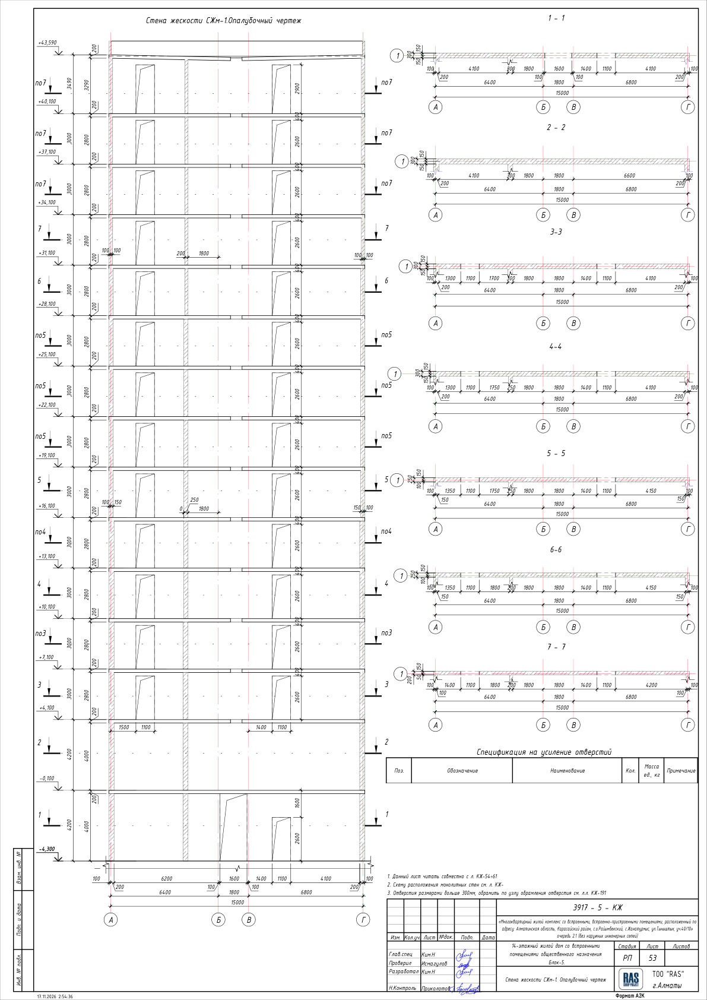
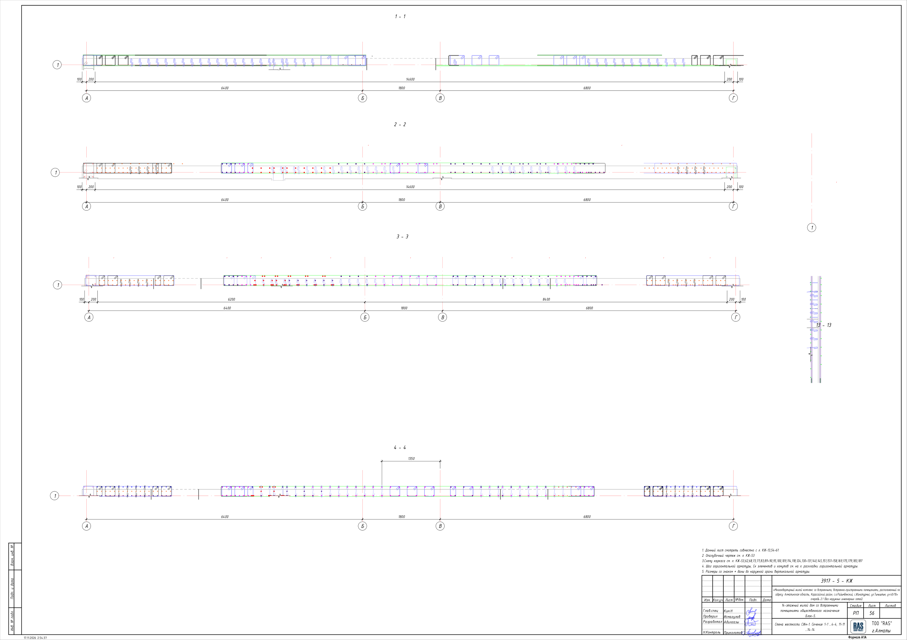
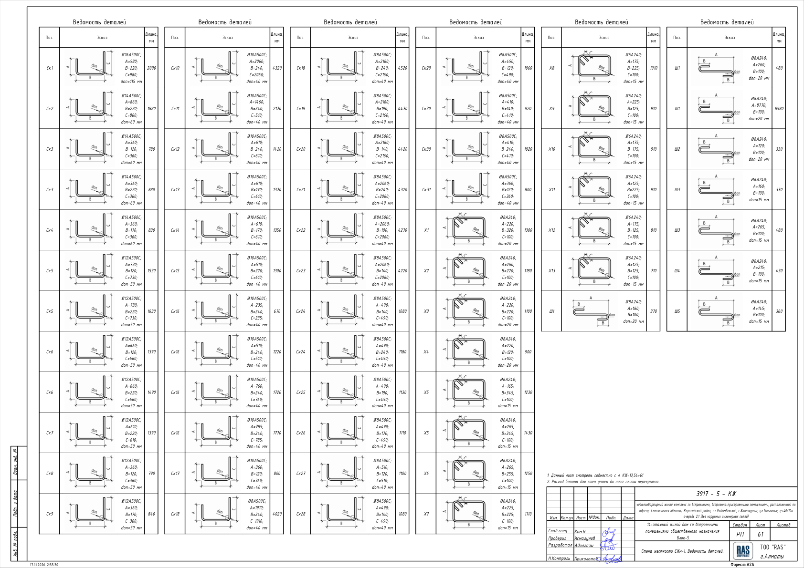

# 09. Монолит стеналар СЖм / СШм — Омар S05 (толық талдау)

Источник: пайдаланушы 17.11.2026 — «Терең етіп оқы» (S05 моделінің фундаменттен басқа бөлігін де толық оқу), «полный қарап қалай бар солай қабылдап сақта ок».
Жазылған: 17.11.2026.
Дерек: `out_S05\d04b_rebar.tsv` (стена маркалары — 22 688 жиын), `d05_hosts.tsv` (495 «Стены»), `d03_sheets.txt`, `out\g01_album.txt`, `out\d06\d06_sheet_13…35, 53…192, 840…880`, `out\d08\*` (стена кестелері), PDF `pdf\S05_013, 053–061, 083–088_5` (12 парақ PNG-ге шығарылып қаралды: `png\agentA\`). Скрипттер: `an\agentA_inv*.py`, `agentA_sum.py`, `agentA_cover.py`, `agentA_d06.py`, `agentA_sheets.py`, `agentA_sch.py`, `agentA_vm.py`, `agentA_mass.py` (шығыстары `an\agentA_*.txt`).
Аясы: тек BI жобалары. Салыстыру негізі — `02` (6-бөлім), `03` (4-бөлім), `04`-файлдар (S03).
Ескерту: Ø, шаг, отметка — S05 есебінен (ереже емес); ереже — *қалай модельденеді және көрсетіледі*.

## 1. Түгендеу

### 1.1 Маңызды: марка екі жерде, екеуі сәйкес емес

- Арматурада марка — `BI_марка_конструкции` (парақ, фильтр, 1СА/4ВД/5ВРС осыған сүйенеді).
- Бетон стенада марка — `Марка` параметрі (тек `3ВМ` кестесі осыған сүйенеді, сүзгі `Марка Equal 'СЖм-N'`).
- Екеуі көп жерде **сәйкес емес** (`agentA_inv3`, `agentA_hostmark2`): СЖм-2 арматурасы `Марка=СЖм-3` стенада (x = 7200); СЖм-3 арматурасы `СЖм-15` / `СЖм-19` стеналарында; СЖм-6 арматурасы `СЖм-19` стенасында; СЖм-1, 9, 11, 18, 19, 0 арматурасының хосттарында `Марка` бос (103 стена белгісіз). `Марка=СЖм-6` стеналары (x = 21400, L = 3050) мүлде арматурасыз.
- Айналық жұптың біреуі ғана армирленген: `Марка=СЖм-4` 30 стена (x = 10700 және x = 17925), арматура тек x = 10700-де; СЖм-3 «по оси 8» (x = 24900) арматурасыз; `Марка=СЖм-2` (x = 3675) арматурасыз.

### 1.2 Маркалар кестесі (арматура маркасы бойынша)

Ішкі z = отметка − 300. Қалыңдық реті төменнен жоғары; `B30` — тип атындағы класс (3ВМ-да «Бетон C25/30», қалғаны «C20/25»), `W6` — тек подвал.

| Марка | Орны (модель x,y), L | t бойынша қабаттар | Отм. | Жиын / стержень | `BI_фильтр` (жиын) |
|---|---|---|---|---|---|
| СЖм-1 | x≈300, у бойы, L 15200 (подв. 14950) | 300 B30 W6 (−1), 300 B30 (1–2), 300 (3–5), 250 (6–10), 200 (11–14) + парапет t150 | −4,300…+43,391 | 2707 / 17683 | Верт 938, Гор 210, Доп 354, Попереч 1205 |
| СЖм-2 | x≈7200, L 3050 | 300 (−1, 1), 250 B30 (2–3), 250 (4–7), 200 (8–14) | −4,300…+43,391 | 597 / 4444 | Верт 203, Гор 114, Попереч 280 |
| СЖм-3 | x≈3700 y 8100…14850 (L 6750–6800) + y≈14950 x 150…3850 (L 3600–3700) | 300 (−1…3), 250 (4–9), 200 (10–14) | −4,300…+43,391 | 502 / 2531 | Верт 334, Гор 168 |
| СЖм-4 | x≈10700, L 3050 | 300 (−1…3), 250 (4–9), 200 (10–14) | −4,300…+43,391 | 722 / 4641 | Верт 345, Гор 70, Доп 295, ДопВерх_Y 12 |
| СЖм-5 | x 14300, y −100…2000, L 2100 | 300 (−1, 1), 250 B30 (2–3), 250 (4–7), 200 (8–14) | −4,300…+43,391 | 479 / 3747 | Верт 295, Гор 64, Доп 15, «Арм_Хомуты и шпилька» 105 |
| СЖм-6 | y 14950, x 150…28300, L 28150 | тек подвал 300 B30 W6 (+6 жиын 1-қабатта) | −4,300…−0,300 | 132 / 498 | Верт 110, Гор 22 |
| СЖм-7 | y≈0–50: екі пилон x 150…3850 және 24750…28450 (L 3600–3700) + подв. L 28300 | 300 (−1…5), 250 (6–10), 200 (11–14) | −4,300…+43,391 | 2557 / 12521 | Верт 1314, Гор 602, бос 641 |
| СЖм-8 | x≈24900, L 3050 | 300 (−1…3), 250 (4–9), 200 (10–14) | −4,300…+43,391 | 508 / 4008 | Верт 195, Гор 60, Доп 8, бос 245 |
| СЖм-9 | x≈28300, L 15200 (СЖм-1 айнасы) | 300 (−1…5), 250 (6–10), 200 (11–14) | −4,300…+43,391 | 2672 / 18489 | Верт 783, Гор 257, Доп 482, Попереч 1150 |
| СЖм-10 | y≈4475, x 26200…28350, L 2150 | 300 (−1…3), 250 (4–9), 200 (10–14) | −4,300…+43,387 | 447 / 3505 | Верт 353, Гор 94 |
| СЖм-11 | x≈21400, y 11200…15100, L 3900 (+27 жиын x 7200-де) | 300 (−1, 1), 250 (2–7), 200 (8–13) | −4,300…+39,900 | 348 / 2951 | Верт 142, Гор 61, Попереч 134 |
| СЖм-12 | x≈10600, y 8300…15100, L 6800 | 300 (−1…3), 250 (4–9), 200 (10–14) + лифт үсті | −4,300…+48,280 | 565 / 2920 | Верт 360, Гор 102, Доп 31, Попереч 72 |
| СЖм-13 | x≈18000, y 8300…15100, L 6800 | сол | −4,300…+47,100 | 1223 / 8375 | Верт 449, Гор 226, Доп 13, бос 535 |
| СЖм-14 | y≈6375, x 3700…25050, L 21350 | 300 (−1…3), 250 (4–9), 200 (10–14) | −4,300…+43,391 | 2088 / 21094 | Верт 325, Гор 208, Доп 10, бос 1545 |
| СЖм-15 | x 14300, y 4200…6500, L 2300 | 300 (−1, 1), 250 (2–7), 200 (8–14) | −4,300…+43,391 | 1246 / 3418 | Верт 493, Гор 508, Доп 16, бос 229 |
| СЖм-16 | y≈8250, x 3700…10700, L 7000 | 300 (−1…5), 250 (6–9), 200 (10–14) | −4,300…+43,400 | 1066 / 8547 | Верт 662, Гор 259, Доп 134 |
| СЖм-17 | y≈8250, x 17900…25050, L 7150 | сол | −4,300…+43,391 | 1494 / 8579 | Верт 704, Гор 238, Доп 13, бос 539 |
| СЖм-18 | x≈3700, y 4800…6500, L 1700 | 300 (−1…3), 250 (4–9), 200 (10–14) | −4,300…+43,391 | 372 / 3047 | Верт 151, Гор 34, «Арм_Хомуты…» 186 |
| СЖм-19 | y≈4475, x 250…2400, L 2150 (СЖм-10 айнасы) | сол | −4,300…+43,387 | 430 / 3615 | Верт 242, Гор 79, «Арм_Хомуты…» 109 |
| СЖм-0 | x≈24900, y 4800…6400, L 1600 (СЖм-18 айнасы) | сол | −4,300…+43,391 | 431 / 2910 | Верт 181, бос 245 — **парағы да, кестесі де жоқ** |
| СШм-1 | x 13300, y 8200…13500, L 5300 | 200 B30 (−1…2), 200 (3–кровля) | −4,300…+47,100 | 1013 / 6995 | Верт 310, Гор 128, Доп 85, бос 490 |
| СШм-2 | y 13400, x 13300…15600, L 2300 | сол | −4,300…+44,700 | 465 / 3671 | Верт 112, Гор 129, бос 223 |
| СШм-3 | y 8200, x 13300…15600, L 2300 | сол | −4,300…+47,100 | 624 / 4348 | Верт 216, Гор 128, Доп 16, бос 264 |

- **СЖм-20** — модельде стена да, арматура да, парақ та жоқ; тек кестелер (`СЖм-20_1СА/3ВМ/4ВД/5ВРС`, `2СА обрамление`, `03_Задание_гильзы СЖм-20`) мен фильтрлер (`#СЖм-20_…`) бар. **СШм-4, СШм-5** — тек выпуск парақтары (34, 35), арматура мен стена жоқ.
- Барлық стена 1-қабаттан бастап қабат сайын бөлек `Wall` (биіктігі плита астына дейін: 2800 / 4000), қалыңдық азайғанда бір беті тұрақты қалады (ось 25 мм-ге жылжиды).
- Поперечная арматураның `BI_фильтр` мәні біркелкі емес: СЖм-1, 9, 11, 12, 2 — `Попереч`; СЖм-5, 18, 19 — фильтр **атауы** `Арм_Хомуты и шпилька` жазылған; қалғандарында бос. Парақта бәрібір жасырылады — фильтр `Форма contains хомут/шпилька` бойынша.

### 1.3 Парақтар (g01_album + d03; VP = видовой экран саны)

| Марка | Парақтар (формат) | Бос (видсіз) парақтар |
|---|---|---|
| СЖм-1 | 13 (А2), 53 (А2к), 54–55 (А1к), 56–58 (А1), 59–60 (А1к), 61 (А2) | — |
| СЖм-2 | 14 (А3), 62–63 (А2к), 64–66 (А2) | — |
| СЖм-3 | 15, 68 «по оси 2», 68.1 «по оси 8», 69 (А1к), 70–72 | **15, 69** (схема армирования бос) |
| СЖм-4 | 16, 73, 74 (А1к), 75–76 | **74** (16-да вид бар, арматурасы жоқ) |
| СЖм-5 | 17, 77–80 (бәрі А2к) | — |
| СЖм-6 | 18, 83 (А1к), 84 (А3), 85–86 (А1к), 87–88.1 (А1), 88.3–88.5 (А1к), 840 (А1к), 850–860 (А2к), 870–880 (А2) | **18, 86, 87, 88, 88.1, 840, 850, 860**; 85 — тек «Узел А» легендасы + ревизия бұлттары |
| СЖм-7 | 89–90 (А2к), 91–92 (А1к), 93 (А1), 94 (А1к) | 93 (VP 14, бірақ маркасыз, размерсіз) |
| СЖм-8 | 19, 95–96 (А2к), 96.1, 97–99 (А2) | — |
| СЖм-9 | 20, 100–102 (А1к), 103–105 (А1), 106–107 (А1к), 108 (А2) | (20-да вид бар, арматурасы жоқ) |
| СЖм-10 | 21, 109, 110 (А1к), 112–113 | — (111 нөмірі жоқ) |
| СЖм-11 | 22, 114, 115 (А1к), 116–117 | — |
| СЖм-12 | 23, 118, 119 (А1к), 120–122 (А1), 123 (А2) | — |
| СЖм-13 | 24, 124, 125 (А1к), 126–129 (А1) | — |
| СЖм-14 | 25, 130 (А2к), 131 (А3к), 132–134 (А1к), 135–139 (А1) | **133, 134**; 132 — тек тік қималар 22-22…28-28 |
| СЖм-15 | 26, 140, 141 (А1к), 142–144 | **26, 141** |
| СЖм-16 | 27, 145, 146 (А1к), 147 (А1), 148–150 | **27, 146, 147** |
| СЖм-17 | 28, 151, 152–153 (А1к), 154–156 (А1) | — |
| СЖм-18 | 29 (А1), 156.1 (А2к) | армирование парағы жоқ |
| СЖм-19 | 30 (А1), 157–158 (А2к) | **30, 158**; армирование парағы жоқ (85–88.5 соныкі болуы мүмкін — 6-бөлім) |
| СШм-1 | 31, 169 (А2к), 170 (А1к), 171–173 (А2) | — |
| СШм-2 | 32, 175 «СШм-2, СШм-3. Опалубочный» (А2к), 176 (А1к), 177–178 | — |
| СШм-3 | 33, 180 (А1к), 181–182 | — |
| СШм-4 / 5 | 34 / 35 (А2) | **34, 35** |

Ортақ: 11 / 11.1 «Узлы стыковки … B30 / B25» (А3), 12 «Схема расположения фрагментов выпусков», 36–50 «Схема расположение элементов каркаса на отм. …» (А2), 51–52 «Разрез 1-1 / 2-2» (А1к), 191 «Узлы усиления отверстий в стенах» (А2), 192 «Перемычка Прм-1» (А2). S05 нөмірлеуі S03-тен 1 парақ ығысқан (S03: СЖм-1 = 52…60, узлы стыковки = 9, 10).

## 2. Арматура тәсілі (d04b, `agentA_sum_*.txt`)

### 2.1 СЖм-1 — қабат-қабат (сыртқы + ішкі бет)

| Қабат (отм.) | t | Верт Ø (саны) | Верт L | Гор өріс | Обвязка (пм) |
|---|---|---|---|---|---|
| −1 (−4,300) | 300 | Ø25 (22), Ø22 (50), Ø20 (34), Ø18 (74), Ø16 (44) | Ø18 5120 / 6020, Ø20 5220, Ø22 5320, Ø25 4200 | Ø14 / Ø12 L 4260…6960 ш200 | — |
| 1 (−0,100) | 300 | Ø25, Ø22 (50), Ø20 (34), Ø18 (74) | Ø18 5120, Ø20 5220, Ø22 5320 / 4420 | Ø14 L 8660 ш200 | Ø12 пм 15160 |
| 2 (+4,100) | 300 | Ø25, Ø22 (62), Ø20 (34), Ø18 (74) | Ø22 3800 / 2940, Ø18 4290 / 4060 | Ø14 8660 ш200 | Ø12 пм, ш300 |
| 3 (+7,100) | 300 | Ø22 (16), Ø20 (78), Ø18 (12), Ø16 (74) | Ø20 3250 / 3275, Ø16 3980 | Ø14 8660 ш200 | Ø12 пм, ш300 |
| 4 | 300 | Ø20 (54), Ø18 (40), Ø16 (86) | Ø20 3250, Ø18 3550 / 4380 | сол | сол |
| 5 | 300 | Ø20 (15), Ø18 (118), Ø16 (140) | Ø18 4100, Ø16 3980 | Ø14 8660 | Ø14 пм, ш300 |
| 6 | 250 | Ø18 (40), Ø16 (88), Ø14 (52) | Ø18 4100, Ø16 3980, Ø14 3860 | Ø14 8660 | Ø12, ш200 |
| 7 | 250 | Ø16 (76), Ø14 (104) | 3980 / 3860 | Ø12 8660 | Ø12, ш200 |
| 8 | 250 | Ø16 (26), Ø14 (84), Ø12 (66) | … / 3730 | Ø12 | Ø12 |
| 9 | 250 | Ø16, Ø14 (70), Ø12 (60), Ø10 (40) | … / 3610 | Ø12 | Ø12 |
| 10 | 250 | Ø14 (137), Ø12 (61), Ø10 (90) | аралас (проём маңы) | Ø12 | Ø12 |
| 11–13 | 200 | Ø12 (74), Ø10 (74) | 3730, 3610 | Ø10 пм 8660 | Ø12 пм |
| 14 (+40,100) | 200 | Ø12 (74), Ø10 (74) | 3290 / 2340, 3230 / 2430 (кровляда тоқтайды) | Ø8 пм 8660 | Ø12 пм |

**Верт** (`(форма)1`):
- Ұзындық = қабат биіктігі + нахлёст `11` / `11.1` кестесінен: B25 — Ø10 3610, Ø12 3730, Ø14 3860, Ø16 3980, Ø18 4100 (3000 + 610 / 730 / 860 / 980 / 1100); B30 (−1, 1) — Ø18 5120, Ø20 5220, Ø22 5320 (4200 + 920 / 1020 / 1120). **S03-пен бірдей тәсіл.**
- 50 % вразбежку — екі топ, әрқайсысы бөлек жиын (шаг 400 + 400 → 200): бірінші стык биіктігі (плита үстінен) және екінші: Ø10 200 / 1000, Ø12 140 / 1090, Ø14 70 / 1190, Ø16 10 / 1290 (6–8-қабатта 50 / 1330), Ø18 0 / 1430 (B25), Ø18 40 / 1240, Ø20 0 / 1330, Ø22 0 / 1460 (B30). Яғни `02`, 3.2-кесте; айырма тек 6–8-қабаттағы Ø16 (+40).
- **Сваркамен стык (S03-те де дәл осылай — 7-бөлім):** 3–4-қабатта Ø20 / Ø22 ұзындығы 3250 / 3275 = 3000 + 12,5d (250 / 275), стыктар 550 / 1150 (Ø20) және 525 / 1125 (Ø22) — 600 мм вразбежку. Бұл — 54-парақтағы легенда `(Стена)Узел стыковки 20д сварка нахлест без накладки` («Узел А»: Ø20, 12,5d = 250, «Сварка ГОСТ 14098-2014, тип С23-Рэ»); 85-парақта — `20,22д` нұсқасы (275 қосылған). СЖм-14 5-қабатында да Ø22 L 3275, 10-қабатында Ø20 3575 / 4405.
- Ø25 (−1…2-қабат): L 4200 = қабат биіктігі (нахлёстсыз), стыктар 600 / 1400 (СЖм-14-те 800 / 1400) + `L = 350` қысқа Ø25 бөліктері (425…775, 1225…1575 — стык ортасында; 1СА-да поз. 8 «L = 350», 86 дана) — `11`-парақтағы «Узел стыковки вертикальной арматуры со сваркой … Н1 (Ø25, Ø28)» накладкасы. S03-те де Ø25 / Ø28 накладкамен (`02`, 3.4).
- Қорғаныс қабаты: тік стержень осі стена бетінен 46…52 мм (Ø12 — 46, Ø16 — 48, Ø25 — 52) → **бетінен 40 мм** (`agentA_cover`, СЖм-2…СШм-3 барлығында). S03-пен бірдей. ⚠ СЖм-1, СЖм-9 (сыртқы бойлық стеналар) және СЖм-2 арматурасы бетон стенаның өзінен 100 / 50 мм ығысқан (6-бөлім).
- Шеткі (торцевой) аймақ: шаг 100 (екі жиын 200 + 200), өрісте 200 (400 + 400); 54-парақтағы `BI_поз.` тізбектері: `300, 50, 100, 200х5=1000, 100, 200х5=1000`, `400х4=1600`.

**Гор** (`(форма)1`, тіктің сыртында):
- Қабат ішіндегі раскладка (плита үстінен, 3000 қабат): **50 → 200×13 = 2600 (14 стержень) → 2750 → 2950** (6–14-қабат); 2–5-қабатта соңғы екеуі 2750 және **3050** (шаг 300). S03: `50 → 200×12 → 200 → 100×3 → 50` (обвязка 4 стержень ш100). Бұл — СЖм-1-дің өз саны: обвязка стержень саны мен Ø-сы екі модельде де стенаға байланысты (7-бөлім), модельдер арасындағы айырма емес.
- Өрістегі стержень — проёмнан проёмға: СЖм-1-де ортаңғы бөлік L 8660 (Ø14 / Ø12 / Ø10 пм / Ø8 пм), шеткі бөліктерде көлденең арматура **ұзын аяқты П-шка** ретінде: Ск10 / Ск22 Ø8–Ø10 `A = C = 2060 / 2160, B = 240`, L 4320 / 4520. S03-те өрістегі бөлік кәдімгі стержень, Ск тек торецте.
- Обвязка тұтас `пм` (Ø12 / Ø14 L 15160, стенаның бүкіл ұзындығы) — S03-пен бірдей тәсіл, Ø кіші.
- СШм-1: 50 → 200×13 → 2650 / 2750 (ш100) — ұқсас; Ø10 / Ø8 L 5360.

**Ск — П-шкалар (`(форма)21`):**
- Көлденең (`Гор`) Ск: B = **t − 60** (300 → 240, 250 → 190, 200 → 140); аяғы = нахлёст (B25 Ø10 — 610, Ø8 — 490; B30 Ø10 — 510, Ø8 — 410). S03-те басым мән t − 50 (t = 200 стенада 140); екі мән де екі модельде кездеседі (7-бөлім). BI жобасында — S03 мәні (пайдаланушы шешімі 17.11.2026).
- Тік (`Верт`) Ск (проём үсті / асты, торец): B = **t − 80** (220 / 170 / 120), A = 360 (қысқа) не нахлёст (Ø12 730, Ø14 860, Ø16 980), шаг 100 / 200 — S03-пен бірдей.
- 4ВД `dоп` (иілу диаметрі): Ø16 115, Ø14 60, Ø12 50, Ø10 40 мм.

**Попереч (хомут / шпилька, А240):**
- Хомут `Х` (`(форма)хомут`, тұйық): Ø8 (300-де), Ø6 (250 / 200-де); ені A = 219 / 173 / 123 (t − 81…77), B = 119 / 219 / 319; шаг қабат түбінде **100 × 6–7**, ортасында **150 × 9–10**, жоғарыда 100 × 6–7; 54-парақтағы тізбек `{100х6}, {150х10}, {100х6}, 300` (300 — плита). Кейбір қабатта толық `{100х27}`. S03-пен бірдей (100 / 150).
- Шпилька `Ш` (`(форма)шпилька S`): Ø8 (t 300) / Ø6, шаг **400**, шахмат (биіктігі 46 / 246) — маркада `шах. п400`. S03-пен бірдей.
- `A` шамасы ауытқиды: t 300-де A = 259 және 158 (−1, 1, 2, 4-қабат) — 158 тым қысқа; t 200-де A = 143 (6-бөлім).

**Доп (`BI_фильтр = Доп`, `(форма)1`, барлығы көлденең):** Ø8…Ø20, L 950…4840, шаг 200 (кей жерде 300), 2–5 дана; орны (СЖм-1, 5-қабат): плита үстінен 150 (Ø8–Ø14, торец аймағында), 1150 / 1950 (проём ортасы / үсті, Ø18 L 1450, Ø8 2150), 2640 / 2660 (Ø20 L 2840, Ø18 L 2680 — проём үстіндегі перемычка аймағы, екі қатар 20 мм аралықпен). S03-тегідей; S03-тегі «плита деңгейіндегі обвязкаға қосымша Ø20 4 дана ш100» S05-те жоқ.

### 2.2 СЖм-6

- Модельде тек подвал (−4,300…−0,300, t 300, L 28150): Верт Ø22 L 5320 (0 / 1460), Ø20 2830 / 4180, Ø18 4140 / 2940 (40 / 1240), Ø16 4090 / 3020, Ø14 3990 / 2920 + Ø18 L 180 ×32 (выпуск үзіндісі?); Гор Ø16 пм L 28260, Ø20 пм L 23660, Ø18 L 28260 ш100, Ø10 L 1700 / 7900; ГорСк Ø14 A 1360 / B 250; хомут Ø6 `BI_фильтр = Верт` (қате мән). 1-қабатта тек 6 жиын (Ск Ø10 / Ø14 A 760).
- 83-парақта СЖм-6 — **ось Г бойындағы 1–9 осьтер аралығы бүкіл биіктік** (28 800, 19 отметка, қималар 1-1…8-8); 1-қабаттан жоғары арматурасы модельде жоқ (сол сызықтағы пилондарда СЖм-3 арматурасы).

### 2.3 СЖм-14 (L 21350, ось бойы y≈6375)

- −1, 1-қабат: Верт Ø25 L 4200 (800 / 1400) + Ø22 5320 / 4140 / 5000, Ø20 5220 (0 / 1330); тік Ск Ø12 A 1460 / B 220 (ш100 — 88 дана), Ø16 A 860; көлденең Ск Ø10 A 1160…1260 / B 240, Ø18 A 1760 / C 920; Гор Ø16 пм L 20010, Ø22 L 8060 (1-қабат).
- 5-қабат: Верт Ø22 L 3275 (сварка, 525 / 1125), Ø18 4100 (0 / 1430); Гор **Ø20 пм L 21460 ш100** (плита маңы); хомут Ø8 A 270 / B 220 ш100 / 150.
- 10-қабат: Ø20 3575 / 4405 (525 / 1125), Ø12 3730; 14-қабат: Ø14 4030 / 4340, Ø12 3730; Гор Ø14 пм L 21460 (ш200 және ш100).
- Поперечная: 1545 жиын `BI_фильтр` **бос**, хомут A 270 / 220 / 170 (t − 30), шпилька A 310 / 260 / 210 (ш400) — СЖм-1-ден өзгеше ені.

### 2.4 СШм-1 (t 200, L 5300)

- −1: Верт Ø18 5120, Ø16 5020, Ø14 4920, Ø12 4810 (B30: 4200 + 920 / 820 / 720 / 610), бірақ стык биіктігі 940 / 2140, 990 / 2060, 1040 / 1980, 1100 / 1900 — **3.2-кестеден өзгеше** (жоғары көтерілген).
- 1: Ø18 4220 … Ø10 3810 (4000 + нахлёст? — 1-қабат биіктігі 4200, L = 4200 + … сәйкес емес; анықталмады).
- 5, 10: Ø14 3860 (70 / 1190), Ø12 3730 (140 / 1090), Ø10 3610 (200 / 1000) — B25 кестесі, S03-пен бірдей.
- Гор Ø10 / Ø8 L 5360 ш200 + екі ш100; ГорСк Ø8 A 490 / B 140; Доп Ø8 L 950 / 2600 / 2850; хомут Ø6 A 220 / 120, ш100 / 150; шпилька Ø6 A 160 ш400. Поперечная `BI_фильтр` бос.
- 171-парақтағы қимада: `40 **`, `120`, `40 **` (екі жұлдызша), тізбек мәтіні қайталанған `200х16=200х16= 3200`.

### 2.5 Қалғандары (қысқа)

- Барлығында бір тәсіл: тік — қабат сайын бөлек, екі топ вразбежку; көлденең — өріс ш200 + `пм` обвязка; торец — Ск; хомут 100 / 150; шпилька ш400.
- Толық модельденбеген: СЖм-3 (Попереч, Доп жоқ), СЖм-4 (Попереч жоқ), СЖм-6 (тек подвал), СЖм-10 (Попереч, Доп жоқ), СЖм-8 / 13 / 15 / 17 (Попереч бос фильтрмен).

## 3. Парақ рецепті

### 3.1 СЖм-1 (КЖ-13, 53…61)

| Парақ | Видтер (тип / шаблон / масштаб / детализация) | Ерекшелік |
|---|---|---|
| 13 «Фрагмент 1. Схема расположения выпусков» А2 | `Фрагмент 1…` (қима, `#03_Армирование стены`, 1:100, Coarse) + `Сечение Выпуск` (1:30) | фильтр `#СЖм-1 Выпуск` жасырын; көрінетіні тек 21 жиын Х / Ш (Ø8 А240), марка `Позиция/Шаг_12` («Х2 шаг 200»); кестелер `(Фундаменты)_Выпуски_2СА / 4ВД (екі бағанға) / 5ВРС СЖм-1` (83,79 кг, «Ведомость указан на один элемент») |
| 53 «Опалубочный чертеж» А2к | развертка (`#02_Опалубка стены`, 1:100, Medium, тереңдік 350) + қималар 1-1…7-7 (1:100; 1-1-де шаблон бар, қалғанында жоқ, Fine) | 17 отметка `BI_стрелка_проектная_вверх`; размерлер `3490, 3000×12, 4200, 4200` және `200 / 2800…`; қима белгілері `1…7`, `по3…по7`; проём — бір диагональ; кестелер `(Стены)_СЖм-1_2СА обрамление` (**бос**), `03_Задание_гильзы СЖм-1` (**бос**) |
| 54 «Схема вертикального и горизонтального армирования» А1к | екі қима-вид, `#03_Армирование стены`, 1:100, Coarse, HLR, тереңдік 200 / 391 + легенда `Узел А` | тікте `Арм_Гор, Арм_Доп, Арм_Хомуты и шпилька, #СЖм-1_Армирование, #СЖм-1_Разрезы, Разрезы_Армирование, Разрез Стены` жасырын; көлденеңде `Арм_Верт` орнына; көрсетілу: тік — `Select 76 / FirstLast 274 / All 203` (2530-тің 1176-сы жасырын), көлденең — `FirstLast 125 / Select 65 / All 20`; MRA `поз.` (`BI_поз.` + `Позиция_7`, тік 4+1, көлденең 3); қызыл мәтін «выпуск» ×11 + қызыл сызықтар ×50; оң жақта хомут тізбегі `{100х6},{150х10},{100х6},300` (`BI_основной_2,5мм_округление_до_10мм`) |
| 55 «Схема дополнительного армирования» А1к | екі вид (тік доп / көлденең доп), 1:100, **Medium**, тереңдік 839 | тек `Арм_Доп`; `All` режимі басым (338 / 286); MRA бар болғаны 1; 15 отметка |
| 56–58 «Сечение …» А1 | қималар 1:25, көбіне шаблонсыз, Coarse/Medium/Fine аралас | `#СЖм-1_Армирование` — **halftone**; 1-1-де `Арм_Верт` жасырын, қалғанында `Арм_Доп`; `All`; **марка, MRA, қалыңдық размері жоқ** (тек ось размері `100, 200, 14600, 200, 100`); атауында көрсетілген 11-11…23-23 тік қималардың тек 13-13 бар |
| 59–60 «Спецификация» А1к | — | `1СА_поэтажно` 6 бағанға (2 парақ × 3), 60-та `3ВМ_поэтажно` (бос «Материалы») + `5ВРС_поэтажно` |
| 61 «Ведомость деталей» А2 | — | `4ВД` 6 бағанға; суреттер `Форма_21.png`, мәтін `Ø16А500С; A=980; B=220; C=980; dоп=115 мм` |

**Примечание — 54-парақ (сөзбе-сөз):** «1. Данный лист смотреть совместно с л. КЖ-13,54÷61 2. Опалубочный чертеж см. л. КЖ-53 3. Размеры со знаком * даны до наружной грани вертикальной арматуры. 4. Стержни рабочей арматуры Ø10 -:- Ø22 в полевой зоне соединять в нахлест. 5. Стыки вертикальной арматуры выполнять в разбежку. 6. Количество стержней, стыкуемых в одном сечении, должно составлять не более 50% от их общего количества. 7. При выполнении гнутых стержней КАТЕГОРИЧЕСКИ запрещается применять нагрев стержней. 8. Размеры всех деталей уточнять по месту. 9. Арматуру во всех пересечениях вязать вязальной проволокой Ø 1,6 мм (ГОСТ 2333-8). 10. Участки вертикального сопряжения стен в плане должны выполняться при одновременном бетонировании продольных и поперечных стен. 11. Ск-элементы стыковать внахлест на скрутках из вязальной проволки. 12. Узлы стыковки арматуры см. л. КЖ-10÷11 13. Все поверхности, соприкасающиеся с грунтом, окрасить горячим битумом на 2 слоя  по праймеру (1слой).» — S03-пен бірдей + 9-тармаққа «Ø 1,6 мм (ГОСТ 2333-8)» қосылған.

**53-парақ (сөзбе-сөз):** «1. Данный лист читать совместно с л. КЖ-54÷61 2. Схему расположения монолитных стен см. л. КЖ-  3. Отверстия размерами больше 300мм, обрамить по узлу обрамления отверстия см. л.л. КЖ-191»

**55–58-парақ (сөзбе-сөз):** «1. Данный лист смотреть совместно с л. КЖ-13,54÷61 2. Опалубочный чертеж см. л. КЖ-53 3.Схему каркаса см. л. КЖ-53,62,68,73,77,83,89÷90,95,100,109,114,118,124,130÷131,140,145,151,157÷158,169,175,179,183,187 4. Шаг горизонтальной арматуры, Ск элементов и хомутов см. на л. раскладки горизонтальной арматуры. 5. Размеры со знаком * даны до наружной грани вертикальной арматуры.»

**59–61 (сөзбе-сөз):** «1. Данный лист смотреть совместно с л. КЖ-13,54÷61 2. Расход бетона для стен учтен до низа плиты перекрытия.»

**13 (сөзбе-сөз):** «1. Данный чертеж смотреть совместно с л. КЖ-54÷61. 2. Размеры со знаком "*" даны до наружной грани арматуры.  3. Узлы стыковки арматуры см. л. КЖ-10÷11»

### 3.2 СЖм-6 (КЖ-18, 83…88.5, 840…880) — айырмасы

- 83 (А1к): развертка + 4 опалубка қимасы (1:100, `#02_Опалубка стены`), қима размерлерінде `BI_курсив_2.5 мм` типі (СЖм-1-де `BI_основной_2,5мм_округление_до_1мм`); 19 отметка; `03_Задание_гильзы СЖм-6`. 84 (А3) — қималар 5-5…8-8.
- 85 — тек `(Стена)Узел стыковки 20,22д сварка нахлест без накладки` легендасы + бос ревизия бұлттары (`Изм. 1`); 86, 87, 88, 88.1 — видсіз.
- 85–88.5 примечаниесі «совместно с л. КЖ-30,159÷166», «Опалубочный чертеж см. л. КЖ-157÷158» (= СЖм-19 парақтары); 88.3–88.5-те **`(СтеныЖес)_СЖм-19_…` кестелері** (1СА, 3ВМ, 4ВД).
- 840 (А1к) — видсіз, `СЖм-6_4ВД` + `3ВМ`; 850, 860 (А2к) — бос; 870–880 (А2) — `СЖм-6_1СА_поэтажно` (6 баған) + `5ВРС`.

### 3.3 Басқа стеналардан айырма (`agentA_sheets.txt`)

- Аннотациясы толық парақтар: СЖм-7 (91–92: 276 / 198 марка, 150 / 194 MRA), СЖм-13 (125–127: 251 + 348 + 157 марка), СЖм-14 қималары (135–136: 205 / 131), СШм-1 (170: 216 марка, 193 MRA; 171: 116), СШм-2, 3, СЖм-10, 11, 12.
- Қималардағы марка типтері (СШм-1, 171): `Позиция_7` (`13`, `Х1`), `Позиция_с засечкой_7` (`Ск3`), `Позиция/Шаг*Шаг_15` (`Ш1 шах. п400`), `Позиция_(_)_7` (`25;`); размер `BI_курсив_2.5 мм`, `40 **`.
- СЖм-1 және СЖм-9 қималарында марка да, MRA да жоқ (0) — S03 СЖм-1 (КЖ-55) толық белгіленген.
- Кіші стенада (СЖм-2, 5, 8) бәрі біріктірілген («Вертикальное и горизонтальное и дополнительное армирование», А2к) — S03-тегідей.

## 4. Кестелер

### 4.1 Құрылымы (СЖм-1)

| Кесте | Шаблон | Сүзгі | Топтау / сұрыптау |
|---|---|---|---|
| `1СА_поэтажно` | `*(спецификация)СА поэтажный` | `BI_марка_конструкции = СЖм-1`, `BI_фильтр_арматуры ≠ обрамление` | `Р_Отм` (header + footer), `Р_Сорт` ↓, `BI_марка_изделия`, `Р_Сортировка` ↓; 476 жол |
| `3ВМ_поэтажно` | `*(спецификация)ВМ поэтажно` | **`Марка = СЖм-1`** (бетон стенаның параметрі) | `Р_Марка`, `BI_главный_элемент`, `Материал: Марка` ↓, `BI_этаж` |
| `4ВД` | — | `BI_арматура_гнутая = 1`, марка | `RAS_префикс`, `BI_позиция`, ұзындық, `BI_D` |
| `5ВРС_поэтажно` | `*(спецификация)ВРС поэтажный` | марка + `Модель ≠ Пустой элемент` | бағандар −1, 1…17, 100 (15–17 — бос, S03 мұрасы) |
| `2СА обрамление` | `*(спецификация)СА` | `BI_фильтр_арматуры = обрамление` | — |

Өрістер `02`/`06`-файлдағыдай. «Отм.» топ атауы 3-қабаттан бастап +600 жоғары: «Отм.+4.700», «+7.700» … «+37.700» (нақты +4,100 …).

### 4.2 Қорытынды сандар

Бетон — `3ВМ` (C25/30 W6 / C25/30 / C20/25); болат — `5ВРС` «Арматурные изделия всего»; тексеру — d04b номинал салмақпен (`agentA_mass`). ⚠ — бетон мен болат әртүрлі физикалық стенаға жатады (1.1).

| Марка | Бетон м³ (W6 / C25/30 / C20/25) | Болат, кг (ВРС) | d04b, кг | кг/м³ |
|---|---|---|---|---|
| СЖм-1 | **0** (кесте бос); d05: ≈176,0 (L×t×h, проём шегерілмеген) | 28 088,05 | 28 074,6 | ≈160 (d05) |
| СЖм-2 | 31,15 (3,30 / 5,61 / 22,24) ⚠ | 3 304,27 | 3 304,8 | — |
| СЖм-3 | 50,77 (5,85 / 10,97 / 33,95) ⚠ | 9 667,16 | 9 676,5 | — |
| СЖм-4 | 36,10 (3,66 / 6,22 / 26,22) | 3 669,91 | 3 666,0 | 102 |
| СЖм-5 | 15,80 (— / 1,47 / 14,33) | 2 706,42 | 2 714,2 | 171 |
| СЖм-6 | 32,41 ⚠ | 4 887,38 | 4 736,6 | — |
| СЖм-7 | 53,13 (30,77 / 6,21 / 16,15) | 17 178,61 | 17 085,1 | 323 |
| СЖм-8 | 31,15 | 3 883,90 | 3 886,2 | 125 |
| СЖм-9 | **0**; d05 ≈176,3 | 36 083,43 | 35 872,1 | ≈205 (d05) |
| СЖм-10 | 22,18 | 3 175,36 | 3 180,9 | 143 |
| СЖм-11 | 41,36 ⚠ | 2 533,29 | 2 535,0 | — |
| СЖм-12 | 77,10 | 7 505,01 | 7 512,6 | 97 |
| СЖм-13 | 80,27 | 9 321,96 | 9 333,3 | 116 |
| СЖм-14 | 134,80 (15,20 / 28,24 / 91,36) | 31 901,82 | 31 304,3 | 237 |
| СЖм-15 | 46,46 | 3 592,25 | 3 595,8 | 77 |
| СЖм-16 | 58,91 | 14 947,13 | 14 970,5 | 254 |
| СЖм-17 | 59,69 | 11 128,26 | 11 134,4 | 186 |
| СЖм-18 | жоқ | 4 168,31 (`СЖм-20_5ВРС` кестесінде) | 4 172,4 | — |
| СЖм-19 | 48,10 (31,40 / 4,17 / 12,53) ⚠ | 3 209,40 | 3 217,6 | — |
| СЖм-0 | жоқ | жоқ | 2 811,2 | — |
| СШм-1 | 50,11 (— / 11,23 / 38,88) | 5 602,91 | 5 605,5 | 112 |
| СШм-2 | 20,21 | 3 534,02 | 3 536,3 | 175 |
| СШм-3 | 23,08 | 3 122,36 | 3 125,8 | 135 |

- ВРС ≈ d04b (айырма ≤ 2 %); айырма `пм` нахлёст қосындысынан (СЖм-14 +598 кг, СЖм-6 +151 кг).
- `3ВМ` бір қабатқа бір стена көлемін көрсетеді (СЖм-4: −4,300 → 3,66 = 3,05 × 0,3 × 4,0), айналық екінші стена саналмаған сияқты — анықталмады.
- `2СА обрамление` және `03_Задание_гильзы` — **барлық стенада бос** (0 жол); модельде «пустой» обрамление семействолары жоқ (тек 13 `(пустой_элемент)` — фильтр мәндеріне арналған).

## 5. Ортақ парақтар мен узелдер

- **191 «Узлы усиления отверстий в стенах»** (А2, легенда `(Стена)Узел обрамления отверстий стен V2`, 1:100): «Схема усиления отверстий в стене от 300мм до 500мм» және «… от 500мм до 1500мм»; `Ск1;Ск2;Ск3`, `Ск4;Ск5;Ск6`, `Х1;Х2;Х3 ш.200`, `Х4;Х5;Х6 ш.200`; размерлер `{Lанк}`, `{50}, {300-;-500}, {50}`, `{40*}, {220;170;120}, {40*}`; ведомость деталей сол парақта. Примечание (сөзбе-сөз): «1. Данный чертеж смотреть совместно с л. КЖ-53,62,68,73,77,83,89÷90,95,100,109,114,118,124,130÷131,140,145,151,157÷158,169,175,179,183,187 2. Обрамление отверстий разработано согласно п.3.14.1 "Руководство по конструированию б. и ж.б. конструкций из тяжелого   бетона (без предварительного напряжения)".» — S03-пен бірдей (`03`, 8.1).
- **192 «Перемычка Прм-1»** (А2): опалубка (1:100) + қима 1-1 (1:50) + тік / көлденең армирование (1:100) + разрез 1-1, 2-2 (1:25), кестелер `(СтеныЖес)_Прм-1_1СА / 3ВМ / 4ВД / 5ВРС`, 145 стержень; пролёт 3550. Примечаниесі 191-дікі (2-тармақ) + «совместно с л. КЖ-39,47,54÷55,…,137». S03 жазбаларында (`04`, `06`) перемычка парағы аталмаған.
- **11 / 11.1 «Узлы стыковки … C25/30 (B30) / C20/25 (B25)»** (А3, легенда `(Стена)Узел стыковки В30 / В25`): нахлёст, анкеровка, «Узел выпусков», «Узел стыковки вертикальной арматуры со сваркой», «Н1(⌀25, ⌀28)» — сандары `02`, 3-бөліммен бірдей (B30: 410 / 510 / 610 / 720 / 820 / 920 / 1020 / 1120; B25: 490 / 610 / 730 / 860 / 980 / 1100 / 1220 / 1340).
- **Легенда «Узел А»** (стена парағында): `20д` (54) және `20,22д` (85) — «Сварка ГОСТ 14098-2014, тип С23-Рэ», 12,5d = 250 (275).
- 12, 13…35 — выпуск фрагменттері (фундамент жазбасы `08`).

## 6. Үлгідегі аяқталмаған не қайшы жерлер (ереже емес — көшірмеймін)

1. **Арматура бетон стенадан ығысқан:** СЖм-1 (x 150…450 стенада тік стерженьдер x 101 / 299 — бір қатары стенадан 49 мм сыртта), СЖм-9 (+100), СЖм-2 (−50). Бетон кейін жылжытылған не арматура басқа осьпен салынған — анықталмады.
2. `Марка` (бетон) ≠ `BI_марка_конструкции` (арматура) — 1.1; соның салдарынан `3ВМ` пен `5ВРС` бір кестеде әртүрлі стенаны санайды; СЖм-1, СЖм-9 `3ВМ` бос.
3. Айналық стеналардың біреуі армирленбеген (СЖм-4 x 17925, СЖм-3 «по оси 8», `Марка=СЖм-6` x 21400, `Марка=СЖм-2` x 3675).
4. СЖм-6: арматура тек подвалда; 85–88.5 парақтары СЖм-19-дікі (примечание, кесте), видтері өшірілген; 840 / 850 / 860 нөмірі мен мазмұны жоқ.
5. Бос парақтар: 15, 18, 26, 27, 30, 34, 35, 69, 74, 86, 87, 88, 88.1, 133, 134, 141, 146, 147, 158, 840, 850, 860; СЖм-18, СЖм-19 армирование парағы жоқ; СЖм-0 — парақсыз, кестесіз.
6. СЖм-20 — кестелері бар, объектісі жоқ; `СЖм-20_3ВМ` сүзгісі `СЖм-7`, `СЖм-20_5ВРС` — `СЖм-18` (көшіріліп өзгертілмеген).
7. Парақ атауы мен виды сәйкес емес: 56 «1-1…4-4, 11-11…14-14» — тік қимадан тек 13-13; 57 «…15-15…18-18» — тік қима жоқ; 58 «7а-7а…10-10, 19-19…23-23» — тек 8-8, 9-9.
8. Сілтемелер: «Узлы стыковки … см. л. КЖ-10÷11» (альбомда 11 / 11.1, 10 жоқ); «Схему расположения монолитных стен см. л. КЖ- » (бос); «КЖ-…179,183,187» (жоқ парақтар); 85-те «КЖ-30,159÷166».
9. 2–5-қабат обвязкасы ш300: соңғы стержень +3050 = келесі қабаттың +50 стерженімен бір орында (екі стержень қабаттасады).
10. Шпилька ені тұрақсыз: t 300-де A 158 (тым қысқа); `Ш1` Ø8 L 8980 (A 8769) — 6 дана, қате модельденген; хомут `BI_фильтр = Верт` (СЖм-6).
11. `BI_фильтр` толтырылмаған (СЖм-7 641, СЖм-13 535, СЖм-14 1545 … жиын) не фильтр атауы жазылған (`Арм_Хомуты и шпилька`).
12. 4ВД: бір позиция әртүрлі өлшеммен (`Ск3` B 120 / 220, `Ск5`, `Ск6`, `Ск16` — 4 түрлі A); 1СА-да позициясыз жолдар (Ø22 L 5320 ×50, Ø20 L 5220 ×35).
13. «Отм.» топ атаулары +600 қате (3ВМ, 1СА: «+4.700» …); 5ВРС-те 15, 16, 17 бос бағандар.
14. Қималарда (СЖм-1, СЖм-9) марка, MRA, `40*` размері жоқ — примечаниедегі «Размеры со знаком *» түсіндірмесі бос қалады; СШм-1-де `40 **` және `200х16=200х16=` (қайталанған префикс).
15. СШм-1 −1-қабат стык биіктігі 3.2-кестеден өзгеше (940…1100); 1-қабат ұзындықтары кестемен сәйкес емес — анықталмады.

## 7. S03-пен салыстыру (қысқа)

**Түзетілді 17.11.2026.** Алғашқы нұсқада S05 дерегі S03-тің *жазбаларымен* (`02`…`04`; үлгісі — СЖм-1-дің бір қабаты) салыстырылған еді, содан «S05-тің үш айырмасы» шыққан: обвязка 2 стержень, көлденең Ск ені t − 60, Ø20 / Ø22 сваркамен стык. Екі модельдің шикі дерегі (`d04b_rebar.tsv` + `d05_hosts.tsv`) бір скриптпен қатар саналғанда (`S05\rv\an\w02_s03_vs_s05.py`, `w04_floor_layout.py`, `w05_vert_joint.py`, `w06_sk_share_belt.py`) үшеуінің екеуі **айырма емес**, үшіншісі — тек басымдық айырмасы болып шықты.

| Тақырып | S03 | S05 | Қорытынды |
|---|---|---|---|
| Тік ұзындық, вразбежку | қабат + нахлёст, 3.2-кесте (типтік қабат: Ø16 — 3980, Ø18 — 4100) | дәл солай (Ø16 6–8-қабатта +40) | бірдей |
| Ø20 / Ø22 тік стык | −1, 1, 2-қабатта (B30) нахлёст (5220 / 5320; 4020 / 4120); **3-қабаттан жоғары сваркамен нахлёст 12,5d** («Узел А»): Ø20 L 3250 — 724 стержень (3–8-қабат), L 3275 — 96; Ø22 L 3275 — 152 (3–5-қабат); стык плита үстінен 550 / 1150 (Ø22: 525 / 1125) | дәл солай: Ø20 L 3250 — 148, L 3275 — 72; Ø22 L 3275 — 140; стык биіктіктері де сол | **бірдей** |
| Қорғаныс қабаты | 40 (тік сыртына) | 40 | бірдей |
| Обвязка (плита деңгейінде, тұтас `пм`, ш100) | стенаға байланысты: СЖм-1 — 4 (Ø20 / Ø18), СЖм-9 — 3 (2 ш100 + 1), СЖм-14 — 2 | СЖм-9 — 3, СЖм-14 — 2 (S03-пен бірдей); СЖм-7 — 4 (Ø14 / Ø16, `пм` емес); СЖм-1 — 2 стержень Ø12 ш200–300 (өріс Ø-сімен) | **тәсіл бірдей**, саны мен Ø — есептен |
| Көлденең Ск B | t − 50 — 62 % (t = 300 / 350: 80 %; t = 250: 56 %); t − 60 — 32 % (t = 200 стенада 82 %: B = 140) | t − 60 — 62 %; t − 50 — 28 % | екі мән де екеуінде бар; **шешім: S03** |
| Тік Ск B | t − 80 | t − 80 | бірдей |
| Шеткі көлденең — ұзын аяқты П-шка (аяғы 1500…2500) | бар: 642 жиын (СЖм-16, 17, 3, 5, 1, 9) | бар: 162 жиын (СЖм-1, 18, 17, 9, 14) | бірдей |
| Хомут / шпилька | 100 / 150; ш400 шахмат | дәл солай | бірдей |
| Доп | проём үсті/асты, түбі; плита деңгейінде обвязкаға қосымша 4 стержень ш100 (Ø14…Ø20, 30 жиын) | соңғысы жоқ, қалғаны бірдей | S05-те аз |
| Обрамление | «пустой» семейство + 2СА | 2СА бос | S05 аяқталмаған |
| Узлы стыковки парағы | КЖ-9, 10 | КЖ-11, 11.1 | тек нөмір |
| Перемычка | жазбаларда аталмаған | бөлек парақ Прм-1 (КЖ-192, бос) | — |

**Пайдаланушы шешімі (17.11.2026): «S03 негіз болсын»** — S03 пен S05 қайшы келген жерде BI стандарты S03 (`07`, 3-бөлім, 12–15). Стенада бұл бір ғана жерге әсер етеді: көлденең Ск ені **B = t − 50**, ал t = 200 стенада B = 140 (S03-тің өзіндегідей). Обвязка мен сваркалы стыкта таңдау қажет емес — тәсіл екі модельде бірдей:
- обвязка — плита деңгейіндегі тұтас `пм` стерженьдер, шаг 100; саны мен Ø — әр стенаның есебінен (үлгі раскладка: S03 СЖм-1, `02`, 6.2);
- Ø20 / Ø22 тік стерженьдер 3-қабаттан жоғары (типтік қабат 3000, B25) сваркамен нахлёст 12,5d арқылы жалғанады, төменгі қабаттарда (B30) — нахлёстпен; Ø ≤ 18 — барлық жерде нахлёст (`02`, 3.4).

## 8. Сұрақтар (анықталмады)

1. СЖм-1 / СЖм-9 / СЖм-2 арматурасының бетоннан ығысуы — қайсысы дұрыс (АР осі)?
2. СЖм-6-ның 1-қабаттан жоғарғы арматурасы қай маркада (СЖм-3 / СЖм-7 / СЖм-19)? 85–88.5 парақтары кімдікі?
3. Айналық стеналар (СЖм-4 x 17925, СЖм-3 «по оси 8») бір маркамен «2 шт» ретінде есептеле ме — 3ВМ / 5ВРС кестесінде бұл көрінбейді.
4. Ø20 / Ø22 сваркалы стыгы (12,5d) — **жартылай шешілді 17.11.2026:** екі модельде де 3-қабаттан жоғары (B25) сваркамен, −1…2-қабатта (B30) нахлёстпен (7-бөлім). Шекараны не анықтайтыны (бетон класы ма, қабат па, есеп пе) модельден көрінбейді — жаңа BI жобасында жобалау паспортында нақтыланады.
5. Обвязка 2 стержень бе, 4 стержень бе — **жабылды 17.11.2026:** сұрақ қате қойылған еді; саны екі модельде де стенаға байланысты (7-бөлім), есептен алынады.

## 9. Суреттер

