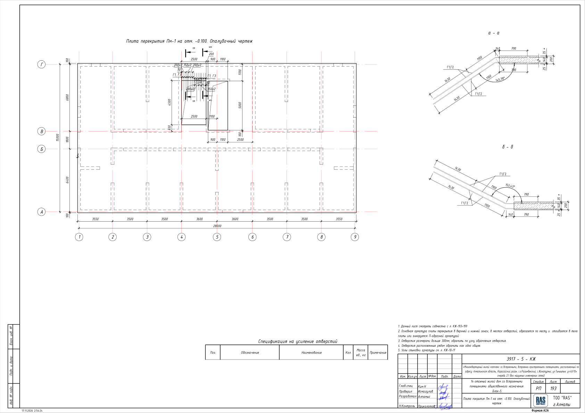
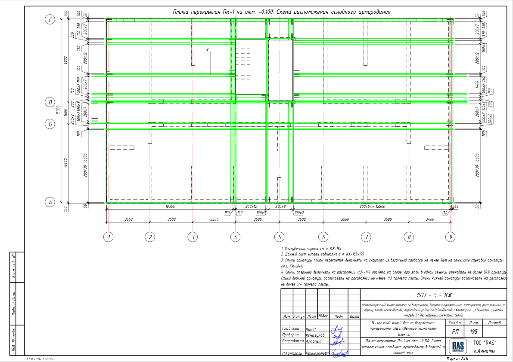
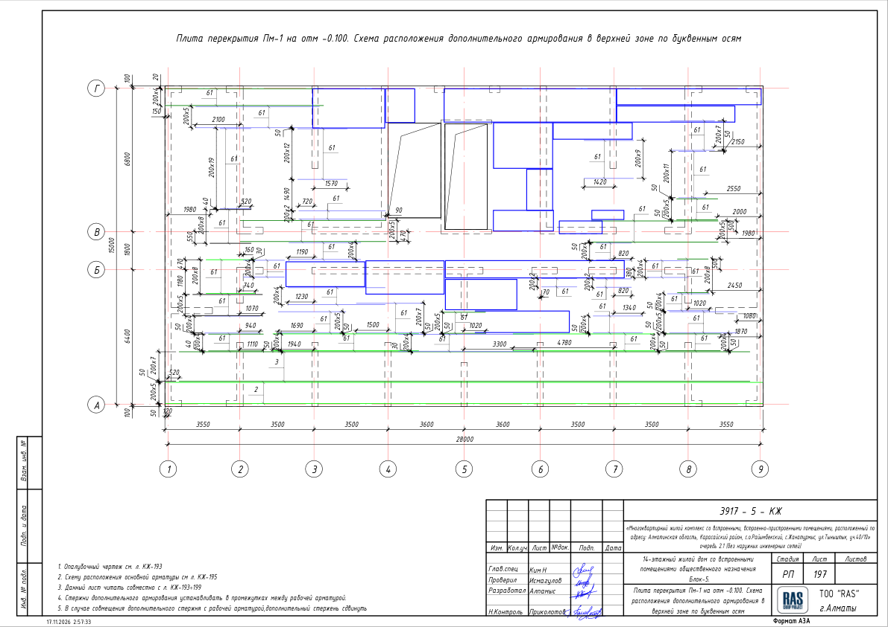
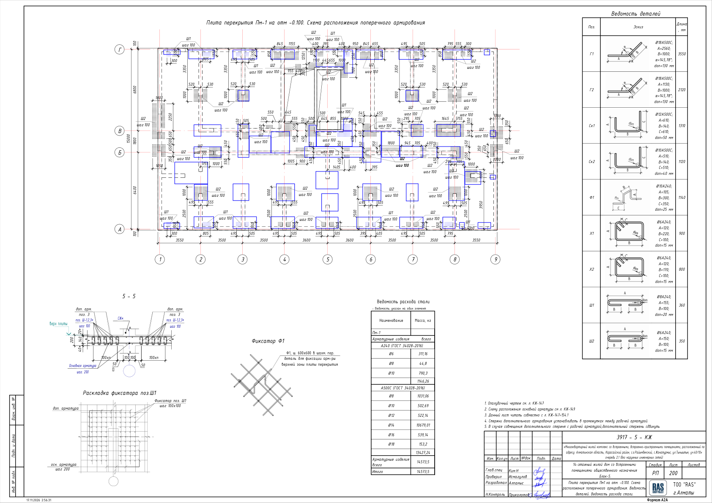

# 10. Плиталар Пм-1…Пм-12 — Омар S05 (толық талдау)

Источник: пайдаланушы 17.11.2026 — «Терең етіп оқы» (S05 моделінің фундаменттен басқа бөлігін де толық оқу), «полный қарап қалай бар солай қабылдап сақта ок».
Жазылған: 17.11.2026. Дерек: `out_S05\d04b_rebar.tsv` (Пм-* — 10 301 жиын жолы), `d05_hosts.tsv` (18 «Перекрытия»), `d01_overview.txt`, `d03_sheets.txt`, `S05\out\d06\d06_sheet_193…262.12`, `d08` кестелері, PDF л. 193–200, 254, 256, 259, 261, 262, 262.3, 262.8, 262.10. Скрипттер: `S05\an\agentB_*.py`. Суреттер: `S05\png\agentB\`. Аясы: тек BI жобалары.
Салыстыру негізі: `02` (4-бөлім), `03` (2, 5–8), `05`. Парапет, лестница, стена — басқа жазбаларда; фундамент — `08`.

## 0. Қысқаша

- 12 марка, 17 плита (Пм-8 — 08–14 қабат, 7 дана), барлығы t = 200. Арматура бір данада (Пм-8 — тек 08 қабатта).
- Тәсіл S03-пен **бірдей** (жеке `Rebar`, негізгі тор `пм`, `Гор`/`Верт` + `Ск2`, төрт доп тобы, `Попереч`, `Каркас`, Ф1 `Доп`). Нақты айырма (17.11.2026 екі модельдің шикі дерегімен тексерілді — 2.8-бөлім): шпилькада `BI_фильтр = Попереч` және Ø10 Ш1; `Доп`-та шпилька аймағының Ø8 `пм`; доп. ұзындығы 10 мм-ге дөңгелек. Пм-1 торы Ø14 пен каркасы Ø16, лестница выпускі Г (Ø18), Пм-10…12-нің `пм`-сіз торы — S03-те де дәл солай (айырма емес).
- Парақ: 9 (А2/А3); Пм-8 — 15 (опалубка әр отметкаға); Пм-10…12 — бір А2 (1:50 + Revit қимасы 1:25).
- Ең ірі қайшылық: парақ атауындағы отметкалар (Пм-4, 8…12) модельден ауытқиды; примечаниелер толық емес.

## 1. Түгендеу

### 1.1 Плиталар (d05 + 3ВМ кестесі)

| Марка | Отм. (модель) | Хост / деңгей | Бетон | V, м³ | Ескерту |
|---|---|---|---|---|---|
| Пм-1 | −0.100 | 2614399 / 01 | C25/30 | 81,78 | тип `…t=200 B30`; л. 193 «Плита **покрытия**» |
| Пм-2 | +4.100 | 5317103 / 02 | C25/30 | 80,96 | `…B30`; хостта `BI_марка_конструкции` бар (жалғыз) |
| Пм-3 | +7.100 | 4475013 / 03 | C25/30 | 81,07 | `…B30`; арматура хосты 04-тікі (1.3) |
| Пм-4 | +10.100 | 5643671 / 04 | C20/25 | 82,03 | арматура хосты 03-тікі; y 16 400 |
| Пм-5 | +13.100 | 5504903 / 05 | C20/25 | 82,00 | y 16 400 |
| Пм-6 | +16.100 | 5648198 / 06 | C20/25 | 81,07 | |
| Пм-7 | +19.100 | 5648323 / 07 | C20/25 | 82,00 | y 16 400 |
| Пм-8 | +22.100…+40.100 | 5648409…5648990 / 08–14 | C20/25 | 81,06 ×7 | сборка «Плита 129»; арматура тек 5648409-да |
| Пм-9 | Кровля +43.590 | 4480566 | C20/25 | 80,21 | еңісті: bbox z 42 940,7…43 290,7 |
| Пм-10 | +44.900 | 5585421 / Лифт плита | C20/25 | 2,59 | 2,4 × 5,4 м |
| Пм-11 | +45.700 | 6657797 / Лифт плита +800 | C20/25 | 3,84 | 2,9 × 7,0 м |
| Пм-12 | +47.300 | 5233608 / 101 Будка | C20/25 | 6,86 | 4,9 × 7,0 м |

04–14 және Пм-9…12 типі `(плита_перекрытия)железобетон_t=200` (класс атында жоқ).
- Габарит (01–14): x 150…28 450, y −100…15 100 → 28,3 × 15,2 м (04, 05, 07-де y 16 400-ге дейін — себебі анықталмады).
- Ойықтар (d06 опалубка видтері): лифт/лестница шахталары `(Элемент_узлов)Обозначение_проема_прямоугольный` — Пм-1-де 2 (2000×5000, 2500×4500), Пм-8-де 3, Пм-9-да 4 + «Проем для шахты»; Пм-8, Пм-9 опалубкасында 8 инженерлік ойық маркасы `Прямоугольный/Назначение_12`: «(ОВ)420x690», «(ОВ)420x680», «(ОВ)420x1360».
- `Марка` параметрі тек Пм-1, 2, 9, 10, 11, 12 хосттарында толтырылған; 03–14 қабат плиталарында бос.

### 1.2 Арматура жиындары (d04b, BI_фильтр бойынша: жиын / стержень)

| Марка | Верт | Гор | Доп | ДопНиз_X | ДопНиз_Y | ДопВерх_X | ДопВерх_Y | Каркас | Попереч | Барлығы |
|---|---|---|---|---|---|---|---|---|---|---|
| Пм-1 | 43/632 | 75/448 | 174/1615 | 30/211 | 53/360 | 36/239 | **1/20** | 46/354 | 494/3479 | 952/7358 |
| Пм-2…7 (диапазон) | 72–84 / 700–706 | 64–72 / 444–472 | 72–167 / 1132–1729 | 20–52 / 108–331 | 31–42 / 213–315 | 46–56 / 413–575 | 38–45 / 283–341 | 77–102 / 632–691 | 649–678 / 5281–5998 | 1120–1280 |
| Пм-8 | 72/700 | 64/444 | 163/1697 | 56/334 | 42/310 | 60/457 | 45/341 | 77/632 | 658/5878 | 1237/10 793 |
| Пм-9 | 68/932 | 76/480 | 150/1349 | 21/132 | 19/197 | 25/175 | 36/303 | 86/656 | 273/2331 | 754/6555 |
| Пм-10 | 8/52 | 8/112 | 4/32 | — | — | — | — | 5/34 | — | 25/230 |
| Пм-11 | 8/64 | 16/148 | 4/42 | 1/4 | — | — | — | 23/101 | — | 52/359 |
| Пм-12 | 4/100 | 8/144 | 8/88 | 2/10 | — | — | — | 13/62 | — | 35/404 |

- Барлығы `Rebar` («Число с интервалом» / «Один»); Пм-ге геометриясыз FamilyInstance жоқ (2.7).
- `Марка`, `Комментарии` бос; `BI_этаж` 5–13 % жолда −1,00, қалғаны бос. Әр марка бір модель тобында («Группа 25» — Пм-1, «Группа 40. Пм-8 Армирования», «Пм-4. Армирования» — Пм-3-тікі).

### 1.3 Хост сәйкессіздігі

Пм-3 арматурасының z 5 485…6 761 (03 қабат плитасы ішінде), бірақ хосты — 04 қабат плитасы 5643671; Пм-4 арматурасы z 8 485…9 761 (04 қабат), хосты — 03 қабат 4475013. Геометрия дұрыс, хост ауыстырылған (d04b `hostId`).

### 1.4 Парақтар (d03, g01)

Пм-1 193–201 (9: А2 ×2, А3 ×7); Пм-2 202–209 (8, спец. поперечное парағында); Пм-3 210–218 (9); Пм-4 219–226 (8, поперечное + ВД бір А1-де); Пм-5/6/7 227–235 / 236–244 / 245–253 (9-дан); Пм-8 254, 254.1…254.6, 255–262 (15: А2 ×10, А3 ×5); Пм-9 262.1–262.9 (9); Пм-10/11/12 262.10/.11/.12 (А2). Ортақ: 263 «Узлы усиления отверстий в плитах» (А3). Видсіз парақтар — тек кесте парақтары (201, 218, 235, 244, 253, 262, 262.9).

## 2. Арматура тәсілі

### 2.1 Негізгі тор (`Верт` = Y бойымен, `Гор` = X бойымен)

| | Пм-1 | Пм-8 (типтік) | Пм-9 (покрытие) | Пм-10…12 | S03 Пм-6 |
|---|---|---|---|---|---|
| Тип | `d=14_А500 пм` | `d=10_А500 пм` | `d=10_А500 пм` | `d=10_А500` (`пм`-сіз) | `d=10_А500 пм` |
| Поз. | 2 | 2 | **3** | 2 (Y), 3/4 (X) | 2 |
| Шаг | 200, жиілету 100/150 | 200 / 100 | 200 / 100 | 200 / 150 | 200 / 100 |
| L (мысал) | 28 460, 15 160, 14 260 | 28 460, 15 160, 10 610 | X 28 460; Y **7 581** (екі жарты, еңіс) | 5360, 2360, 6960, 4860 | 28 860, 15 160 |
| Жиын (негізгі) | 59 | 68 | 82 | 6–12 | 68 |
| Асты: ось табаннан | Y 47, X 61 | **Y 35, X 45** | еңіс бойымен | X 40, Y 50 | Y 35, X 45 |
| Үсті: ось беттен | X 27, Y 41 | **X 45, Y 55** | — | Y 25, X 35 | X 45, Y 55 |

- Пм-2…8 қабаттары S03-пен **дәл бірдей** (әрқайсысы тексерілді). Пм-1 (Ø14): үсті 20, асты 40 (ось − d/2) — 5-5 легендасындағы `20*`/`40*`-қа сай. Пм-10…12-де реті керісінше (үсте Y). Пм-9-да Y-стерженьдер еңіспен көлбеу.
- Жиын проёмда үзіледі, кей жиын «Один».

### 2.2 Шеткі П-шка `Ск2` (`(форма)21`, `BI_фильтр` негізгідей)

| | Ø | A = C | B | L | Ескерту |
|---|---|---|---|---|---|
| Пм-1 | 10 | 510 | 140 | 1119 (кесте 1120) | B30 Ø10 нахлёсты = 510 ✓ |
| Пм-2 | 8 | 410 | 140 | — | B30 Ø8 = 410 ✓ |
| Пм-3 | 8 | 490 | 140 | 1083 | **C25/30 бола тұра B25 мәні** |
| Пм-4 | 8 | 410 | 140 | — | **C20/25 бола тұра B30 мәні** |
| Пм-5…12 | 8 | 490 | 140 | 1083 (кесте 1080) | B25 Ø8 = 490 ✓ |

Ереже (модельден): Ск аяғы = бетон класына сай нахлёст ұзындығы (`02`, 3.1-кесте). S03 Пм-6-мен (Ø8, 490/140/490, L 1080) бірдей.

### 2.3 Доп. төрт топ (`(форма)1`, шаг 200, кәдімгі тип)

| | ДопНиз_X / Y | ДопВерх_X | ДопВерх_Y |
|---|---|---|---|
| Пм-8 Ø | 8…20 / 8…20 | 8…20 | 8…20 |
| Пм-8 L | 1230…6150 / 1550…4610 | 1230…10 080 | 1550…5320 |
| Пм-8 ось деңгейі | табаннан 35 | беттен 55 | беттен 35 |
| Пм-1 Ø, L | 8…16; 900…14 300 (+ `пм` Ø8, Ø12 L 27 880) | 8…14 (+ `пм` Ø12 27 000, Ø14 28 250) | тек Ø8 L 1380 (1 жиын) |
| Пм-1 деңгейі | табаннан 59 | беттен 35 | беттен 35 |
| Пм-9 | Ø8…14 + Ø8/Ø10 `пм` (Y) | Ø8…12 | Ø8…12 (+ `пм`) |

- Пм-8 деңгейлері S03-пен бірдей (35 / 55 / 35). Пм-1-дікі басқа (59 / 35 / 35).
- Доп-та **`пм` типті тұтас стерженьдер** де бар (Пм-1: X бойымен 27–28 м, поз. 2–4); кестеде п.м. жолына қосылады. S03-те де бар (S03 — 52 жиын, S05 — 25) — айырма емес.
- Ұзындық 10 мм-ге дөңгелек (1230, 1890, 2470…), S03-те 100 мм-ге (S03 доп. жиындарының 94 %-ы 100-ге еселі). Пайдаланушы шешімімен (17.11.2026, «S03 негіз болсын») BI жобасында — 100 мм-ге.

### 2.4 `BI_фильтр = Доп` (Ф1, шпилька аймағының Ø8, лестница выпускі)

- **Ф1** — Ø10 А240 `(форма)98_лягушка`, A 105 / B 300 / C 350, L 1140, шаг 600 (Пм-1: 64 жиын / 1129 дана; Пм-8: 60 / 1104). S03-пен бірдей.
- **Шпилька аймағының бойлық Ø8 `пм`** — Пм-1: 98 жиын / 458 дана, L 200…2900; Пм-8: 91 / 565, L 300…2000; шаг 200, екі деңгей (беттен 35, табаннан 54). Кестеде Пм-1 поз. 4, Пм-8 поз. 3 «п.м.»; 5-5 легендасында «доп. арм. поз. 3». Қызметі bbox-тан шығарылды: Пм-8-дегі 91 жиынның 89-ы шпилька жиынымен қиылысады (`agentB_d8.py`). S03-те жоқ дерлік (бүкіл модельде 5 жиын; S05-те 675) — S05 қосқан тәсіл, міндетті емес.
- **Лестница выпускі `Г`** — Ø18 А500С `(форма)15`: Пм-1 Г1/Г2 (A 2560/1130, B 1000, α 145,78°, шаг 350/400), Пм-8 Г1…Г4 (A 990/950, B 2550/1120, α 153,43°); Пм-1…8-де 28-ден, Пм-9…12-де жоқ. Парақта — ВД және опалубкадағы легенда «(Лестница)Пм Выпуски под лестницу вверх/вниз» (1:25). S03-те де дәл осылай (Пм-1…8, әр плитада 12 жиын Ø18 `(форма)15`, `BI_фильтр = Доп`).

### 2.5 Поперечное (`BI_фильтр = Попереч`, `(форма)шпилька`, шаг 100)

| | Ш1 | Ш2 | Ш3 |
|---|---|---|---|
| Пм-1 | Ø8 А240, L 356 (360), A 156/B 100 — 320 дана | Ø6 А240, L 352 (350) — 3159 | — |
| Пм-8 | **Ø10 А240**, L 370, A 170 — 253 | Ø8, L 360 — 584 | Ø6, L 350 — 5041 |
| Пм-9 | Ø8 — 136 | Ø6 — 2195 | — |

S03-пен айырма: `BI_фильтр = Попереч` (S03-те бос); Пм-2…8-де Ø10 Ш1; Пм-2-де Ø12 А240 (478) және А500 Ø14 «Ш» (52). Пм-10…12-де шпилька жоқ. Аймақ парақта көк контур (`BI_сплошная_синяя_4`).

### 2.6 Пространственные каркасы (`BI_фильтр = Каркас`)

| | Бойлық (поз. 1) | Хомут | П-шка |
|---|---|---|---|
| Пм-1 | Ø16 `пм`, 27 жиын × 2 дана, шаг 200/150, ось беттен 35 және 137 | Х1 Ø6 А240 120×220×100, L 896 (900), шаг 200; Х2 L 796 | Ск1 Ø12, A=C 610, L 1309 |
| Пм-8 | Ø14 `пм`, 44 жиын, ось 47 / 153 | Х1 ×492, Х2 ×38 | Ск1 Ø10, 610/140/610, L 1319 |
| Пм-9 | Ø14 `пм`, шаг 150 | Х1 Ø6 170×120×100, L 796 | Ск1 Ø10 |
| Пм-10…12 | Ø14 (Пм-10 `пм`-сіз), шаг 150 | Х1 130×170×100, L 816 | Ск1 Ø10 |

S03 (Ø14 `пм`, Х1/Х2 Ø6 шаг 200, П-шка Ø10) — Пм-8 бірдей, Пм-1-де Ø16 / Ø12 (S03-тің Пм-1-інде де бойлық Ø16 `пм`).

### 2.7 Ойық обрамлениесі

- Пм маркалы геометриясыз семейство **жоқ**. `(Стены)_СЖм-1_2СА обрамление  Пм-1` (сүзгі `BI_фильтр_арматуры = обрамление`) және `03_Задание_гильзы Пм-1` — 0 жол; л. 193-те бос «Спецификация на усиление отверстий» (PDF).
- Модельде марксыз, хостсыз `(арматура)прямой` (поз. 1), `Пшка` (поз. 3), `ф51` (Х1) — 448 дана, workset «Abilmansur», әр қабат деңгейінде. Позициялары «Узлы усиления отверстий в плитах»-қа ұқсас, бірақ тиесілігі **анықталмады**.
- Ойықта негізгі тор жай үзіледі, П-шка қойылмаған.

### 2.8 S03-пен салыстыру қорытындысы

- **S03-пен бірдей:** `пм` тұтас тор (поз. 2), қабат реті 35/45/45/55 (Пм-2…8), Ск2 Ø8 490/140, доп. 4 топ (`(форма)1`, шаг 200, деңгей 35/55/35), Ф1, каркас Ø14 `пм` + Х Ø6, вид баптауы, кесте жүйесі.
- **Айырма** (түзетілді 17.11.2026: екі модельдің шикі дерегі бір скриптпен қатар саналды — `S05\rv\an\w07_slab_compare.py`):
  - шпилькада `BI_фильтр = Попереч` (S03-те бос) және Ø10 Ш1 (S03-те тек Ø6 / Ø8);
  - `Доп`-та шпилька аймағының бойлық Ø8 `пм` стерженьдері (S05 — 675 жиын, S03 — 5);
  - доп. ұзындығы 10 мм-ге дөңгелек (S03 — 100 мм-ге);
  - Пм-9 поз. 3; обрамление Пм-ге берілмеген.
- **Айырма емес** (алғашқы нұсқада қате аталған — S05 дерегі S03-тің Пм-6 жазбасымен салыстырылған еді):
  - Пм-1 торы Ø14 `пм`, каркасы Ø16 `пм`, Ск Ø10 A 510 / B 140 — S03-тің Пм-1-і де дәл сондай (қабат деңгейлері салыстырылмады);
  - Пм-10…12 торы `пм`-сіз — S03-те де;
  - доп-тағы `пм` стерженьдер — S03-те де (52 жиын);
  - лестница выпускі Г Ø18 `(форма)15`, `BI_фильтр = Доп` — S03-те де (әр плитада 12 жиын).
- **Пайдаланушы шешімі (17.11.2026): «S03 негіз болсын»** — қайшы жерде S03 (`07`, 3-бөлім, 12–15): доп. ұзындығы 100 мм-ге дөңгелектенеді. Шпилька аймағының Ø8 `пм` стерженьдері S03-те жоқ — міндетті тәсіл емес (есеп не конструктив талап етсе қойылады). Шпилькаға `BI_фильтр = Попереч` қалады (`07`, 3-бөлім, 10 — менің түсіндірмем).

## 3. Парақ рецепті

### 3.1 Ортақ вид баптауы (барлық Пм)

- План: `EngineeringPlan`, тип `*06_Плиты`, 1:100 (Пм-10…12 — 1:50), шаблон `#03_Армирование плиты` (Coarse, Wireframe), опалубкаға `#02_Опалубка плиты` (Fine, HLR), vpType `загаловок_на_листе`. Параметрлер: `BI_группирование = ⏺ Плиты`, `BI_комментарии_к_виду = Плиты`, `BI_марка_конструкции = Плита Пм-N`. S03-пен бірдей.
- Фильтрлер: 14 `Арм_*` (көрсетілетін топтан басқасы жасырын) + `Пм-N_Армирование`, `Пм-N_Разрезы` (ереже `NOT(BI_марка_конструкции = Пм-N)`, жасырын) + `УБРАТЬ ВСЕ РАЗРЕЗЫ` (жасырын). Пм-1 видтерінде тек Пм-1…7 фильтрлері бар.
- Опалубка видтерінде барлық `Арм_*` көрінетін күйде, `Пм-8_…` фильтр 254.1–254.6, 262.1-де жоқ — арматура бәрібір көрінбейді (bars total = 0).
- Размер типтері: `BI_курсив_2.5 мм`, `BI_основной_2,5мм_округление_до_1/5/10мм`, `BI_поз.`; марка: `Позиция_7`, `Позиция_с засечкой_7`, `Позиция/Шаг_12` («Ш1 шаг 100», «Х1 шаг 200»).

### 3.2 Пм-1 жиынтығы (193–201)

| № | Формат | Видтер | Көрінетін топ / режим | Аннотация |
|---|---|---|---|---|
| 193 Опалубка | А2 | план 1:100 + легенда «(Лестница)Пм Выпуски под лестницу вверх 1 / вниз 1» (1:25, а-а, б-б) | — | ойық байлауы, «Г1, Г3»; бос кестелер «2СА обрамление Пм-1», «03_Задание_гильзы Пм-1» |
| 194 Каркасы | А3 | план | `Каркас` + `Хомуты и шпилька`; All / Middle, 279/354 жасырын | 15 марка «1», 16 «Х1/Х2 шаг 200», тізбек `200х65= 12800` |
| 195 Основное | А3 | план | `Верт` + `Гор`; FirstLast, 851/1080 жасырын | **бір** марка «2», 3 бос «??»; тізбек `BI_курсив_2.5 мм` (`200х64= 12800`, `{100х3}`) — MRA да, қима легендасы да жоқ |
| 196–199 Доп | А3 | план + растр сурет (`ниж х.jpeg` т.б.) | бір топ, FirstLast | MRA `шаг_количество` (тегсіз) + `Позиция_с засечкой_7`; 199-да 1 жиын, марка жоқ |
| 200 Поперечное + ВД + ВРС | А2 | план + легендалар «(Плита)Плиты Фиксатор», «(Плита)Плиты Пм-1 сечение поперечной арматуры» (1:20, «5-5»), «узел раскладка фиксатора» | `Попереч` + `Хомуты и шпилька`, All | 51 марка «Ш1/Ш2 шаг 100», 118 байлау размері; `_4ВД`, `_5ВРС` |
| 201 Спецификация | А3 | — | — | `_1СА` (екі баған), `_3ВМ(сборка)` |

5-5 легендасы (PDF л. 200): «верх плиты», `200`, `20*`/`140`/`40*`, «Основная арматура шаг. 200», «поз. Ш-1,2,3* шаг 100», «доп. арм. поз. 3», «СЖм», `100хn`, `50`.

### 3.3 Пм-8 — неге 15 парақ

Арматура бір рет сызылады (255–262: 8 парақ, атауы «… +21.200 ... +39.200»), ал опалубка әр қабатқа бөлек: 254 (+22.100), 254.1 (+25.100) … 254.6 (+40.100) — 7 парақ. 7 + 8 = 15. `05`-тегі «опалубка әр отметкаға бөлек» ережесі расталды.

| № | Видтер | Ерекшелік |
|---|---|---|
| 254 | план + выпуск легендалары «… +6.800 +» | 254.1…254.6-да тек план |
| 255 Каркасы (А3) | план + легенда «(Плита)_Сечение 1-1» (1:20: «Пространственный каркас», «поз. Х-1* шаг 200», `35*, 145, 20*`) | 39 MRA `поз.` + 34 «Х1/Х2 шаг 200» |
| 256 Основное (А2) | тек план | FirstLast 48 + All 88 (Ск); 31 MRA `поз.` («200х41=8200», «200х52=10400»); «Ск2» маркасы; қима легендасы жоқ |
| 257–260 Доп (А3) | план | FirstLast; MRA `поз.` 45/42/52/43; 259-да қызыл мәтін «2шт.» |
| 261 Поперечное (А2) | план (Medium) + Пм-1-дегі үш легенда (сол id) | 51 марка «Ш1/Ш2/Ш3 шаг 100» |
| 262 (А2) | — | `_1СА`, `_3ВМ`, `_4ВД`, `_5ВРС` (ВРС: «Ведомость указан на один элемент») |

### 3.4 Пм-9 (262.1–262.9)

Пм-8 құрылымы; вид атауы «Плита **покрытия** Пм-9 на отм. +43.400», парақ атауы «Плита **перекрытия** Пм9 на отм. +42.500». Еңіс салдарынан MRA мәндері бөлшек: `199,958х4=799,833`; 262.3-те `2005х2= 10400` (PDF расталды). 262.8-де фиксатор/қима легендасы жоқ.

### 3.5 Пм-10…12 (бір А2)

Опалубка + основное + каркас (+ Пм-11, 12-де «нижнее доп. по буквенным осям») 1:50, **нағыз Revit қимасы** «Пм-N. Разрез 1-1» (тип `*02_Плита_разрез`, 1:25, «All unobscured»: `20*, 145, 35*`, `200хn`), ВД, ВРС, 1СА + 3ВМ. Атаулар Пм-11, 12-де видтің өз атауы емес, `TextNote`-пен қолдан жазылған.

### 3.6 Примечаниелер (сөзбе-сөз)

- **193 (опалубка):** «1. Данный лист смотреть совместно с л. КЖ-193÷199 2. Основная арматура плиты перекрытия в верхней и нижней зонах, в местах отверстий, обрезается по месту и отгибается в тело плиты или анкеруется П-образной арматурой 3. Отверстия размерами больше 300мм, обрамить по узлу обрамления отверстия. 4. Отверстия расположенные рядом обрамить как одно общее. 5. Узлы стыковки арматуры см. л. КЖ-10÷11»
- **195 (основное):** «1. Опалубочный чертеж см. л. КЖ-193 2. Данный лист читать совместно с л. КЖ-193÷199 3. Стыки арматуры плиты перекрытия выполнять на скрутках из вязальной проволки не менее 3шт на стык.Узлы стыковки арматуры см.л. КЖ-10÷11 4. Стыки стержней выполнять на расстоянии 1/3--1/4 пролета от опоры, при этом в одном сечении стыковать не более 50% арматуры. Стыки верхней арматуры располагать на расстоянии не менее 1/3 пролета плиты. Стыки нижней арматуры располагать на расстоянии не более 1/4 пролета плиты.»
- **194, 196–199:** «1. Опалубочный чертеж см. л. КЖ-193 2. Схему расположения основной арматуры см л. КЖ-195 3. Данный лист читать совместно с л. КЖ-193÷199 4. Стержни дополнительного армирования устанавливать в промежутках между рабочей арматурой. 5. В случае совмещения дополнительного стержня с рабочей арматурой,дополнительный стержень сдвинуть»
- **200, 201:** сол мәтін, бірақ «л. КЖ-147», «л. КЖ-149», «л. КЖ-147÷154.1» (S05-те 147, 149 — СЖм-16 парақтары).
- **Пм-6 (238…244), Пм-7, Пм-8, Пм-9, Пм-10…12:** тек «1. Узлы стыковки арматуры см л. КЖ-9».
- **Пм-3, Пм-4, Пм-5:** примечание жоқ. Пм-2: «…см. л. КЖ- …» (нөмірсіз).

PDF-пен расталды (8 парақ): 193, 195, 197, 200, 256, 262, 262.3, 262.10 — атау видтің үстінде ортада; Ø14 ашық жасыл, Ø10 қара; шпилька аймағы көк контур; 3ВМ спецификация астында «Материалы» жолы.

## 4. Кестелер

### 4.1 Құрылымы (d08)

Шаблондар `*(спецификация)СА / ВМ(сборка) / ВД / ВРС / изделия_СА`.

| Кесте | Санат | Сүзгі | Сұрыптау / мазмұн |
|---|---|---|---|
| `(Плиты)_Пм-N_1СА` | Несущая арматура | `BI_марка_конструкции = Пм-N`, `BI_фильтр_арматуры ≠ обрамление` | `Р_Сорт`↓, `BI_марка_изделия`, `Р_Сортировка`↓, `BI_D`; п.м. жолдары алдымен |
| `_3ВМ(сборка)` | Сборки | `Комментарии = Пм-N`, `BI_марка_конструкции < 1` | «Материалы»: СТ РК EN 206-2017, Бетон, м³ |
| `_4ВД` | Несущая арматура | `BI_арматура_гнутая = 1` + марка | `RAS_префикс`, `BI_позиция`; эскиз, `О_размеры`, `Р_Длина` |
| `_5ВРС` | Несущая арматура | марка, `Модель ≠ Пустой элемент` | класс → Ø; «Ведомость указан на один элемент» |
| `(Плиты)_изделия_СА` | Несущая арматура | `BI_тип_элемента_КЖ` 2…4, `BeginsWith Пм` | 0 жол |
| `03_Задание_гильзы Пм-1` | Обобщенные модели | `Модель = Отверстие`, `Описание = гильза` | 0 жол |
Пм-1-дің қосымша кестелері: `_2СА_по группам`, `_Гильзы`, `_Разводка под освещение` (бос), `_1СА каркас` (аты «каркас», сүзгісі `обрамление`, бос), `_4ВД_IFC`, `_1СА-конструкция_(сборка)`.

### 4.2 Қорытынды (3ВМ, 5ВРС; аудан = V / 0,2)

| Марка | Бетон | V, м³ | Болат, кг | кг/м³ | кг/м² |
|---|---|---|---|---|---|
| Пм-1 | C25/30 | 81,78 | 14 573,5 | 178,2 | 35,6 |
| Пм-2 | C25/30 | 80,96 | 10 855,5 | 134,1 | 26,8 |
| Пм-3 | C25/30 | 81,07 | 12 673,8 | 156,3 | 31,3 |
| Пм-4 | C20/25 | 82,03 | 12 404,5 | 151,2 | 30,2 |
| Пм-5 | C20/25 | 82,00 | 13 183,7 | 160,8 | 32,2 |
| Пм-6 | C20/25 | 81,07 | 12 913,6 | 159,3 | 31,9 |
| Пм-7 | C20/25 | 82,00 | 13 029,6 | 158,9 | 31,8 |
| Пм-8 (бір қабат) | C20/25 | 81,06 | 12 926,5 | 159,5 | 31,9 |
| Пм-8 ×7 | | 567,4 | 90 485,8 | | |
| Пм-9 | C20/25 | 80,21 | 8 154,4 | 101,7 | 20,3 |
| Пм-10 | C20/25 | 2,59 | 259,3 | 100,1 | 20,0 |
| Пм-11 | C20/25 | 3,84 | 423,7 | 110,3 | 22,1 |
| Пм-12 | C20/25 | 6,86 | 622,2 | 90,7 | 18,1 |

Бос/0 кесте жоқ; d04b номинал салмағымен тексеріс (`agentB_len.py`): Пм-1 13 993,8 кг (+ нахлёст ≈ 571 кг = 14 565), Пм-8 12 718,2, Пм-10 259,0 — ВРС-пен сай.

### 4.3 «п.м.» жолындағы нахлёст

Тип параметрі `BI_длина_нахлеста_множитель`: Ø10 `пм` = 60, Ø14 `пм` = 64; `Округление нахлеста = 10` (d01).

| | Модель, м | Стык (11,7 м кесінді) | + k·d | Есеп | Кесте 1СА |
|---|---|---|---|---|---|
| Пм-8 Ø10 поз. 2 | 8 574,8 | 512 | × 0,60 | 8 882,0 | 8 897,4 |
| Пм-1 Ø14 (поз. 2 + доп `пм`) | 8 226,0 | 508 | × 0,90 | 8 683,2 | 8 698,0 |

Қалдық ≈ 15 м (0,2 %) — дөңгелектеу формуласынан (`Р_ДлинаОкругл-10мм`); дәл формуласы анықталмады. S03-тегі тәсілмен бірдей (стык саны × k·d).

## 5. Үлгідегі аяқталмаған не қайшы жерлер (ереже емес — көшірмеймін)

1. **Парақ атауындағы отметкалар**: Пм-4 «+10.700» (модель +10.100); Пм-8 «+21.200 … +39.200» (вид пен модель +22.100 … +40.100; 255-те «++21.200»); Пм-9 «+42.500» (вид +43.400, деңгей +43.590); Пм-10 «+44.000» (+44.900); Пм-11 «+44.800» (+45.700); Пм-12 «+46.400» (+47.300).
2. «Плита покрытия Пм-1» (193) / «Плита перекрытия Пм9» (262.x) — атау керісінше.
3. Пм-3 ↔ Пм-4 арматурасының хосты ауыстырылған; Ск аяғы Пм-3-те B25, Пм-4-те B30 мәнімен — бетон класына қайшы.
4. Примечание сілтемелері: «КЖ-9», «КЖ-10÷11» — S05-те «Узлы стыковки» парақтары 11 (B30) және 11.1 (B25); «КЖ-147, 149» (200, 201) — СЖм-16 парақтары; Пм-2-де «КЖ-» бос; Пм-3…5-те примечание жоқ.
5. Пм-1 позициялары: 1СА-да 12 жолда поз. 61 қайталанады, 15 жолда позиция бос (бір жолға әртүрлі позиция бірігеді); Пм-8 таза (1…59).
6. Пм-1 основное (195): бір позиция маркасы, 3 бос «??» марка, MRA жоқ; доп парақтарында MRA `шаг_количество` (басқа плиталарда `поз.`); 199-да 1 жиын, марка жоқ.
7. Пм-3 доп парақтары 213–216 және Пм-2 206: марка да, MRA да жоқ (0).
8. Қима легендалары көшірме атымен: «(Плита)_Пм-1 Сечение 1-1/2-2» Пм-3, 4, 6, 7-де; «Сечение 2-2111», «Сеченеи 4-4 4», «Фиксатор копия 1», «Выпуски … +6.800 +» (Пм-3…8); Пм-8 256, Пм-9 262.3, Пм-1 195-те негізгі тор қимасы жоқ. 5-5 легендасындағы «доп. арм. поз. 3» Пм-1-де поз. 4-ке сай келмейді.
9. Обрамление: `2СА обрамление Пм-1`, `03_Задание_гильзы Пм-1` бос, басқа Пм-ге мұндай кесте жоқ; 448 «пустой» семейство марксыз.
10. `BI_этаж`: плитада −1 (03 қабатта 3), арматурада бос — «BI_этажу назначается номер нижнего уровня от плиты» кестесі толтырылмаған.
11. Кесте атаулары: `(Плиты)_Пм-1_1СА каркас` сүзгісі `обрамление`; `(Плиты)_Пм-3_3ВМ(сборка) копия 1` сүзгісі Пм-2.
12. Пм-9 MRA мәндері еңістен бөлшек, 262.3-те `2005х2= 10400` (3.4).

## 6. Сұрақтар (анықталмады)

1. 04, 05, 07 қабат плиталарының y 16 400 шығыңқысы не (балкон ба, модель қатесі ме)?
2. 448 марксыз `прямой / Пшка / ф51` — плита ойығының обрамлениесі ме, стенанікі ме?
3. Пм-9 еңісінің бағыты (жотасы ортада ма, шетте ме) — тек bbox бойынша 150 мм құлау анықталды.
4. Пм-1 доп/поперечное парақтарындағы растр суреттердің (`ниж х.jpeg`, `поп.jpeg` т.б.) мазмұны.
5. «п.м.» кестесіндегі 15 м қалдықтың дәл формуласы.

Файлдар: скрипттер `S05\an\agentB_*.py` (11), суреттер `S05\png\agentB\S05_<N>_ov.png` (16).

## 7. Суреттер

