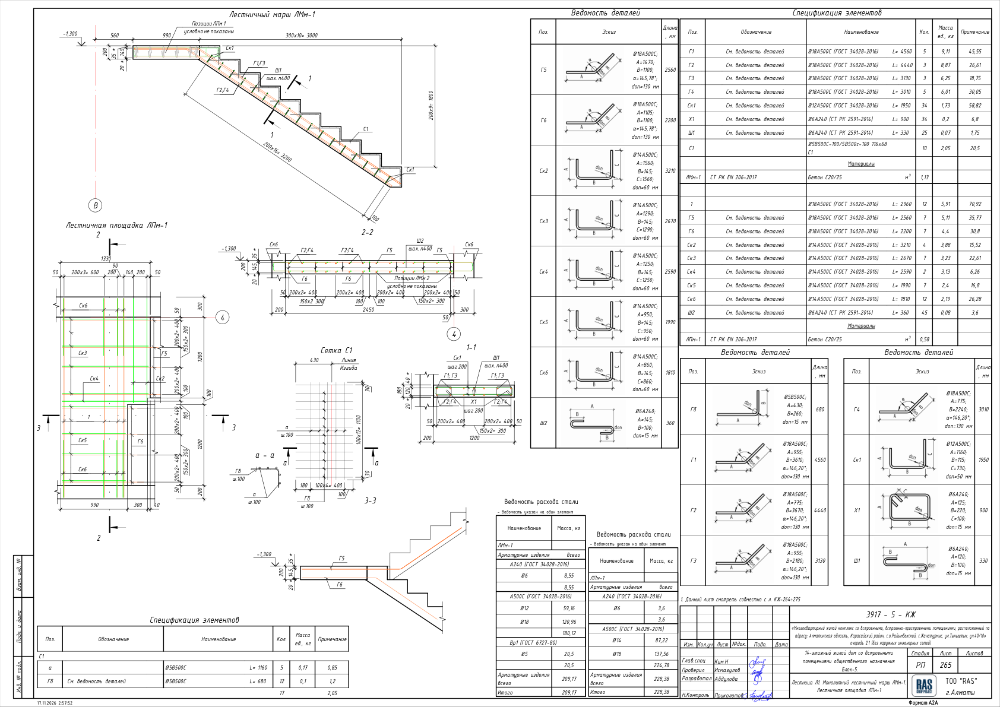
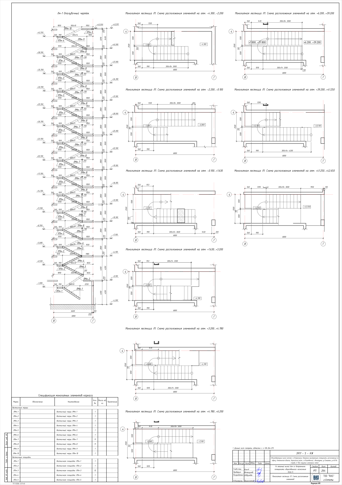
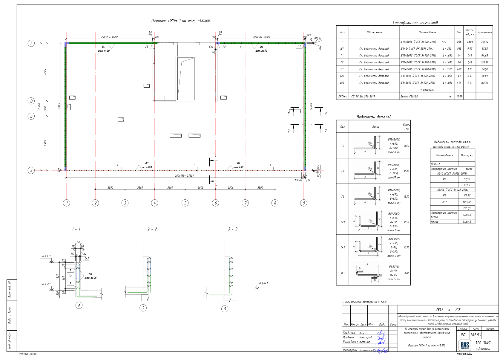

# 11. Лестница, парапет, балка, колонна, қызметтік парақтар — Омар S05 (толық талдау)

Источник: пайдаланушы 17.11.2026 — «Терең етіп оқы» (S05 моделінің фундаменттен басқа бөлігін де толық оқу), «полный қарап қалай бар солай қабылдап сақта ок».
Жазылған: 17.11.2026.
Дерек: `3917_OMAR_01_02_S05_KJ01_01_M3` (ЖК «Омар», 2 очередь, Блок-5, 14 қабат, Revit 2026, ТОО «RAS»). Дамптар: `BI_Group\out_S05\d04b_rebar.tsv`, `d05_hosts.tsv`, `d01_overview.txt`, `d02_view_templates.txt`; `Erzhan\S05\out\d06\d06_sheet_*.txt` (41 парақ), `out\d08\d08_sched_*.tsv` (кестелер), `g01_album.txt`; PDF: 264, 265, 268, 275, 191, 192, 276, 167, 262.9.1, П1 (10 парақ көзбен қаралды, суреттер `png\agentC\`). Скрипттер `an\agentC_*.py`.
Аясы: тек BI жобалары. S03 нәтижесі (`07`, 5-бөлім) — тек тізім деңгейінде болған, мұнда толық сипат.
Координата: ішкі z = отметка − 300 мм (парақ 264/262.9.1 отметкаларымен тексерілді: ЛПм-1 үсті z −1600 → «−1,300»; парапет үсті z 44110,7 → «+44,411»).

## 0. Қысқа қорытынды (ең бастысы)

| Конструкция | Моделде бар ма | Парақ | Күйі |
|---|---|---|---|
| ЛМм-1…10 (марштар), ЛПм-1…5 (площадкалар) | Иә: 46 хост (30 марш + 16 площадка), арматура 15 хостта | 264, 265…275 | Толық, арматурасы, кестесі, парағы бар. 267-парақ жоқ |
| ПРПм-1…3 (парапет) | Иә, **Wall** хосттарында (бөлек парапет типі жоқ); арматура бар | 262.9.1, 262.10.1, 262.11.1 | ПРПм-1, 2 — толық; ПРПм-3 парағы **бос** |
| Бм-1, Бм-2 (балка) | **Жоқ**: балка хосты да, арматурасы да жоқ; тек Бм-2-де 20 шайба (ШБ1) | 167, 168 | Парақтар бос үлгі (А3) |
| Км-1 (колонна) | **Жоқ**: «Колонны» санатында тек венткороб пен уголок-закладная | парағы жоқ | Тек шаблоннан қалған кестелер (бос) |
| Прм-1 (перемычка) | **Жоқ**: арматурасы/хосты жоқ | 192 | Парақ бос, видтері басқа марканың арматурасын көрсетеді |
| «Бм-N» сборкалар | Лестница хосттарының сборка атаулары, балка емес | — | Тілдік қателік: «Бм-6…Бм-68» = 46 сборка (17 тип) |
| ОРС01…13, А1, Л1, П1, 000 | Қызметтік/бақылау парақтары | — | 5-бөлімде |
| 263, 191, 276…281 | Легенда-парақтар (узел/кладка), модельсіз | — | 6-бөлімде |

## 1. Лестница Л1 (ЛМм-1…10, ЛПм-1…5)

### 1.1. Модельдеу
- Хост: категория **«Каркас несущий»** (FamilyInstance), типтері **«Лестницы 1»** (марш, 30 дана) және **«Лестницы 2»** (площадка, 16 дана). Бәрі — 46 (`d01_overview`: «46 Каркас несущий FamilyInstance»). Бетон ЛМм/ЛПм = `Бетон C20/25` (3ВМ кестесі).
- Әр хост **Assembly**-де: сборка типінің аты `Бм-6, Бм-8, Бм-9, Бм-14, Бм-19, Бм-28, Бм-45, Бм-59, Бм-60 (×11), Бм-62, Бм-63, Бм-64, Бм-65, Бм-66, Бм-67 (×9), Бм-68 (×12), Бм-7` — 46 сборка, 17 тип (`ASSEMBLIES BY TYPE NAME`). Бұл балка емес: тип аты «Бм-» болып аталған, ал нақты марка **сборканың «Комментарии» параметрінде** (`ЛМм-1.`, `ЛПм-1.` — парақ 264 «Марки сборок {Комментарии}» 46 дана). 3ВМ/1СА(сборка) кестелері де `Комментарии = <марка>` бойынша сүзеді.
- Хост параметрлері: `BI_главный_элемент` (Да/Нет), `BI_этаж = −1,00` — **барлық 46 хостта** (14-қабаттағы да). `Марка` және `BI_марка_конструкции` хостта бос.
- Геометрия (бір қабаттағы повторы, `d05_hosts` bbox):
  - Лестницы 1 (марш): ені 1200; ұзындығы 3000…3602 (у); биіктігі z 1600…2300. Екі қатар: x 12000…13200 («оң» марштар) және x 10700…11900 («сол» марштар) — екі маршты баспалдақ, аралық площадка 2500 × 1290…1630 × 200 (Лестницы 2, x 10700…13200).
  - Лестницы 2 (площадка): қалыңдық 200; 2500 × 1290…1630 (стандарт 1410); ЛПм-5: 2700 × 2050 (x 10700…13400, y 13050…15100, z 43050…43250).
  - Типті қабат (қадам 3000): Бм-67 (ЛМм-7 көшірмесі, x 12000…13200, h 1800) және Бм-60 (ЛМм-8 көшірмесі, x 10700…11900, h 1600) кезектеседі; Бм-68 — ЛПм-3 көшірмесі (2500 × 1410 × 200).
- Қайталану (парақ П1 «Количество конструкции» және `01_КЖ_(*Общие)_Вся конструкция_(сборка)`): ЛМм-1…6, 9, 10 — 1 дана; **ЛМм-7 — 11, ЛМм-8 — 11**; ЛПм-1, 2, 4, 5 — 1; **ЛПм-3 — 12**. Хост санымен сәйкес: ЛМм-7 = Бм-64 + Бм-65 + 9×Бм-67; ЛМм-8 = 11×Бм-60; ЛПм-3 = 12×Бм-68. Жиыны 30 марш + 16 площадка = 46.
- Арматура **тек бірінші данада** модельденген: 15 хост (ЛМм-1…10 + ЛПм-1…5 бастапқы хосттары). Қайталанған 31 хостта (Бм-60/65/67/68 көшірмелері) стержень жоқ — арматура санын кестелер «Количество конструкции» арқылы көбейтеді. Арматуралы жиын саны: ЛМм-1…10 = 71, 77, 83, 77, 77, 71, 77, 71, 95, 69; ЛПм-1…5 = 20, 24, 22, 20, 26 (`d04b`, `BI_марка_конструкции`).
- Біреуінің сыртында жатқан жиындар (қайшы, 1.7-бөлім): бір марштың «Г» стержендері көрші площадка хостына байланған (мыс. хост 5734943 = ЛПм-1 площадкасы: ЛПм-1 ×20 + ЛМм-2 ×5 + ЛМм-1 ×4), `Пм-1` маркасы бар 1 жиын ЛМм-2 хостында, `ЛМм-9` ×1 ЛМм-7 хостында, ЛМм-10-ның 2, ЛМм-2-нің 1, ЛПм-5-тің 3 жиыны `Перекрытия`/2 жиыны `Стены` хостында.
- Қайталанатын арматура **группа моделіне** жиналған: `ЛМм-N. общ арм`, `ЛПм-N. общ арм` (10 + 5 топ), және С1 каркасы үшін `С1. ЛМм-N` / `С1 для ЛМм-N` / `C1 для ЛМм-3` (әр бір топ = 6 стержень, марштағы қадам санына тең: ЛМм-1…10 үшін 10, 11, 12, 11, 11, 10, 11, 10, 14, 10 топ).

### 1.2. Арматура құрамы (`d04b`, қалай модельденген)
Диаметр/шаг/ұзындық — осы объектінің есебінен; позиция ережесі (бөлек) — төменде.

**Марш (ЛМм-1…9), типті құрам:**

| Не | Тип | Форма | RAS_префикс | Раскладка | Ұзындық |
|---|---|---|---|---|---|
| Негізгі ұзына арқа | `d=18_А500` | `(форма)15` (v-образный) | `Г` (поз. 1…4; ЛМм-9: 1, 2, 5, 6) | «Число с интервалом» 3…5 дана, шаг 400 | 3008…5650 |
| Қосымша П-скоба | `d=12_А500` | `(форма)21` (пшка) | `Ск` (Ск1) | 16…23 дана, шаг 200; 2 жиын (екі жағы) | 1954 (ЛМм-4, 6, 8: 2004) |
| Хомут | `d=6_А240` | `(форма)хомут` | `Х` | сол шаг 200, 2 жиын | 892…898 |
| Шпилька | `d=6_А240` | `(форма)шпилька S` | `Ш` | шаг 400, 8…12 дана, 2–3 жиын | 332 |
| Жалпақ каркас С1 | `d=5_BР500 каркас` | `(форма)1` (поз. `а`) + `(форма)11 3` (поз. `Гб`) | — (`BI_марка_изделия = С1`, `BI_фильтр = Каркас`) | `а`: 1 дана ×(50…70 жиын); `Гб`: 12 дана, шаг 100 | а = 1160; Гб = 681/725/748 |

- **ЛМм-10** (жоғарғы марш) өзгеше: Г-орнына 2 стержень `d=18_А500`, форма `26_угол_больше_90` («z-об_+90»), поз. 1 және 2, L = 6665 (шамасымен 6670), 7 дана шаг 200; префикс жоқ; хост санаты `Перекрытия` — бұл марш плитасына ұласады.
- Хомут/шпилька/Ск жиындары BI_фильтр-сіз (бос); тек С1 каркасында `BI_фильтр = Каркас`. Яғни бұл жерде `Верт/Гор/Доп` қолданылмайды; вид сүзгісі марка бойынша (`ЛМм-N_Армирование`).
- `BI_этаж` жиындарда −1, 1, 2 (ЛМм-1, 2, 10: −1; ЛМм-3, 5, 7, 9: 1, ал каркас бөлігі 2 — қосарлы; ЛМм-4, 6, 8: 2). Группа атаулары араласқан: ЛМм-3-тің жиындары группа «ЛМм-4. общ арм»-да.

**Площадка (ЛПм-1…5):**

| Позиция | Тип/форма | Префикс | Раскладка | Ұзындық |
|---|---|---|---|---|
| 1 | `d=18_А500`, `(форма)1` | — | 6 дана шаг 200, 2 жиын (12 дана) | 2960 (ЛПм-4: 2860) |
| Г5, Г6 (ЛПм-4: Г7, Г8) | `d=18_А500`, `(форма)15` | Г | 7 дана шаг 200 | 2198…2895 (ЛПм-5: Г5 = 3370) |
| Ск2…Ск7 | `d=14_А500`, `(форма)21` | Ск | 1…7 дана шаг 200, ұзындығы 1805…3265 | |
| Ш2 | `d=6_А240`, `(форма)шпилька S` | Ш | шаг 400, 3 немесе 4 жиын | 355/356 |
| ЛПм-5-те қосымша | `Х2`, `Х3` хомут (`d=6_А240`, 912/712), поз. 3, 4 (`d=18_А500` пм-сыз, 2860/2370) | | шаг 200/100 | |

Позиция нөмірі марштан кейін жалғасады: ЛПм-1-де Г5, Г6, Ск2…Ск6, Ш2 (Г1…4, Ск1, Х1, Ш1 — марштікі).

**Масса (кесте 5ВРС = модельдегі бір данаға):** ЛМм-1…10 = 209,17; 223,44; 223,69; 222,70; 204,73; 196,84; 206,83; 196,28; 259,45; 270,46 кг. ЛПм-1…5 = 228,38; 253,88; 232,78; 225,30; 373,71 кг. Скрипт есебі (`agentC_stair.py`, масса жолына × ұзындық) 0,4 % айырмамен сәйкес (ЛМм-1: 210,1 ↔ 209,17).
Бетон (3ВМ): ЛМм-1…10 = 1,13; 1,16; 1,19; 1,07; 1,09; 0,97; 1,11; 0,97; 1,38; 0,97 м³; ЛПм-1…5 = 0,58; 0,65; 0,61; 0,57; 1,06 м³.
Қайталанумен жиыны (көбейту мен есепте, кестеде жоқ): марштар 30 дана ≈ 6245 кг, 31,8 м³; площадкалар 16 дана ≈ 3875 кг, 10,2 м³ (скрипт есебі, көбейту: ЛМм-7/8 ×11, ЛПм-3 ×12).

### 1.3. Парақ рецепті (265…275; А2, альбомдық, масштаб 1:25)
Мысал: 265 (ЛМм-1 + ЛПм-1), 268, 275 PDF-тен қаралды.
- Рамка `(основная_надпись):Форма 3`, формат А2 (Высота 420, көлемі 594 × 420), БОКОВОЙ штамп. Парақ параметрлері: `BI_штамп_имя_листа_пользовательское = 07.Плиты`, `BI_штамп_раздел_проекта = КЖ`, фамилиялар Мурашкин/Абдулова.
- **Примечание (сөзбе-сөз, PDF-те):** «1. Данный лист смотреть совместно с л. КЖ-264÷275» (барлық стена-парақтарында бөлек; `BI_примечание_расширенное`).
- Видтер (шаблон `#03_Армирование лестницы`, Section, `*07_Лестница_разрез`, деталь Coarse, HLR, `vpType = загаловок_на_листе`):
  1. негізгі разрез «ЛМм-N» (марш бойынша) — 1:25 (268, 270, 274: **1:27**); 
  2. площадка разрезі «ЛПм-N» (мысалы 265: «ЛПм-1», кесу жазықтығы көлденең, 1:25) — `BI_марка_конструкции` марштікі;
  3. қималар «1-1», «2-2», «3-3», «4-4» (`vpType = сечение_номер_вида` не `загаловок_на_листе`) 1:25;
  4. легенда `(Лестница)_С1` (1:20, шаблонсыз, Medium) — «Сетка С1»: сурет + `а — а`, `Гб ш.100`, «Линия изгиба», қима 3-3. Әр парақта сол легенда (id 4591922); 
  Парақтағы видтер саны: 265 — 5 (4 қима + легенда), 266 — 3, 268 — 6, 269 — 3, 270 — 5, 271 — 3, 272 — 3, 273 — 3, 274 — 6, 275 — 6.
- Сүзгілер (шаблонда 28): `УБРАТЬ ВСЕ РАЗРЕЗЫ`, `ЛМм_Армирование` (NOT BI_марка_конструкции BeginsWith «Л»), әр марка үшін `ЛМм-N_Армирование`, `ЛМм-N_Разрезы`, `ЛПм-N_Армирование` (N = 1…6; ЛПм-7 жоқ). Көрінетін марканы сүзгі тек «NOT = марка» тәсілімен қалдырады: мысалы ЛМм-1 видінде `ЛМм_Армирование` және `ЛМм-1_Разрезы` visible=False (басқа марка жасырылады). Көрінетін сүзгі саны: 35…38.
- Арматура көрінісі: негізгі вид — «All unobscured» (мысал: ЛМм-1 вид 84 жиын, 331 стержень); площадка разрезінде **«Select unobscured» (8 жиын) + «All unobscured» (4)**, `hiddenInView = 20` (площадка видінде марштың бөлігі жасырылған). Қималарда — «All unobscured».
- Марка типтері (барлық 10 парақта): `Позиция_7` (160), `Позиция_(_)_7` («Г1;» түрі, 76), `Позиция_с засечкой_7` (56), `Позиция/Шаг_12` («Х1 шаг 200», 20), `Позиция/Шаг*Шаг_15` («Ш1 шах. п400», 30), `BI_марка_изделия` (семейство `(марка)арматурная_сетка`, 10) — С1 маркасы. `leader: Free`, орыс. Горизонталь.
- Размер типтері: `BI_основной_2,5мм_округление_до_1мм` (127), `…до_5мм` (74), `…до_10мм` (11), `BI_курсив_2.5 мм` (22, 20*/35* — жұлдызшалы), `BI_поз.` (40) + `_BI_поз` (39), `MultiReferenceAnnotation «поз.»` (40) — шаг тізбегі (мысал «200х3=600»). Шаг жазуы «200х16= 3200» түрінде.
- Басқа аннотация: `(типовые_аннотации)линия_обрыва` (99), `Высотные отметки {BI_стрелка_проектная_вверх}` (35, мысал «−1,300»), `Разрез 2` (`(типовая_аннотация)разрез_условный3`, 10), `(Оформление) Выноска1:Без указателя` — жазулар (сөзбе-сөз): «Позиции ЛПм 1 / условно не показаны», «Позиции ЛМм 2 / …», «Армирование плиты / условно не показаны» (268-те), «Линия / Изгиба» (легенда), «Гб / ш.100», «а / ш.100». `FilledRegion (цветовая_область)песок` (бетон/құм штрихы).
- Кестелер (парақ 265, `Графика спецификации` — 10): `(ЛестнМарш)_ЛМм-1_2СА-`, `(ЛестнМарш)_ЛМм-1_3ВМ(сборка)`, `(Лестница)2СА на каркас_ЛМм-1`, `(Лестница)4ВД_ЛМм-1`, `(ЛестнМарш)_ЛМм-1_5ВРС`; площадка үшін `(Лестница)2СА_ЛПм-1`, `(Лестница)3ВМ весь элемент_ЛПм-1`, `(Лестница)4ВД_ЛПм-1`, `(ЛестнПл)_ЛПм-1_5ВРС`. Орналасуы: оң жақта «Спецификация элементов» (2 кесте, жоғары-төмен), «Ведомость деталей» (4 дана: Г5/Г6/Ск2…Ш2 және Гб/Г1…Ш1), «Ведомость расхода стали» 2 дана (марш пен площадка), төменде «Спецификация элементов» (С1: а, Гб).
- Парақта С1 каркасы 5ВРС жолында `Вр1 (ГОСТ 6727-80) Ø5` көрсетілген (кесте), ал каркас типі моделде `d=5_BР500 каркас` — «В500С» (кестеде «Ø5B500С-100/5В500с-100 116х68»).

### 1.4. Парақ 264 «Монолитная лестница Л1. Схема расположения элементов» (А1, книжный, қаралды)
- Видтер: «Лм-1 Опалубочный чертёж.» (1:100; шаблон `#02_Опалубка лестницы`, деталь Medium, 63 сборка, 46 «Каркас несущий» көрінеді; `BI_марка_конструкции = Лм-1` (басқа жазылу: «Лм-1» — ЛМм емес)), 9 план/разрез (`Разрез 19, 23, 26, 27, 82, 98, 5, 4, 6` — 1:50, `Лм-1`, `BI_назначение_вида = Армирование` — атауы «Схема расположения элементов на отм. −4.300…−2.200; −2.200…−0.100; −0.100…+1.630; +1.630…+3.200; +3.200…+4.780; +4.780…+6.200; +6.200…+39.200; +39.200…+41.250; +41.250…+42.650»).
- Аннотация: 46 `Марки сборок {Комментарии}` («ЛМм-1.», …), 45 `Высотные отметки`, размерлер `BI_основной_2,5мм…`, `BI_курсив_2.5 мм` (`300х11` түрі), `Обозначение проема` (5150 × 1900).
- Кесте: `01_КЖ_(*Общие)_Вся конструкция_(сборка) копия 1` — «Спецификация монолитных элементов каркаса» (Лестничные марши / Лестничные площадки; Кол-во: ЛМм-7 — 11, ЛМм-8 — 11, ЛПм-3 — 12). Бағандар «Обозначение», «Масса ед., кг», «Примечание» **бос**.
- Отметкалар (PDF): оң қатар −4.300, −0.100, +4.100, +7.100 … +40.100, +43.550/+43.591; сол қатар площадка деңгейлері −1.300, +2.530, +5.680, +8.700 … +38.700, +42.150.
- Примечание (сөзбе-сөз): «1. Данный лист смотреть совместно с л. КЖ-264-275».

### 1.5. Кестелер (лестница)
Шаблон тізімі (`tpl`): `*(спецификация)СА` (2СА), `*(спецификация)каркас_СА` («на каркас»), `*(спецификация)ВМ весь элемент` / `ВМ(сборка)` (3ВМ), `*(спецификация)ВД` (4ВД), `*(спецификация)ВРС` (5ВРС), `*(спецификация)СА-конструкция_(сборка)` (1СА, сборка санатында).
- `2СА`: категория «Несущая арматура»; сүзгі `BI_марка_конструкции = <ЛМм-N>`, `BI_фильтр_арматуры ≠ обрамление`, `≠ ниша`; ЛПм үшін қосымша `BI_марка_изделия ≠ С1`; сұрыптау `BI_марка_конструкции`, `BI_марка_изделия`, `Р_Сортировка`. Өріс: `BI_марка_изделия/RAS_префикс/BI_позиция/`, `О_Обозначение`, `BI_примечание`, `Ø…BI_наименование…`, `О_Длина`, `О_Количество`, `О_МассаЕдиницы`, `О_МассаВсего` (құрамдас «Наименование»: «Ø18А500С (ГОСТ 34028-2016) L= 4560»).
- `2СА на каркас`: `BI_марка_изделия Contains 'С'` — тек С1 (жолдар: С1, а — L 1160, 5 дана; Гб — 680, 12 дана; жиыны 17 дана 2,05 кг).
- `4ВД`: `BI_арматура_гнутая = 1`; өрістер «Эскиз» (Форма_15, Форма_21, Форма_51 хомут, Форма_11, шпилька суреті), `О_размеры` («Ø18А500С; A=955; B=3610; α=146,20°; dоп=130 мм»), `Р_Длина`.
- `5ВРС`: сүзгі `BI_марка_конструкции = <марка>`, `Модель ≠ Пустой элемент`; топтау `О_Группа` → `О_Подгруппа`; «Ведомость расхода стали — Ведомость указан на один элемент»; Итого (ЛМм-1): А240 Ø6 8,55; А500С Ø12 59,16, Ø18 120,96; Вр1 Ø5 20,5 → 209,17 кг.
- `3ВМ(сборка)`: `Р_Марка = ЛМм-1` (ЛМм-1 үшін) не `Комментарии = <марка>` + `BI_марка_конструкции < '1'`. Мәтіні: «ЛМм-1 | СТ РК EN 206-2017 | Бетон C20/25 | м³ | 1,13».
- Жобада қолданылатыны: бекітілген 10 марш × (2СА, 3ВМ, 4ВД, 5ВРС, «на каркас») + 5 площадка × (2СА, 3ВМ, 4ВД, 5ВРС) — бұлар 265…275 парақтарында.
- **Шаблоннан қалған / қолданылмайтын:** `ЛМм-11`, `ЛМм-12` (2СА, 3ВМ, 5ВРС, на каркас, 4ВД — 15 кесте, ішінде жолдар жоқ), `ЛПм-6`, `ЛПм-7` (5ВРС, 2СА, 3ВМ, 4ВД — жолдары жоқ), `ЛМм-44_*` (4 кесте; ЛМм-4-тің көшірмесі, мазмұны бар, парақта жоқ), `(Лестница)2СА_ЛМм-88`, 1СА-конструкция_(сборка) ЛМм-1/ЛПм-1 (парақта жоқ). Барлығы 99 лестничная кесте (`Лестн|ЛМм|ЛПм` атауы).
- Кесте атаулары мен сүзгісі **бір санға ығысқан** (атау ≠ сүзгі, нәтиже дұрыс): 269 парағы (ЛМм-4) `(ЛестнМарш)_ЛМм-5_3ВМ(сборка)` қояды (сүзгі `Комментарии = ЛМм-4`, 1,07 м³); 270 (ЛМм-5) — `_ЛМм-6_3ВМ` (сүзгі ЛМм-5); 271 (ЛМм-6) — `_ЛМм-7_3ВМ`; 272 (ЛМм-7) — `_ЛМм-8_3ВМ`; 273 (ЛМм-8) — «копия 1» кестелері (`ЛМм-7_2СА копия 1` сүзгі `ЛМм-8`, `ЛМм-8_3ВМ копия 1`); 275 (ЛМм-10) — бәрі «копия 1».
- ОРС10 («Арматура.Лестницы.Общий»): 231,26 кг ғана (тек С1 каркасы, Ø бағандар 0) — марштар арматурасының 3 ‑4 есе аз бөлігі (1.7-бөлім).

## 2. Парапеттер (ПРПм-1…3)

### 2.1. Модельдеу
- Бөлек «парапет» типі де, сборкасы да жоқ: парапет — **Wall** хосты (стена `t=150`/`t=200`), арматура `BI_марка_конструкции = ПРПм-N`. Хост `Марка`/`BI_марка_конструкции` бос (`d05`).
  - ПРПм-1 (`Кровля`, +43,590): стеналар `(стена)железобетон_t=150`: 28300 (у=−25), 10450, 15200 (x=225), 15150 (x=28375) — контур; үсті z 44110,7 («+44,411»), сыртқы биіктік ≈ 820 (парақ 1-1). Плюс 14 Этаж `t=200` стена 15200 (хост 9683187; жиын 12). Арматура: 100 жиын.
  - ПРПм-2 (`101 Будка` + `Лифт плита` деңгейі): стеналар t=150 (4900, 6800) және t=200 (4900, 2400); биіктік 980…1400. 56 жиын.
  - ПРПм-3: `Лифт плита` (t=150/200, 2700, 2400) + `Будка` стеналары (t=200, 4900) + `Кровля` СШм-1/СШм-3/СЖм-19 стенасымен; 82 жиын.
- Арматура сипаты:

| Марка | Вертикаль | Көлденең | Хомут/шпилька | Жалпы масса (5ВРС) |
|---|---|---|---|---|
| ПРПм-1 | `Г` d12 (форма 11, 3 типоөлшем 1650/1600/1520, шаг 200) + `Ск` d8 (форма 21, 1050/1030, шаг 200) | `1`: `d=12_А500 пм` форма 1 (858 п.м., Σ жиыны), `Ск1` d8 | `Ш1` `d=6_А240` шпилька S, L=320, шаг 400 (965 дана) | 2119,45 кг, бетон 10,07 м³ |
| ПРПм-2 | `Г1` d12 (1690, 174 дана), `Ск1…Ск4` d8 (1030…1080) | `1` d12 пм (234 п.м.) | `Ш1` 350, `Ш2` 320 | 539,63 кг, 2,68 м³ |
| ПРПм-3 | `Г2` d12 (1620…2570), `2` d12 тік (1470/2420) | `1` d12 пм (32,4 п.м.), `Ск1`/`Ск2` d8/d10 | `Х1` хомут (700…950), `Ш1` | 223,09 кг, 1,32 м³ |

  BI_фильтр: тік — `Верт`, көлденең — `Гор`, шпилька/хомут — бос. Қалыптасу: `Г` — L-тәрізді (форма 11, A = 600, B = 950…1120), `Ск` — П-тәрізді (форма 21, A = 490).
- Группа моделі: `ПРпм-1 арм (исключенные компоненты)` (33), `Группа 39` (ПРПм-3, 82), `Группа 40` (ПРПм-2, 56) — аттары автоматты.
- Көлденең стержень «п.м.» типінде (`d=12_А500 пм`) — тұтас, нахлёст кестеде (S03-пен ұқсас принцип).

### 2.2. Парақ рецепті (262.9.1, 262.10.1 — қаралды; 262.11.1 — бос)
- Формат А2 альбомдық, `Форма 3`. Parak тақырыбы: «Парапет ПРПм-1 на отм. +42.500.» (S03-те «Парапет ПРПм-1 на отм. +52.250.»).
- **Примечание (сөзбе-сөз):** «1. Узлы стыковки арматуры см л. КЖ-9». Қолтаңба фамилиялары: Сейсембиев, Алтаев (262.9.1, .10.1), Алпамыс (262.11.1).
- Видтер (шаблон `#03_Армирование парапета`, Section-шаблон, Wireframe):
  1. план «Парапет ПРПм-1 на отм. +42.500.» (`EngineeringPlan`, `*06_Плиты`, 1:100 (ПРПм-2: 1:50), Coarse, Wireframe, crop 32842 × 18749); арматура: 32 жиын `Верт d12 форма 11`, 22 `шпилька S`, 15 `Верт d8 форма 21`, 10 `Гор d12 пм`, 9 `Гор d8` (2028 стержень);
  2. қималар 1-1, 2-2, 3-3 (`*01_Стена_разрез`, 1:25, HLR). ПРПм-2: 1-1, 2-2.
- Сүзгілер: `ПРПм-1 Армирование`, `ПРПм-1 Разрезы` (NOT BI_марка_конструкции = ПРПм-1 → visible=False), бәрі 31…88 көрінеді. Парапет шаблонында сүзгі жоқ (шаблон `HIDDEN CATS: Колонны, Уровни`; `CAT OVR Несущая арматура projW=3 cutW=3`).
- Марка: `Позиция_7`, `Позиция_с засечкой_7`, `Позиция/Шаг*Шаг_15` («Ш1 шах. п400»), `Позиция/Шаг_12`. Размер: `BI_основной_2,5мм_округление_до_5мм`, мысал `200х51=10200`, `200х139=27800`, `{30*}`. Отметкалар (PDF): +44,411, +43,591, +43,441 (`Высотные отметки BI_стрелка_проектная_вверх`).
- Кестелер: `(Плиты)_ПРПм-N_1СА`, `_3ВМ(сборка)`, `_4ВД`, `_5ВРС` (тек «Плиты» тобы, S03-пен ұқсас). Орналасуы PDF: сызба сол жоғарыда, қималар төменде, оң жақта «Спецификация элементов», «Ведомость деталей», «Ведомость расхода стали».
- Қаралмаған: 262.10.1 PDF (парақ дампымен ғана); ПРПм-2/3 PDF әлі жоқ болған.
- **262.11.1 (ПРПм-3, «на отм. +47.380»):** парақта вид жоқ, кесте жоқ — тек рамка мен «Ведомость изменений». ПРПм-3-ке `(Плиты)_ПРПм-3_1СА / 3ВМ / 4ВД / 5ВРС` кестелері дайын, бірақ парақта орналаспаған.

### 2.3. Кестелер
- Қолданылатын: `(Плиты)_ПРПм-1…3`. Шаблоннан қалған: `(Парапеты)_ПРПм-1…8_4ВД` (+ `_IFC`), `(Парапеты)_ПРПм-1…3_1СА-конструкция, 2СА, 3ВМ, 5ВРС` — парақта жоқ (ПРПм-4…8 — модельде марка жоқ).
- `(Плиты)_ПРПм-1_1СА` құрылымы: сүзгі `BI_марка_конструкции = ПРПм-1`, `BI_фильтр_арматуры ≠ обрамление`; 7 жол: 1 (п.м., 858, 761,92 кг), Ш1 (965), Г1 (44), Г2 (96), Г3 (668), Ск1 (49), Ск2 (404).

## 3. Балка Бм-1, Бм-2 (парақ 167, 168)
- **Модельде балка жоқ.** `d05_hosts` және `d04b`: `BI_марка_конструкции = Бм-1` — 0 жол; `Бм-2` — 20 жол, барлығы `(закладная_деталь)шайба_d=20`, `BI_марка_изделия = Шб2`, `BI_позиция = ШБ1`, модель группасы `Бм-2 арматура (исключенные компоненты)`; хосты жоқ (hostCat бос). Орналасуы x = 9870 / 10170 / 18730 (6 / 4 / 10), y ≈ 14790…15110, z 12410…12790 (≈ +12,7…+13,1).
- Кесте `(Балки)_Бм-2_2СА`: «Шб2 ШБ1 — Шайба t16х80 (ГОСТ 19903-2015) L=80, 20 дана, 0,81 кг, 16,2 кг»; 5ВРС: «Изделия закладные, Лист t16х80 — 16,2 кг, Итого 16,2».
- Парақтар А3 (Высота_Реальная = 297):
  - 167 «Балка монолитная Бм-1» (PDF қаралды): вид 1:50 `#03_Армирование балки`, `*04_Каркас_разрез`, Coarse, HLR, `BI_комментарии_к_виду = Колонна и балка`; 1-1 қимасы 1:20 (`*01_Стена_разрез`), қима қара «Балка» жоқ — көрінетін модель Стена 8, Сборка 4, Перекрытие 1; арматура 0; сызба 4–6 осьтер аралығы 7200 (3600+3600, 2200+500), қимада +4,100. Кестелер бос: `(Балки)_Бм-1_2СА`, `(СтеныЖес)_Бм-1_3ВМ`, `(СтеныЖес)_Бм-1_4ВД`, `(Балки)_Бм-1_5ВРС`.
  - 168 «Балка монолитная Бм-2»: вид 1:50 (Wireframe), қима «Разрез 119» 1:20; видте 20 `Несущая арматура/FamilyInstance` (шайбалар), марка `ШБ1` (`Позиция_7`, 2 дана), 1 размер 3600+3600, 1 размер 500+4500; кестелер `(Балки)_Бм-2_2СА`, `(СтеныЖес)_Бм-2_3ВМ`, `(Балки)_Бм-2_5ВРС`, `(СтеныЖес)_Бм-2_4ВД копия 1` (**сүзгісі `Бм-1`**, қате).
- **Примечание (сөзбе-сөз, екі парақта бірдей):** «1. Данный лист смотреть совместно с л. КЖ-28,118÷125 2. Расход бетона для стен учтен до низа плиты перекрытия.» Стена парақтарынан көшірілген (КЖ-118…125 = СЖм-12).
- Шаблон-бағыты (балка шаблоны `#03_Армирование балки`): сүзгілер `Арм_Верт, Арм_Гор, Арм_Доп, Арм_Каркас, Арм_Хомуты и шпилька, Разрезы_Армирование, Разрезы_Опалубка`, және Бм-1…7 үшін `Бм-N_Армирование`, `Бм-N  Выпуск`, `Бм-N_Разрезы` (167 видінде `Бм-1_Армирование`, `Бм-1_Разрезы` — visible=False, яғни Бм-1 ғана көрінеді; шаблон тізімінде Бм-1…7 бар, жобада Бм-1, Бм-2).
- Бм атауы екі мағынада: «Бм-6…Бм-68» — лестница сборкалары (1-бөлім); «Бм-1», «Бм-2» — балка парақтары. Екеуі де «Бм-» атауымен араласып тұр.

## 4. Колонна Км-1 және перемычка Прм-1

### 4.1. Км-1
- Модельде **Км-1 жоқ**: `BI_марка_конструкции = Км-1` — 0 жол; хосты жоқ; парағы жоқ.
- «Колонны» санаты (715 FamilyInstance) — ж/б колонна емес: `(венткороб)сборный_одиночный_670х400х2700` (143: әр қабатта 11, 13 қабат) және `(уголок)100х100х10_l=80` (572: әр қабатта 44). Параметрлер: `Высота отверстия = 200`, `отметка расч = 500`, `BI_отметка_от_этажа = 2880`, `BI_этаж`. Яғни вентшахта тесіктері мен закладной бұрыш — «колонна» санатымен жасалған.
- Кестелер (барлығы бос, тек шапка): `(Колонны)_Км-1_2СА` (`*(спецификация)СА поэтажный`), `_2СА копия 1`, `_3ВМ_поэтажно` (`*ВМ поэтажно`), `_4ВД`, `_4ВД_IFC`, `_5ВРС` (`*ВРС поэтажный`, баған «Масса по этажам, кг»: −1, 1…17, 100), `_1СА-конструкция_(сборка)`, `(Фундаменты)_Выпуски_2СА / 4ВД / 5ВРС Км-1` (сүзгі `Марка = Км-1 Выпуск`), `00_(*Общие)_BI_этаж_Колонны`. Қолданылған парақ жоқ. «Км-1 Выпуск» маркалы стержень жоқ (выпускілер `СЖм-N Выпуски` — стена бөліміне).
- Шаблондағы колонна вид-шаблоны `#03_Армирование колонны` (Км-1…3 сүзгі, `Км-1_Армирование` visible=False) — жобада қолданылмайды (парақ жоқ).

### 4.2. Прм-1 (парақ 192, А2, PDF қаралды)
- Модельде `Прм-1` маркасы жоқ: арматура 0 жол, хост жоқ (жалғыз «Прм» — шаблон кестелері).
- Парақ 192 «Перемычка Прм-1.»: видтер `#02_Опалубка стены` (1:100 «Опалубочный чертеж», 1:50 «Разрез опалубки 1-1») және `#03_Армирование стены` (1:100 «Схема расположения вертикального / горизонтального армирования», 1:25 «Разрез 1-1», «Разрез 2-2»). Көрінетін модель: Стена 3…4, Сборка 3, Оси 2, Дверь 1, арматура 0 (тек 1-1 қимасында 17 жиын көрінеді — **СЖм-1/СЖм-3** арматурасы: `Верт d18`, `Верт d22`, `Доп d12`, `Гор d14`, `Попереч`; Прм-1-ге жатпайды). Размер тек `3550 + 150`. Марка жоқ.
- Кестелер (бос): `(СтеныЖес)_Прм-1_1СА / 3ВМ / 4ВД / 5ВРС`; шапкалары ғана («Спецификация элементов», «Материалы», «Ведомость деталей», «Ведомость расхода стали»).
- **Примечание (сөзбе-сөз):** «1. Данный чертеж смотреть совместно с л. КЖ-39,47,54÷55,63÷64,71,76,80,83,86,90,95,100,105,111,116÷117,126,129,132,137 2. Обрамление отверстий разработано согласно п.3.14.1 "Руководство по конструированию б. и ж.б. конструкций из тяжелого бетона (без предварительного напряжения)".»
- Парақта «Перемычка» ақпараты жоқ: бұл шаблон/стена парағының көшірмесі.

## 5. Қызметтік және қалған парақтар

| Парақ | Атауы | Формат | Мазмұны |
|---|---|---|---|
| 000 | Стартовый экран | 298,546×210 | Жобаның басты парағы (`00_(*Общие)_Сборки_Марки и Объем`, `00_(*ОбщиеД)_Процентовка выполнения`) |
| А1 | Раходы материалов | А4 (альбомда А4, `основная_надпись анализ_данных`) | `02_КЖ_(*ОбщиеД)_Общая/Реализуемая площадь здания`, `02_(Анализ)_Арматура на бетон площади` (Фм-1: бетон 39,10 м³ (C8/10)… «кг арм/куб бетона»), `01_КЖ_(Арматуры)_ВРС` («Ведомость расхода стали, кг — на все элементы», Общий итог бағанда 371714) |
| Л1 | Примечания к листам | А1 (`пустая_рамка`) | `00_(*ОбщиеД)_Примечания на листах`: № листа / имя / `BI_примечание_расширенное` / фамилиялар (294 жол) — барлық КЖ-парақтың примечаниесін жинайтын кесте |
| П1 | Количество конструкции | А1 книжный (`Форма 3`, штамп «3917 - 5 - #Вспомогательные») | «Спецификация монолитных элементов каркаса» (Марка / Обозначение / Наименование / Кол-во / Масса ед. / Примечание; Фундаменты, Стены жесткости, Стены шахт, Плиты перекрытия, Парапеты, Лестничные марши, Лестничные площадки) + сол жақта «Сборки»/«Арматуры» кестесі (Комментарии / Кол-во). Количество: Фм-1 1; СЖм-2, 3, 4, 8, 11, 18 ×2; СШм-1…3 ×1; Пм-8 ×7; ПРПм-1…3 ×1; ЛМм-7, 8 ×11; ЛПм-3 ×12 |
| ОРС01…ОРС13 | Бақылау («проверка») парақтары | А3 (ОРС12 — А2) | Шикі санды тексеру кестелері; формат жалпы КЖ-альбомға кірмейді |

ОРС мазмұны (`d08`): ОРС01 «Арматура.Бетон.Фундамент.Общий» (`01_ОРС_Арматура.Фундамент.Общий`: 4349,07 кг (Ø16 4262,9); `01_ОРС_Бетон. Фундамент`); ОРС02 «Арматура.Горизонталка.Общий» (7086,1 кг, 599 жиын; сүзгі `BI_марка_конструкции NotContains 'Бм'`, `BI_марка_изделия NotContains 'Кр'`); ОРС03 «Бетон. Горизонталка» (`NotContains 'КПТм'`, `NotContains 'Бм'`); ОРС04 «Арматура.Вертикалка.Общий» + «Балки.Лифт» (сүзгі `СШм-1`, `BI_фильтр_арматуры = Балка лифта`); ОРС05/06 «Вертикалка.Проверка»; ОРС07 «Бетон. Вертикалка»; ОРС08/09 «Бетон. Вертикалка проверка»; ОРС10 лестницы (`Фильтр лестницы = 1`; 231,26 кг); ОРС11 «Арматура. Каркас плоский» (Кр: 1625 дана, 9398,28 кг); ОРС12 «Закладные» (кестесіз, тек рамка); ОРС13 «ОРС.Контроль» (`Кр.Заполнение`, `Нахлест` (BI_длина_нахлеста_множитель = 64…), `Проверка пустых масс`, `Паркинг_H3.3.Колонны/Стены` (≈ 42 жол, сүзгі `Марка NotContains 'ПРП'`), `Кол-во конструкции`). Яғни «ОРС» = RAS өзінің ішкі бақылау тобы; мағынасы (аббревиатура) дампта жазылмаған — анықталмады.
Бұл парақтар `06`-да «нөмірсіз қызметтік» деп аталған (S03-пен бірдей: `000, А1, Л1, П1, ОРС01…13`).

## 6. Легенда парақтары (263, 191, 276…281)
- **263 «Узлы усиления отверстий в плитах»** (А3): видте легенда `Плита обрамление` (1:20, Fine); кесте жоқ (тек «Ведомость изменений»); примечание жоқ (қолтаңба Кан, Алпамыс). PDF суретке шығарылған, қарала алмады (ұсақ; плита бөлімімен көршілес).
- **191 «Узлы усиления отверстий в стенах»** (А2, PDF қаралды): легенда `(Стена)Узел обрамления отверстий стен V2` (1:100); сызбалар: «Схема усиления отверстий в стене от 300мм до 500мм» және «от 500мм до 1500мм», қималар а—а, б—б, в—в, г—г; кесте жолдары суретте (штатты «Спецификация» кестесі жоқ — сурет DWG-дан легенда): `1` Ф20 А500С п.м. 2,47 кг; `Ск1…Ск6` Ф16 А500С L=2255…2120 (3,35…3,56 кг); `Х1…Х6` Ф8 А240 L=1080…960 (0,35…0,46 кг); «Ведомость деталей» (Ск1…Ск6, Х1…Х6). **Примечание (сөзбе-сөз):** «1. Данный чертеж смотреть совместно с л. КЖ-53,62,68,73,77,83,89÷90,95,100,109,114,118,124,130÷131,140,145,151,157÷158,169,175,179,183,187 2. Обрамление отверстий разработано согласно п.3.14.1 "Руководство по конструированию б. и ж.б. конструкций из тяжелого бетона (без предварительного напряжения)".» Белгілер: «Ф» (Ø емес), массаның ондық белгісі нүкте — қалған парақтарда үтір.
- **276, 277** — «Примеры усиления перегородок из пустотелых камней СКЦ толщиной 90мм / 190мм» (А2, 276 PDF қаралды): легенда видтері (1:10, 1:100); легенда ішінде 850 `DetailLine BI_сплошная_черная_2`, 931 `Автонанесение размеров в эскизе` (DWG импортынан), 56 `(типовая_аннотация)текст_с_выноской`, 47 қара және 31 қызыл `FilledRegion`; бөлшектер А, Б, В, Г, Д, Е, С1, Кр1; сызба: стена сызбасы (отм. −3.700…−1.100; 2600), «Глухих участков стен», «Обрамление проемов», қималар 1-1, 2-2. **Примечание (сөзбе-сөз, PDF/дамп):** «1. Данный лист читать совместно с чертежами марки АР. 2. Для кладки стен и перегородок применять пустотелые бетонные камни ( пустотный цементно 3. песчаный блок) размером 390х190х188(h), кл. B10 удовлетворяющих требованиям ГОСТ 6133-84 "Камни бетонные стеновые". 4. Кладку блока вести на цементно-песчаном растворе М100, с тщательным заполнением 50% пустот бетоном на мелком заполнителе класс В10. 5. Значение временного сопротивления кладки осевому растяжению по неперевязанным швам должно быть не менее 60кПа (0,6кгс/см2). 6. Армирование перегородок из пустотелых бетонных блоков выполнены по рекомендациям альбома IV "Ненесущие и самонесущие стены из пустотелых бетонных камней" РГП КазНИИСА.» (мұнда «цементно 3. песчаный» — бір сөйлемнің екіге бөлініп, «3.» нөмірі кірген қатесі).
- **278 «Спецификация элементов на усиление кладки из СКЦ»**, **281 «…из Газоблока»** (А2): тек кесте (`Перегородки СКЦ`, `Перегородки Газоблок`; 4 және 3 кесте дана).
- **279, 280 «Примеры крепления стен из газоблоков толщиной 200 / 100 мм»** (А2): легенда (1:10, 279: Medium; 280: Medium). **279 примечаниесі (сөзбе-сөз):** «1. Данный лист читать с чертежами марки АР. 2. Данный лист смотреть совместно с л. 156. 3. Для кладки стен применять газобетонный блок б=200мм; б=100мм, класса B3,5 плотностью D600 по ГОСТ 31360-2007. 4. Кладку вести на клеевых составах. Стойки для крепления стен и обрамления проемов располагать согласно фрагментам данного листа. Отверстия для пропуска инженерных коммуникаций обрамлять аналогично дверным проемам. 5. Шаг вертикальных стоек на глухих участках - не более 1800 мм. 6. Крепление стоек и соединительных элементов к ж/б конструкциям выполнять на самоанкерующихся болтах. Рекомендуемый тип болта HST M8x95 фирмы "HILTI". Диаметр бура 8 мм. 7. Самонивелирующий раствор выполнить за 2-3 часа до укладки блоков. Перед укладкой блоков соприкасающиеся поверхности промазать клеем. 8. Стальные конструкции кладки окрасить эмалью ПФ-115 или ХВ-110 ГОСТ 18374-79 по грунту ГФ021 ГОСТ 25129-82. Общая толщина покрытия не менее 55 мкм. Спецификация элементов крепления стен типового этажа приведена на один этаж.» **280:** «1. Данный лист смотреть совместно с л. 155.»
- Бұл парақтар модельдік емес: сызба/кесте легенда мен импортталған DWG-ден жасалған, `BI_марка_конструкции` жоқ, арматура жоқ; шаблоннан/басқа жобадан көшірілген «үйлесімді парақ» ретінде жүреді (штамп `07.Плиты`; фамилия Гаддасов).
- Парақ реті: 278 және 281 (спецификациялар) 279/280-нен бөлек, 276–277 және 278, 279–280, 281 араласып нөмірленген (album: «л.278…281 (2)» және «л.279…280 (2)» — нөмірлер ақылға сай емес).

## 7. S03-пен салыстыру (тек парақ деңгейінде, `19_BI Group\05`, `06`)
- S03: ЛМм-1…11 (S05: ЛМм-1…10; ЛМм-11/12 кестелері бос қалған). S05 парақ 264 А1 книжный; S03 `294–305`-те 12 парақ.
- S03: парапеттер ПРПм-1…3 («Парапет ПРПм-1 на отм. +52.250.», `Пм-10` қатарында А2); S05: 262.9.1…262.11.1 (кіші нөмірлер), ПРПм-1 «+42.500».
- S03: Бм-1, Бм-2 стена парақтарының арасында; S05: Бм-1, Бм-2 = 167, 168 (бос А3).
- ОРС/П1/А1/Л1/000 — S03-пен бірдей жиын (`06` «нөмірсіз қызметтік»).

## 8. Үлгідегі аяқталмаған не қайшы жерлер (ереже емес — көшірмеймін)

1. **Бм-1, Бм-2 парақтары (167, 168) — бос:** модельде балка да, арматура да жоқ; 168-де тек 20 шайба. `(СтеныЖес)_Бм-2_4ВД копия 1` сүзгісі `Бм-1`-ге бағытталған.
2. **Парақ 192 «Прм-1» — бос:** модельде Прм-1 жоқ; 1-1 қимасы СЖм-1/СЖм-3 арматурасын көрсетеді; кестелер бос.
3. **Км-1** — парақ та, хост та жоқ, кестелер бос; «Колонны» санатына венткороб/уголок салынған.
4. **262.11.1 (ПРПм-3) бос:** видтер мен кестелер жоқ; кестелері дайын (`(Плиты)_ПРПм-3_*`), бірақ парақта емес. ПРПм-3 `1СА`-да позициялар қайталанады (Ш1, Х1 ×4, Г2 ×3, Ск1 ×3 — әртүрлі ұзындық/диаметр).
5. **Парапет тақырыптары (отметка) моделге сәйкес емес:** ПРПм-1 «на отм. +42.500» — PDF-тегі отметкалар +43,591 және +44,411; ПРПм-2 «+46.400» (будка +47.300), ПРПм-3 «+47.380» — осы сандардың мағынасы дампта түсіндірілмеген (анықталмады).
6. **«Бм-N» сборка атаулары** (Бм-6, Бм-8, …, Бм-68) — лестница сборкаларының атауы; `Комментарии` параметрінде ғана нақты марка. Нөмірлер қатарынан емес (6, 7, 8, 9, 14, 19, 28, 45, 59, 60, 62…68).
7. Барлық 46 лестница хостының `BI_этаж = −1,00` (14-қабатта да); стержень `BI_этаж` мәні −1/1/2/бос аралас; ЛПм-5 стерженьдерінде бос.
8. **Хост ≠ марка:** ЛМм-1/ЛМм-2 «Г» жиындары площадка хостында; `Пм-1` ×1 ЛМм-2 хостында; `ЛМм-9` ×1 ЛМм-7 хостында; ЛМм-10/ЛПм-5 жиындары `Перекрытия`/`Стены` хостында.
9. **Группа атаулары араласқан:** ЛМм-3 арматурасы «ЛМм-4. общ арм» тобында; `ЛМм-4. общ арм` және `…арм.` екі нұсқа; `Группа 39/40` атаусыз; `ПРпм-1 арм (исключенные компоненты)`; `С1 для ЛМм-N` / `С1. ЛМм-N` / `C1 для ЛМм-3` (латын C).
10. **Позиция нөмірлері:** ЛМм-9-да Г1, Г2, Г5, Г6 (Г3, Г4 жоқ); ЛПм-1…5-те Ск1, Ш1, Х1 жоқ (марш нөмірінен жалғасады: Г5/Ск2/Ш2); ЛПм-4-те Г7, Г8; ЛМм-10-да 1 және 2 позицияның ұзындығы бірдей (6670), префикссіз; ЛПм-5-те «3» позиция 3 жиында (10 дана, 2 дана, 2 дана).
11. **Кесте атауы ≠ сүзгі:** 269…273 парақтары (ЛМм-4…8) 3ВМ-ны бір санға ығысқан атаумен қояды; 273, 275 — «копия 1» кестелері; 274 парағы (ЛМм-9) ЛПм-4 кестелерін қояды, ал 275 парағының атауы «…площадка ЛПм-4» болса да кестелері ЛПм-5 (ЛПм-4 мен ЛПм-5 парақтары араласқан).
12. **Қолданылмаған кестелер:** ЛМм-11, ЛМм-12 (15 кесте), ЛПм-6, ЛПм-7 (8), ЛМм-44 (4, мазмұны бар), `ЛМм-88`, `(Парапеты)_ПРПм-1…8` (30+), `(Колонны)_Км-1_*`, `Бм-1/Бм-2 _2СА копия`, ОРС10-да «ЛМм-9» үшін қосарлы жолдар (қабат 1 және 2).
13. **Видтердің атаулары:** «ЛМм-66» (ЛМм-5 парағында), «ЛПм-3» (`BI_марка_конструкции = ЛМм-6`, 270), «ЛМм-88», «ЛМм-88 копия 1» (ЛМм-9, 274), «ЛМм-10. 11», «ЛМм-100»; «Разрез N» атаулы 14 вид (126…130, 33, 74); «Лм-1» (264) — ЛМм емес.
14. **Масштаб:** ЛМм-3, 5 және 9 парақтарының негізгі виді 1:27 (қалғаны 1:25). Мәтіндегі қате: «условано не показаны» (бір жазба).
15. **ОРС10/ОРС02:** лестница арматурасы ОРС кестесінде 231,26 кг (тек С1 каркасы; Ø бағандар 0) — модельдегі нақты ≈ 3,5 т (1 данасы) / ≈ 10 т (көбейтумен) арасындағы айырма; ОРС02 7086,1 кг ғана (599 жиын) және `А1` «Ведомость расхода стали» «Общий итог» 371714 — `BI_общая_масса_арматуры = 150983,15` параметрімен қайшы (санның мағынасы анықталмады).
16. **264 парағы:** кесте «Спецификация монолитных элементов каркаса»: «Обозначение», «Масса ед.», «Примечание» бос.
17. **Парапет парақ нөмірлері** «262.9.1 / 262.10.1 / 262.11.1» (нүктелі қосымша нөмір); примечание «Узлы стыковки арматуры см л. КЖ-9» — КЖ-9 парағы жоқ (парақтар 000, 0, 0.1, 1…8, 11, 11.1, 12…; 9 жоқ).
18. **267-парақ жоқ** (266 → 268).
19. **191/276/277…281** легенда парақтары — DWG импортынан (931 авто-размер, `Ф` белгісі, нүктелі ондық), BI параметрлері жоқ.
20. Примечание қателері: 276/277-дегі «3. песчаный блок» (нөмір сөйлем ортасында); 167/168-дегі «КЖ-28,118÷125» және «Расход бетона для стен…» — Бм-ға тән емес (стена примечаниесінің көшірмесі).

## 9. Анықталмаған / сұрақтар
- «Бм-N» сборка атаулары қалай шыққаны (Revit автоматты қою ба, шаблон пернесі ме) — дампта жоқ.
- ПРПм парақ тақырыбындағы «на отм. +42.500 / +46.400 / +47.380» мағынасы (қай деңгей/ось).
- «ОРС» аббревиатурасы.
- Лестница хосты қандай семейство (family) және 3D-геометриясы қалай жасалған — `d05` тек типін («Лестницы 1/2») береді.
- 262.10.1, 262.11.1, 168, 263, ОРС, А1, Л1 PDF-тері қаралмады (дамп негізінде жазылды).

## 10. Суреттер

