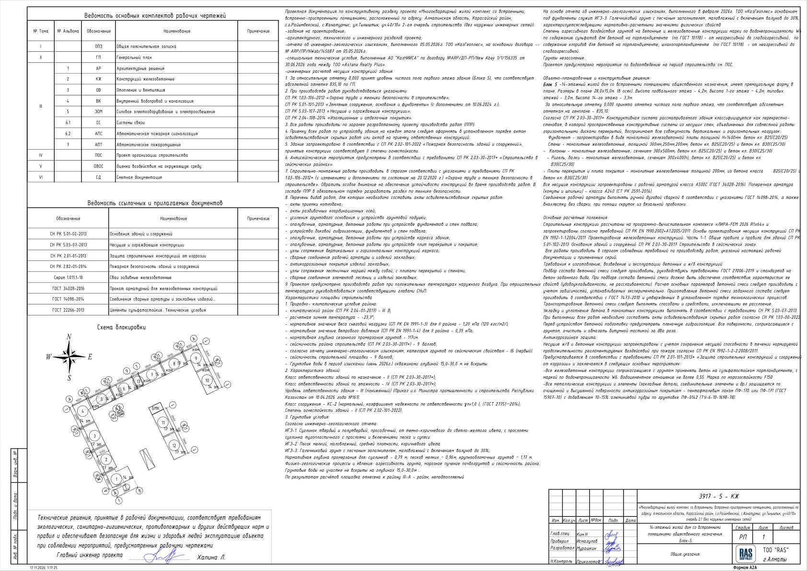
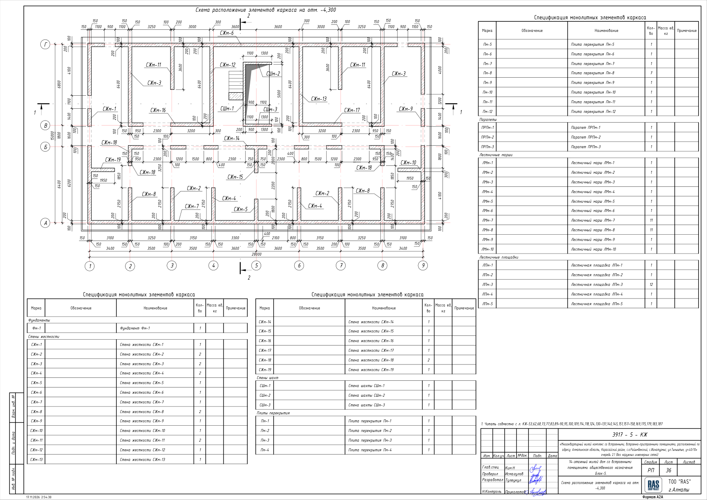

# 12. Альбом құрамы, общие данные, шығын — Омар S05 (толық талдау)

Источник: пайдаланушы 17.11.2026 — «Терең етіп оқы» (S05 моделінің фундаменттен басқа бөлігін де толық оқу), «полный қарап қалай бар солай қабылдап сақта ок».
Жазылған: 17.11.2026. Дерек: S05 API дампы (`out_S05\d01…d05`), парақ дамптары `out\d06` (308), кесте дамптары `out\d08` (556), PDF мәтіні (л. 1, 2, 3, 11, 11.1, 12, 36, 44, 50), PDF суреттері (л. 12, 36, 37, 50 — `png\agentD\`), `d04b_rebar.tsv`. Аясы: тек BI жобалары. Салыстыру: `01_Модель…` және `06_Спецификация, ведомости, альбом құрамы` (S03). Фм-1 — `08_Фундамент Фм-1 — Омар S05`, қайталанбайды. Толық «марка бойынша» кесте (3ВМ, сборка, 5ВРС, d04b бағандарымен): `12a_Шығын кестесі — Омар S05 (марка бойынша).md`.

## 1. Альбом құрамы

**1.1 Сандар.** Парақ **309** = КЖ **292** (`BI_штамп_раздел_проекта = КЖ`) + ОРС **13** (`ОРС01…13`, раздел `ОРС`) + қызметтік **4** (`000`, `А1`, `Л1`, `П1`; `#Вспомогательные`). S03: 330 / 311. «Ведомость листов» сүзгісі (раздел КЖ, нөмір «0»-мен басталмайды) → **290 жол**. Дамп 308/309 (л. 93 `d06`-да жоқ).

**1.2 Реті.**

| S05 л. | Бөлім | Саны | Формат |
|---|---|---|---|
| 0, 0.1 | Обложка, «Обложка копия 1» (титульный) | 2 | А2 |
| 1 | Общие указания | 1 | А2 |
| 2–3 | Общие данные = тек «Ведомость листов» | 2 | А2 |
| 4–8 | Фм-1: опалубка → основная → доп. → каркасы → поперечная | 5 | А2 |
| 11, 11.1 | Узлы стыковки C25/30 (B30), C20/25 (B25) (S03: 9–10) | 2 | А3 |
| 12 | Схема расположения фрагментов выпусков (S03: 11) | 1 | А2 |
| 13–35 | Фрагмент N выпусков: СЖм-1…19, СШм-1…5 (S03: 12–33) | 23 | А3…А1 |
| 36–50 | Схема каркаса на отм. …: 36–49 деңгей бойынша, 50 кровля (S03: 34–49) | 15 | А2 |
| 51–52 | Разрез 1-1, 2-2 | 2 | А1 книжный |
| 53–182, 840–880 | Стены СЖм-1…19, СШм-1…3; Бм-1, Бм-2 (167–168) | 128 | А3…А1 |
| 191–192 | Узлы усиления отверстий в стенах; Перемычка Прм-1 | 2 | А2 |
| 193–262.12 | Плиты Пм-1…12 (S03: Пм-1…13) + парапеттер ПРПм-1…3 (262.9.1, 262.10.1, 262.11.1) | 91 | А3, А2, А1 |
| 263 | Узлы усиления отверстий в плитах | 1 | А3 |
| 264–275 | Лестница Л1: 264 схема + ЛМм-1…10 / ЛПм-1…4 (267 жоқ) | 11 | А1к, А2 |
| 276–281 | Кладка усиление (СКЦ 90/190, газоблок) | 6 | А2 |

**1.3 Нөмірлеу.** Бүтін нөмір + нүктелі қосымша (30 парақ: `0.1, 11.1, 68.1, 88.1, 88.3–88.5, 96.1, 156.1, 254.1–254.6, 262.1–262.12, 262.9.1…`): `.N` — сол конструкцияның қосымша парағы (Пм-8: 254 + 254.1–254.6 = 7 этаж опалубкасы). Үзілістер: 9–10, 67, 81–82, 111, 159–166, 174, 179, 183–190, 267. Үш таңбалы **840–880** — СЖм-6-ның екінші жинағы (5 парақ). ОРС/А1/Л1/П1/000 — нөмірсіз, ведомостьке кірмейді.

**1.4 Формат және штамп** (`tb=`): `Форма 3` (бір параметрлік семейство, S03-пен бірдей): 594×420 (А2 альбомный) 128; 420×297 (А3) 74; 594×841 (А1 книжный) 40; 420×594 (А2 книжный) 31; 841×594 (А1 альбомный) 30; 297×420 (А3 книжный) 1 (л. 131). Басқа штамп: `обложка` 594×420 (л. 0), `титульный` 594×420 (0.1), `стартовая_страница` 298,5×210 (000), `анализ_данных` 297×210 (А1), `пустая_рамка` 841×594 (Л1). Σ: А1 71, А2 161, А3 75, басқа 2. PDF штампы: «Формат А2А», «3917 - 5 - КЖ», «РП», «ТОО "RAS" г.Алматы», қолтаңба (Главный инженер проекта, Глав.спец, Проверил, Разработал, Н.Контроль). Параметрлер: `BI_штамп_раздел_проекта`, `BI_штамп_имя_листа_пользовательское`, `BI_примечание_расширенное` (261 толық, 45 бос, 3 «Примечание» — л. 0, 0.1, 1), `BI_штамп_строка_3/4_фамилия` (л. 36–50 Кан/Тулеукул; 11, 11.1, 12 Кан/Алпамыс; л. 1 Сейсембиев/Мурашкин), `Листы_Уровень сложности` (24 парақ, Σ 128), `Листы_% по разработке` (3 парақ = 0).

**1.5 Браузер.** Парақ `folder` — барлығы бос; топтау `BI_штамп_имя_листа_пользовательское`: `00.Общие` 5 (0–3), `02.Фундамент` 10 (4–8, 11, 11.1, 12, 13, 14), `03.Каркас` 17 (36–52), `04.Стены` 151 (15–35, 53–182, 191, 192, 840–880), `07.Плиты` 109 (193–262.12 және **263–281**: лестница, кладка да осында), бос 17 қызметтік. S03-пен топтар бірдей. Видтер: `folder` тек 45/1351-де («Фм-1 / Планы…», «Фм-1 / Разрезы», «РТм-1 / …», «??? / Разрезы» — соңғы екеуі басқа объекттен қалған), қалғаны `BI_группирование`. Рабочие наборлар 19 (S03-пен бірдей).

**1.6 Бос парақтар (вид те, кесте де жоқ) — 20:** `0`, `0.1` (обложка, қалыпты); **18 нақты:** 69 (СЖм-3 армирование); 74, 75, 76 (СЖм-4 армирование, спецификациялар); 86, 87, 88, 88.1, 850, 860 (СЖм-6); 133, 134 (СЖм-14); 141 (СЖм-15); 146, 147 (СЖм-16); 158 (СЖм-19 қималары); 262.11.1 (ПРПм-3); ОРС12 (Закладные). Бәрі ведомость листов-та тұр.

**1.7 S03 ↔ S05:** `BI_версия_шаблона` 3,51 екеуінде; фильтр 617 / 616; кесте 1 260 / 1 242; қабат 17 / 14 (+ кровля +43,590, «Лифт плита» +44,900, будка +47,300); парақ топтары, штамп, раздел — бірдей.

## 2. Обложка, общие указания, общие данные (л. 0, 0.1, 1, 2, 3)

**Л. 0, 0.1:** тек штамп семействосы (`обложка`, `титульный`), вид/кесте жоқ. PDF-і жоқ.

**Л. 1 «Общие указания»** (А2): легенда `Схема блокировки` 1:1600 (`Omar_2`, `S5 = Да`), кесте `Ведомость документов` және `Ведомость комплектов чертежей`, 2 `TextNote`. Мазмұны (сөзбе-сөз, маңыздылары):
- Нормалар (8): СН РК 5.01-02-2013; СН РК 5.03-07-2013; СН РК 2.01-01-2013; СН РК 2.02-01-2014; Серия 1.011.1-10 «Сваи забивные железобетонные»; ГОСТ 34028-2016; ГОСТ 14098-2014; ГОСТ 22266-2013. Комплект: «2 КЖ Конструкций железобетонные» (I ОПЗ, II ГП, III: 1 АР, 3 ОВ, 4 ВК, 5 ЭОМ, 6.1 СС, 6.2 АПС, 7 АПТ; IV ПОС; V ОВОС; VI СД).
- «1. За относительную отметку 0,000 принят уровень чистого пола первого этажа здания (Блока 5), что соответствует абсолютной отметке 835,10 по ГП.» «6. Антисейсмические мероприятия … СП РК 2.03-30-2017*». «5. … II степени огнестойкости.» Пп. 2–4, 7–9: СП РК 1.03-106-2012, СП РК 5.01-101-2013, СП РК 5.03-107-2013, ППР, акты скрытых работ (12 түр).
- Алаң: «климатический район … III В; расчетная зимняя температура - -23,3°; … снеговой нагрузки … 1,20 кПа; ветрового давления … 0,39 кПа; … промерзания грунтов - 117см; сейсмичность района строительства … - 9 баллов; … категория грунтов по сейсмическим свойствам - IБ; сейсмичность строительной площадки - 9 баллов». «Класс ответственности … II; … по этажности - IV; Уровень ответственности … III (пониженный); Класс сооружения - КС-2 (… ɣn=1,0); Степень огнестойкости - II». Негіз ИГЭ-3 (галечник), грунтовые воды не вскрыты 15–30 м, район III-А.
- Ғимарат: «перекрестно-стеновая»; 28,0×15,0 м; подвал 4,2, 1-қабат 4,2, типовой 3,0, 14-қабат 3,3 м.
- **Материал:** «Фундамент … плиты толщиной H=1400мм. бетон кл. В25(С20/25)»; «Стены … толщиной 300мм,250мм,200мм; бетон кл. В25(С20/25) и бетон кл. В30(С25/30)»; «Колонны … 300х500мм»; «Ригель, балки … 300х400(h)»; «Плиты перекрытия и плита покрытия … 200мм, … В25(С20/25) и В30(С25/30)»; «рабочей арматурой класса А500С (ГОСТ 34028-2016). Поперечная арматура (хомуты и шпильки) - класса А240 (СТ РК 2591-2014)»; «Соединение рабочей арматуры выполнять ручной дуговой сваркой … ГОСТ 14098-2014, а также внахлестку без сварки, при помощи скруток из вязальной проволоки».
- Есеп: «ЛИРА-FEM 2026 R1х64», СП РК EN 1990 / EN 1992-1-1, СП РК 5.01-102-2013, СП РК 2.03-30-2017. Бетон: ГОСТ 27006-2019, ГОСТ 7473-2010. Коррозия: «… соприкасающиеся с грунтом применять бетон на сульфатостойком портландцементе, с маркой по водонепроницаемости W6. Водоцементное отношение не более 0,55. Марка по морозостойкости F150»; металл — ПФ-170/ПФ-171 по грунтовке ПФ-0142. **Защитный слой, қабат жүктемелері, нахлёст — жалпы мәтінде жоқ.**

**Л. 2–3:** екеуінде тек «Ведомость рабочих чертежей основного комплекта» (`01_КЖ_(*ОбщиеД)_Ведомость листов`; шаблон `*(спецификация)оформление_с_заголовками`; Номер 15 | Имя 140 | `BI_примечание` 30 мм; сүзгі раздел = КЖ, номер ≠ «0…»). Л. 2: 3 бағана (1…113), л. 3: 2 бағана (114…217). Примечание екеуінде: «1. Читать совместно с л. КЖ-2÷3». Нахлёст/стык ережесі — л. 11/11.1 примечаниесінде (сөзбе-сөз): «1. Общие данные смотри л. л. КЖ-2÷3 2. Читать совместно с листами армирования. 3. Арматуру гнуть без нагрева 4. Все соединения арматурных стержней соединять на скрутках, кроме оговоренных на листах армирования. 5. Количество стержней , стыкуемых в одном сечении , должно составлять не более 50% от их общего количества .» (кестелер B30 / B25 бөлек, `Скрутить вязальной проволокой не менее 3-х скруток на стык`).

**Қалай жасалған:** «Ведомость документов», «Ведомость комплектов» — Revit кестесі (`Листы`), жалған сүзгі (`Имя листа = '---------'`), денесі бос, мәтін кестенің **Header** бөліміне қолмен жазылған (10 / 15 жол). `Ведомость спецификаций` (547243) ішінде шаблоннан қалған «Спецификация отделки фасада. Спецификация отлива…».

## 3. Схема каркаса (л. 36–50) және фрагменттер схемасы (л. 12)

**Вид (36–50):** `EngineeringPlan`, вид типі `*02_Каркасы`, **1:100**, шаблон `#04_Каркас` (жасырын: Несущая арматура, Колонны, Обобщенные модели, Уровни), фильтр `Разрез каркаса` (көрінбейді; `NOT(BI_группирование Contains "Каркас")`), `BI_группирование = ⏺ Каркасы`, стиль HLR, видовой экран `загаловок_на_листе`. Модель: Стены 28–64, Сборки 29–32, Двери, Оси, Перекрытия. Детализация: Coarse (38, 39, 41, 43–49), Medium (36, 37, 40, 50), Fine (42). **Шаблон тағайындалмаған:** л. 37, 50. Видтер: 36 `-01 Подвал_(-4.300)_(*Каркасы)`, 37 `01 Этаж_(-0,100)_(*Каркасы)`, 38–49 «Схема расположение элементов каркаса на отм. +4,100 / +6,200 / +9,200 … +39,200», 50 «…+46,638».
- **Маркалар:** `Марки сборок` (`(марка)сборка`, `Комментарии` → Сборки, leader Free, горизонталь), 26–32 дана/парақ (50: 9); мәтін = сборка маркасы (СЖм-2, СШм-1, ПРПм-1…); арматура маркасы жоқ.
- **Размерлер:** `BI_основной_2,5мм_округление_до_5мм` (стена тізбектері 150, 150, 1100, 900 …), `…до_1мм` (28000, 15000, оське байлау), `BI_курсив_2.5 мм` (3400/3500/… оське), кейде `…до_10мм`; 20–35 дана/парақ. Қосымша: л. 44 қызыл `TextNote` «21 », л. 50 `Высотные отметки` +44,291.
- **Кесте:** тек **л. 36**-да — `01_КЖ_(*Общие)_Вся конструкция_(сборка)` «Спецификация монолитных элементов каркаса» (Марка | Обозначение | Наименование | Кол-во | Масса ед., кг | Примечание), 3 сегмент; топтар: Фундаменты, Стены жесткости, Стены шахт, Плиты перекрытия, Парапеты, Лестничные марши/площадки. Кол-во 2: СЖм-2, 3, 4, 8, 11, 18; Пм-8 = 7; ЛМм-7, ЛМм-8 = 11; ЛПм-3 = 12. Обозначение мен Масса бағандары бос.
- **Примечание (36–50, бірдей; сөзбе-сөз):** «1. Читать совместно с л. КЖ-53,62,68,73,77,83,89÷90,95,100,109,114,118,124,130÷131,140,145,151,157÷158,169,175,179,183,187» (әр стена жинағының бірінші парағы).

**Л. 12 «Схема расположения фрагментов выпусков»:** вид `-01 Подвал_(-4.300)_(*Каркасы) Фрагменты`, #04_Каркас, 1:100, Medium; 30 `TextNote` «Фрагмент N» (`BI_основной_текст_2,5_к`) + 28 `Типовые аннотации` `Фрагмент аннотаций` (`Длина`, `Ширина=6`, `BI_наименование`, `BI_ссылка_на_лист = см.лист …`) — фрагментті қоршайтын контур; 4 размер. Оң жақта кесте «Спецификация к схеме расположения фрагментов выпусков» (`Ведомость примечаний1`: Поз. | Обозначение | Наименование | Кол. | Масса ед.кг | Примечание; 22 жол). Примечание: «1. Читать совместно с л. КЖ-12÷35».

## 4. Жалпы кестелер

| Кесте (id) · парақ | Не есептейді / сүзгі | S05 мазмұны |
|---|---|---|
| `00_(*ОбщиеД)_Процентовка выполнения` (616420) · 000 | парақ процентовкасы; Листы, раздел КЖ; Уровень сложности, с1…с10, %, Замечания | 293 жол; сложность 24-те (Σ **128**), % бос; «Общий итог: 292» |
| `00_(*Общие)_Сборки_Марки и Объем` (2316311) · 000 | **сборка көлемі**: Сборки, `BI_главный_элемент=1`; Марка по стандарту, Тип, Объем (бір тип — бір жол) | 116 жол; стена 3 жол/сборка (C25/30 W6, C25/30, C20/25 ретпен), плита, Фм-1 (C8/10 + C25/30 W6), лестница, парапет |
| `00_*_Кол-во конструкции` (468588; 468571) · П1, А1 | сборка саны / `BI_количество_расчетное`; `Комментарии Contains 'м-'` | 54 / 60 жол |
| `01_КЖ_(*Общие)_Вся конструкция_(сборка)` (342775; `копия 1` 9288195 `Л…`) · 36, П1, А1, 264 | конструкциялар тізімі | 60 жол (§3) |
| `00_(*Общие)_BI_этаж_Стены/Плиты/Колонны`, `_Стены_зависимости` | `BI_этаж` тағайындауын тексеру | 26 / 19 / **0** / 45; плита: «BI_этажу назначается номер нижнего уровня от плиты» |
| `00_(*Общие)_Марки сборок_(ключевая)` (340191) | кілттік кесте: Комментарии, Наименование сборки, Группирование, Сортировка | 285 жол |
| `00_(*Общие)_Материалы` (578627) | материал ↔ семейство, главный элемент | 67 жол |
| `00_(Арматуры)_Атрибуты`, `_Расчетные данные`, `_Множитель нахлеста`, `_Отгиб…`, `_АПП`, `_ВД_проверка картинок` | арматура типі: класс, Ø, масса п.м., **нахлёст көбейткіші**, форма→png | көбейткіш: Ø6 61, Ø8 62, Ø10 60, Ø12 А240 60 / А500 62, Ø14 64, Ø16 62, Ø18 61, Ø20 61, Ø25 61, **Ø22 бос** (S03-пен бірдей) |
| `01_КЖ_(*ОбщиеД)_Ведомость листов / документов / комплектов / спецификаций` | §2 | 290 / 8 / 13 / 10 жол |
| `00_(*ОбщиеД)_Примечания на листах` (545413) · Л1 | барлық примечание + қолтаңба | 293 жол |
| `02_КЖ_(*ОбщиеД)_Общая / Реализуемая площадь здания` (+`_оф.без пер.`) · А1 | ТЭП ауданы (Помещения) | **бос**; сан жоба параметрінде: 15 106,48 / 12 664,24 |
| `02_(Арматуры)_Общая масса` (471146) | `П_Тип КЖ ≤ 2`, `П_Класс > 0` | бір сан **15 764,91** («Итого, т») |
| `01_КЖ_(Арматуры)_ВРС` (349809) · А1 | бүкіл ғимарат ВРС «на все элементы» | 191 жол × 53 баған; §5 |
| `02_(Анализ)_Арматура на бетон площади` (471435) · А1 | кг арм / м³ бетон, кг / м² (жалпы, реализ.); Материал Contains `бетон`, `Комментарии BeginsWith 'Ф'` | тек Фм-1: C8/10 39,10 м³ → 3 861,26 кг/м³; C25/30 W6 648,26 м³ → 232,91; 9,99 / 11,92 кг/м² = `BI_общая_масса_арматуры` **150 983,15** / аудан |
| `01_КЖ_(*Общие)_Сваи`, `_Сваи_ведомость` | қада | бос |
| `03_Задание_гильзы <М>` (19: Пм-1, СЖм-1…3, 5…17, 19, 20) | гильза тапсырмасы | барлығы бос |
| `00_/01_ОРС_…` (36) · ОРС01…13 | ОРС бақылау: арматура/бетон қабат бойынша; `Фильтр вертикальные/горизонтальные конструкции = 1` | Вертикалка, Бетон (Горизонталка, Вертикалка, Фундамент, Лестницы, Балки, Капитель) — **бос**; Горизонталка.Общий Σ 7 086,1 (тек А240 Ø10 шпилька); Фундамент.Общий 4 349,07 (каркас); Лестницы.Общий 231,26; Паркинг_H3.3.Стены 42 жол (басқа жобадан) |

## 5. Шығын кестесі (бүкіл ғимарат)

**Тәсіл.** Бетон — `_3ВМ` кестелері (1 элементке) стена үшін сенімсіз (§7), сондықтан көлем = сборка көлемі (`00_Сборки_Марки и Объем`) × дана (сборка типі саны `d01`, `Вся конструкция`-мен сәйкес); 3ВМ — `12a` файлында. Болат — `_5ВРС` (1 элементке), дана санына көбейтілді (арматура бір элементте ғана модельденген: Пм-8-дің 1 237 стержені 1 сборкада; СЖм-2 — «Стена 2»-де, «Стена 3»-те жоқ — `hostId`). `d04b` = `Полная длина стержня` × номинал салмақ (ілмек/нахлёст жоқ). Көзі: **К** — 5ВРС кестесі, **D** — d04b, **С** — сборка кестесі.

| Марка | N | м³ (1 эл.) | м³ ∑ | кг (1 эл.) | кг ∑ | кг/м³ | көзі |
|---|---|---|---|---|---|---|---|
| Фм-1 | 1 | 687,36 | 687,36 | 52 523 | 52 523 | 76 | С; D+К |
| СЖм-1 | 1 | 149,00 | 149,00 | 28 088 | 28 088 | 189 | С; К |
| СЖм-2 | 2 | 32,37 | 64,74 | 3 304 | 6 609 | 102 | С; К |
| СЖм-3 | 2 | 58,10 | 116,21 | 9 667 | 19 334 | 166 | С; К |
| СЖм-4 | 2 | 34,07 | 68,14 | 3 670 | 7 340 | 108 | С; К |
| СЖм-5 | 1 | 22,29 | 22,29 | 2 706 | 2 706 | 121 | С; К |
| СЖм-6 | 1 | 87,13 | 87,13 | 4 887 | 4 887 | 56 | С; К |
| СЖм-7 | 1 | 75,48 | 75,48 | 17 179 | 17 179 | 228 | С; К |
| СЖм-8 | 2 | 31,12 | 62,24 | 3 884 | 7 768 | 125 | С; К |
| СЖм-9 | 1 | 149,99 | 149,99 | 36 083 | 36 083 | 241 | С; К |
| СЖм-10 | 1 | 22,16 | 22,16 | 3 175 | 3 175 | 143 | С; К |
| СЖм-11 | 2 | 41,38 | 82,76 | 2 533 | 5 067 | 61 | С; К |
| СЖм-12 | 1 | 78,90 | 78,90 | 7 505 | 7 505 | 95 | С; К |
| СЖм-13 | 1 | 80,24 | 80,24 | 9 322 | 9 322 | 116 | С; К |
| СЖм-14 | 1 | 134,82 | 134,82 | 31 902 | 31 902 | 237 | С; К |
| СЖм-15 | 1 | 21,68 | 21,68 | 3 592 | 3 592 | 166 | С; К |
| СЖм-16 | 1 | 58,88 | 58,88 | 14 947 | 14 947 | 254 | С; К |
| СЖм-17 | 1 | 59,64 | 59,64 | 11 128 | 11 128 | 187 | С; К |
| СЖм-18 | 2 | 18,54 | 37,08 | 4 168 | 6 980 | 188 | С; К+D |
| СЖм-19 | 1 | 22,16 | 22,16 | 3 209 | 3 209 | 145 | С; К |
| СШм-1 | 1 | 50,13 | 50,13 | 5 603 | 5 603 | 112 | С; К |
| СШм-2 | 1 | 20,24 | 20,24 | 3 534 | 3 534 | 175 | С; К |
| СШм-3 | 1 | 23,13 | 23,13 | 3 122 | 3 122 | 135 | С; К |
| Пм-1 | 1 | 81,78 | 81,78 | 14 574 | 14 574 | 178 | С; К |
| Пм-2 | 1 | 80,96 | 80,96 | 10 855 | 10 855 | 134 | С; К |
| Пм-3 | 1 | 81,07 | 81,07 | 12 674 | 12 674 | 156 | С; К |
| Пм-4 | 1 | 82,03 | 82,03 | 12 405 | 12 405 | 151 | С; К |
| Пм-5 | 1 | 82,00 | 82,00 | 13 184 | 13 184 | 161 | С; К |
| Пм-6 | 1 | 81,07 | 81,07 | 12 914 | 12 914 | 159 | С; К |
| Пм-7 | 1 | 82,00 | 82,00 | 13 030 | 13 030 | 159 | С; К |
| Пм-8 | 7 | 81,06 | 567,42 | 12 927 | 90 486 | 159 | С; К |
| Пм-9 | 1 | 80,21 | 80,21 | 8 154 | 8 154 | 102 | С; К |
| Пм-10 | 1 | 2,59 | 2,59 | 259 | 259 | 100 | С; К |
| Пм-11 | 1 | 3,84 | 3,84 | 424 | 424 | 110 | С; К |
| Пм-12 | 1 | 6,86 | 6,86 | 622 | 622 | 91 | С; К |
| ПРПм-1 | 1 | 10,07 | 10,07 | 2 119 | 2 119 | 210 | С; К |
| ПРПм-2 | 1 | 2,68 | 2,68 | 540 | 540 | 201 | С; К |
| ПРПм-3 | 1 | 1,32 | 1,32 | 223 | 223 | 169 | С; К |
| ЛМм-1 | 1 | 1,13 | 1,13 | 209 | 209 | 185 | С; К |
| ЛМм-2 | 1 | 1,16 | 1,16 | 223 | 223 | 193 | С; К |
| ЛМм-3 | 1 | 1,19 | 1,19 | 224 | 224 | 188 | С; К |
| ЛМм-4 | 1 | 1,07 | 1,07 | 223 | 223 | 208 | С; К |
| ЛМм-5 | 1 | 1,09 | 1,09 | 205 | 205 | 188 | С; К |
| ЛМм-6 | 1 | 0,97 | 0,97 | 197 | 197 | 203 | С; К |
| ЛМм-7 | 11 | 1,11 | 12,21 | 207 | 2 275 | 186 | С; К |
| ЛМм-8 | 11 | 0,97 | 10,67 | 196 | 2 159 | 202 | С; К |
| ЛМм-9 | 1 | 1,38 | 1,38 | 259 | 259 | 188 | С; К |
| ЛМм-10 | 1 | 0,97 | 0,97 | 270 | 270 | 279 | С; К |
| ЛПм-1 | 1 | 0,58 | 0,58 | 228 | 228 | 394 | С; К |
| ЛПм-2 | 1 | 0,65 | 0,65 | 254 | 254 | 391 | С; К |
| ЛПм-3 | 12 | 0,61 | 7,32 | 233 | 2 793 | 382 | С; К |
| ЛПм-4 | 1 | 0,57 | 0,57 | 225 | 225 | 395 | С; К |
| ЛПм-5 | 1 | 1,06 | 1,06 | 374 | 374 | 353 | С; К |

**Фм-1.** 5ВРС: 18 393,5 кг арматура (Ø22 10 097,98) + уголок L50×6 5 299,8 = 23 693,3. d04b: Ø22 38 902,7, барлығы 47 223,7. Айырма 23 530 кг (+99 %) = негізгі тор; Ø6/10/12 екеуінде бірдей. Қорытынды: 47 223,7 + 5 299,8 = **52 523,5 кг**. Кесте мен d04b > 5 % — тек Фм-1; қалғаны: плита −1,4…−4,0 % (кестеде нахлёст бар), СЖм-6 −3,1 %, СЖм-14 −1,9 %, басқасы ≤ ±1 %.

**Түрі бойынша:**

| Түрі | Элемент саны | Бетон м³ | Болат кг | кг/м³ |
|---|---|---|---|---|
| Фундамент | 1 | 687,4 | 52 523 | 76 |
| Стена | 28 | 1 487,0 | 239 081 | 161 |
| Плита | 18 | 1 231,8 | 189 580 | 154 |
| Парапет | 3 | 14,1 | 2 882 | 205 |
| Лестница | 46 | 42,0 | 10 119 | 241 |
| **Σ (Выпускісіз)** | | **3 462,3** | **494 185** | **143** |
| Выпуски (фундамент → стена, d04b) | — | — | 13 604 | — |
| **Ғимарат барлығы** | | **3 462,3** | **507 789** | **147** |

Бетон класы: C20/25 — 2 035,6 м³; C25/30 — 578,9; C25/30 W6 — 808,7 (648,26 фундамент + 160,4 подвал стенасы); C8/10 — 39,1 (сборка жолдарының реті, СЖм-4, СШм-1 бойынша 3ВМ-мен тексерілген). Болат Ø бойынша (d04b, дана санымен, т): Ø5 0,7; Ø6 23,1; Ø8 35,0; Ø10 118,2; Ø12 51,1; Ø14 71,3; Ø16 46,9; Ø18 49,0; Ø20 45,0; Ø22 52,7; Ø25 5,1 → 498,1 т (уголок пен «Пшка/ф51» қосылмаған).

**Жоба сандарымен салыстыру (сәйкес емес):** `BI_общая_масса_арматуры` = 150 983,15 кг; `02_Общая масса` = 15 764,91; `01_КЖ_(Арматуры)_ВРС` «Общий итог» = 371 714 (= «Масса на один элемент» қосындысы 355 947 + 15 765, дана санына көбейтілмеген); осы есеп — 507 789 кг (33,6 кг/м² жалпы ауданға). 150 983-тің шығу тегі анықталмады.

**Кірмеген:** Бм-1, Бм-2 (Бм-2 ВРС тек 16,2 кг закладные t16×80), Прм-1, Км-1 (кесте бос; колонна жоқ), ЛМм-11/12, ЛПм-6/7 (кесте бос, сборка жоқ). Выпуски — d04b 13 603,7 кг шығынға қосылды (6 005 кг-ы `Марка` өрісі бос 316 стержень; 5ВРС кестелерімен расталғаны 7 425,5 кг, 13 бірегей кесте).

## 6. Конвенциялар: S03-тен айырма

(`rv\an\a04_conventions.py` S05-ке қолданылды → `an\agentD_a04_out.txt`.) Атау үлгілері, `BI_` параметрлері, `BI_фильтр`, арматура типтері, түстер, штамп, нахлёст көбейткіштері — **S03-пен бірдей**. Айырма:
- Деңгейлер: 14 қабат + `100 Кровля` (+43 590,7), **`Лифт плита` (+44 900)**, `101 Будка`; `BI_абсолютная_отметка_нуля` = 350 000 (мәтінде 835,10).
- Вид шаблондарының қолданылуы S05 / S03: `#03_Армирование стены` 356/450, `#02_Опалубка стены` 127/172, `#03_Армирование плиты` 101/106, `#02_Опалубка плиты` 21/23, `#03_Армирование фундамента` 23/25, `#03_Армирование лестницы` 63/55, `#03_Армирование парапета` 16/22, `#04_Каркас` 19/23; масштаб, детализация бірдей.
- Per-mark фильтр: `_Разрезы` 99, `_Армирование` 98, `_Выпуск` **62** (S03: 99×3).
- Кесте атаулары: `(Группа)_<Марка>_<код>` бірдей; жаңасы: `(Фундаменты)_Выпуски_2СА/4ВД/5ВРС <М>` (25×3), `(СтеныЖес)_СЖм-5_5ВРС Выпуски`, `(Лестница)3ВМ весь элемент_ЛПм-N`, `(Колонны)_Км-1_…`, `(Балки)_Бм-N_5ВРС`; ПРПм кестелері екі топта қатар (`(Плиты)_ПРПм-N`, `(Парапеты)_ПРПм-N`).
- Марка жазылуы: `Фпм1`/`Фм-1`, `Пм1`/`Пм-1` (парақ атауы мен модельде), `СЖм-6. Выпуск`, `СЖм-0` (СЖм-18-дің 2-ші стенасы); плита шпилькасында `BI_фильтр = Попереч`.

## 7. Үлгідегі аяқталмаған не қайшы жерлер (ереже емес — көшірмеймін)

**Альбом / ведомость**
- **Ведомость листов толық емес:** 290 жолдың 201-і басылған (л. 3 соңы — 217, Пм-3); **89 жол (218…262.12, 263…281, 840…880) жоқ** (5 сегмент жетпейді). Қателер: «Фпм1», «Стена жескости», «горизонатльного».
- 18 бос парақ (§1.6); СЖм-6 екі жинағы қатар (83–88.5 және 840–880), СЖм-3-тің негізгі армирование парағы (69) бос.
- Нөмір үзілістері (§1.3). **Л. 36–50 примечаниесі `179, 183, 187` парақтарына сілтейді — олар жоқ.** Л. 2–3 және 11/11.1: «Общие данные смотри л. л. КЖ-2÷3» — нақты жалпы мәтін л. 1-де.
- Атау ↔ вид: л. 44 «+22,100 и 25,100» ↔ «+21,200 и +24,200»; 39–49 вид аты парақ атынан 900 мм кем (+7,100 ↔ +6,200 …); **л. 50 «+43,500» ↔ «+46,638»**; «Схема расположение» (36–49). Л. 36: Обозначение/Масса бос; Бм-1, Бм-2, Прм-1 тізімде жоқ; 37, 50 шаблонсыз; л. 44 қызыл «21 ».
- **Л. 12:** `см.лист` ескірген (Фрагмент 1 → «11», 2 → «12», 10 → «27.3», 16 → «27.1», 17 → «28.2» …; нақты 13…35); кестеде 22 жол, жинақта 24 (23, 24 — СШм-4, 5 кестеде жоқ); **Фрагмент 7 планда бар, парағы жоқ**; планда «Фрагмент 12'».
- «Копия» видтер парақта 25 (л. 5 `Сечение 3-3 коп`, 4-4 коп; 25, 29, 93 ×7, 96, 135 ×5, 136 ×5, 209, 274 `ЛМм-88 копия 1`); «копия» кесте парақта 22 (л. 168, 173, 177, 181, 182, 264, 273, 275); л. 273 (ЛМм-8) ЛМм-7 кестелерін қолданады.

**Общие данные (л. 1)**
- Мекенжай: жоба параметрі «город Нур-Султан, район Есиль…», л. 1/штамп «Алматинская область, Карасайский район…», «г.Алматы»; абсолют 350 000 мм ↔ «835,10». Геология: «05.05.2026г.» ↔ «в феврале 2026г.»; «W4» (агрессивтілік) ↔ «W6» (бетон).
- «Колонны 300х500», «Ригель, балки 300х400» айтылған, модельде жоқ (санат `Колонны` = уголок/венткороб); фундамент «В25(С20/25)», 3ВМ-де C25/30 W6 + C8/10; 14-қабат «3,3 м», деңгей бойынша 3,49; «Серия 1.011.1-10 Сваи» — қада жоқ; нормалар «СН РК» (ведомость) ↔ «СП РК» (мәтін).
- Нахлёст, защитный слой, қабат жүктемесі жалпы мәтінде жоқ.

**Кестелер**
- `3ВМ_поэтажно` стена: СЖм-1, СЖм-9, Бм-1, Бм-2, Прм-1, Км-1, ЛМм-11/12, ЛПм-6/7 **бос**; СЖм-3, 5, 6, 7, 15, 19 сборкамен > 5 % сәйкес емес (СЖм-6 32,41 ↔ 87,13; СЖм-19 48,10 ↔ 22,16) — стена типінің `Марка` параметрі сборка маркасына сәйкес емес («Стена 2» → СЖм-3, «Стена 3» → СЖм-6, «Стена 64» → СЖм-19, «Стена 12» → СЖм-15). `СЖм-20_3ВМ` сүзгісі `СЖм-7`, `СЖм-20_5ВРС` — `СЖм-18`; `ЛМм-44/5/6/7/8_3ВМ` атаулары мен сүзгі жылжыған; `Фм-1_3ВМ копия` — `ПРМм-1`; `Ведомость С20/25` бос.
- `5ВРС` бос: Км-1, Бм-1, Прм-1, ЛМм-11/12, ЛПм-6/7; Выпуски кестелері бос 11 марка (СЖм-3, 5, 6, 9, 15, 16, 19, 20, СШм-4, 5, Км-1); `Выпуски 5ВРС СЖм-2` = СЖм-11 көшірмесі (121,2), `…СЖм-18` = СЖм-7 (2 099,76); СШм-1 — 3 нұсқа (5 610,15 / 5 602,91 / копия); СЖм-1 Выпуски 83,79 ↔ `01_ВРС` 1 513,35.
- `01_КЖ_(Арматуры)_ВРС`: Ø және «Кол-во» тек шпилька/каркас жолдарында, қалған ~100 жолда Ø = 0; «Общий итог» санға көбейтілмеген; `02_Общая масса` тақырыбы «т», мәні кг; `BI_общая_масса_арматуры` 150 983 ↔ 507,8 т.
- ОРС: бетон мен вертикалка бос (`Фильтр … конструкции` параметрі толтырылмаған); Паркинг H3.3 — басқа жобадан; `Общая площадь` бос; процентовкада % жоқ. СЖм-0 (431 стержень, 2 811 кг) — СЖм-18-дің 2-ші стенасы, `Вся конструкция`-да СЖм-18 ×2.

**Ашық сұрақтар**
1. `BI_общая_масса_арматуры` = 150 983,15 қайдан (бұрынғы модель күйі ме)?
2. Қайталанатын элементтердің (СЖм-2, 3, 4, 8, 11; Пм-8 ×7; ЛМм-7/8; ЛПм-3) арматурасы бірдей деп алынды — модельде тек бір дана.
3. 840–880 — СЖм-6-ның жарамды жинағы ма, әлде 83–88.5 пе?
4. Бм-1, Бм-2, Прм-1 бетоны/арматурасы шығынға қосылсын ба (кестелері бос)?
5. Л. 44, 50 видтерінің аты (+21,200 / +46,638) дұрыс па, әлде парақ атауы ма?

## 8. Суреттер

